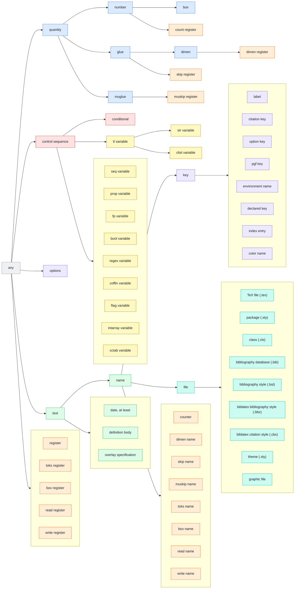

<!-- generated from doc/src/wiki/domains.md.in by satex-doc; do not edit -->

<p align="center"><a href="https://eagleoutice.github.io/satex-analyzer/"></a></p>

# Abstract domains

`satex` runs TeX's machine over values that stand for *sets* of what a real run could hold.
Each domain below says what it abstracts and how it joins, narrows and widens.
When those happen is in [SEMANTICS § 14](https://eagleoutice.github.io/satex-analyzer/SEMANTICS#14-where-satex-is-not-exact).

This chapter builds on [what TeX does](Semantics). The [formal model](Formal-semantics) states both in Lean.

One invariant holds everywhere: a construct is followed **exactly**, or its result is **over-approximated** and a diagnostic says so. `satex` never guesses one outcome.

- [`Value`](#value-what-a-control-sequence-or-register-holds) and [the set lift `OneOf`](#the-set-lift-oneof)
- [Character codes](#character-codes-as-sets), [colors](#colors-color-and-colors), [meaning sets](#meaning-sets-what-a-control-sequence-may-mean)
- [Modes and boxes](#modes-and-box-dimensions), [unknown text](#unknown-text-the-textclass-lattice), [category sets](#category-sets-as-a-lattice-element), [argument types](#argument-types-the-ty-lattice)
- [Files written in the run](#files-written-in-the-run), [names from unknown text](#names-from-unknown-text), [call summaries](#call-summaries-what-a-call-did-twice)
- [The join](#the-join-in-general), [`limits`](#limits-where-the-domains-stop-being-precise), [known limits](#known-limits), [the soundness invariant](#soundness-invariant)

## `Value`: what a control sequence or register holds

[`src/engine/value.rs`](https://github.com/EagleoutIce/satex-analyzer/blob/main/src/engine/value.rs): every kind has an exact value, a hull, a bounded set of either, and a top.

| Kind | Exact | Hull | Top |
| --- | --- | --- | --- |
| count (`\count`, `\numexpr`) | `Int(i64)` | `Num { lo, hi }` | `[-MAX_INT, MAX_INT]` |
| dimension (`\dimen`, `\dimexpr`) | `Dimen(Scaled)` | `Num`, in sp | the word `[-2^31, 2^31-1]` stored (`Dim::ANY`): box sums and `\advance` pass `\maxdimen` ([tex.web §§ 656](https://github.com/TeX-Live/texlive-source/blob/71911d456eb7d2104062e99fed6010f6054c5be8/texk/web2c/tex.web#L13018), [1238](https://github.com/TeX-Live/texlive-source/blob/71911d456eb7d2104062e99fed6010f6054c5be8/texk/web2c/tex.web#L23134)), `[-MAX_DIMEN, MAX_DIMEN]` scanned ([§ 461](https://github.com/TeX-Live/texlive-source/blob/71911d456eb7d2104062e99fed6010f6054c5be8/texk/web2c/tex.web#L9064)) |
| glue, muglue (`\skip`, `\muskip`) | `Glue` | `GlueHull`: one `Num` per component ([tex.web § 150](https://github.com/TeX-Live/texlive-source/blob/71911d456eb7d2104062e99fed6010f6054c5be8/texk/web2c/tex.web#L3147)) | `GlueHull::full()` |
| token list (`\toks`) | `Toks` | common start and end around one typed unknown token | `Unknown` |
| color (`\color@⟨name⟩`) | `Color`, every component a point | `Colors`, one `Num` per component | the model's full range |

The bounded set is `OneOf` for every kind (below). Code that does not inspect the abstract value reads a hull or set as `Unknown` (`Env::value`).

- **Numbers through text.** `\the`, `\number` of a bounded number give one token of typed digits that carries its `Num`. A later scan reads the `Num` back, so a bound survives text and a recursion over it ends.
- **Typed digits** stay inside the interval their name spells, even after a widening join.
- **Tests.** `\ifnum` and `\ifdim` decide by the interval, `\ifpdfabsnum` by the interval of the absolute values.
- **Token lists** past the set keep their frame: pgfmath's operand stacks with different tops join to one stack whose top is typed digits, so a delimited pop still finds its braces ([tex.web § 1227](https://github.com/TeX-Live/texlive-source/blob/71911d456eb7d2104062e99fed6010f6054c5be8/texk/web2c/tex.web#L22968)).

## The set lift: `OneOf`

`Value::OneOf` is the one set lift `Set_k(D)` for every kind: a few values, each exact or a hull. `{[0pt,10pt], [100pt,110pt]}` stays two ranges, not `[0pt,110pt]`.

| Operation | What it does |
| --- | --- |
| join | union of the members. Overlapping or touching intervals merge. At most `limits.value_set` (8) exact members, `limits.interval_set` (4) with an interval among them. |
| widening | past `k`, or with an `Unknown` side: the hull of all members (`Value::join_hulls`). Only the gaps are lost. |
| test | `\ifnum`/`\ifdim` decide member by member. When members disagree, each arm keeps the narrowed part that passes (`Num::narrow`). The arms rejoin at `\fi`. A test of an expression that is one register plus a constant (`\numexpr\count1-10`) narrows that register by the bound minus the constant, in `\ifnum` and in each `\ifcase` arm. |
| arithmetic | `Num::lift` on the hull: exact at a point, else the interval's corners (cut at zero). An overflow clips, a 32-bit wraparound ([tex.web § 1238](https://github.com/TeX-Live/texlive-source/blob/71911d456eb7d2104062e99fed6010f6054c5be8/texk/web2c/tex.web#L23134)) widens to the whole word range. |

Macro bodies use the same lift as [meaning sets](#meaning-sets-what-a-control-sequence-may-mean) (`limits.meaning_set`).

## Category codes

Every character has one of TeX's sixteen category codes ([The TeXbook, chapter 7](https://ctan.org/pkg/texbook#chapter-7)). Pages here link each "category N" to its row.

| Code | Category |
|---|---|
| <a id="catcode-0"></a>0 | escape character |
| <a id="catcode-1"></a>1 | begin group |
| <a id="catcode-2"></a>2 | end group |
| <a id="catcode-3"></a>3 | math shift |
| <a id="catcode-4"></a>4 | alignment tab |
| <a id="catcode-5"></a>5 | end of line |
| <a id="catcode-6"></a>6 | parameter |
| <a id="catcode-7"></a>7 | superscript |
| <a id="catcode-8"></a>8 | subscript |
| <a id="catcode-9"></a>9 | ignored |
| <a id="catcode-10"></a>10 | space |
| <a id="catcode-11"></a>11 | letter |
| <a id="catcode-12"></a>12 | other character |
| <a id="catcode-13"></a>13 | active character |
| <a id="catcode-14"></a>14 | comment |
| <a id="catcode-15"></a>15 | invalid |

### Category sets as a lattice element

A character whose category is not pinned keeps the set of categories it may have, one bit each (`CatcodeTable::unknown`, [tex.web § 232](https://github.com/TeX-Live/texlive-source/blob/71911d456eb7d2104062e99fed6010f6054c5be8/texk/web2c/tex.web#L4811)). A join unions the sets, the save stack restores them (per group, only the first save of a slot on each path joins: it is what the group's end leaves), and `\the\catcode` reads them as a set of numbers. Callers ask `cats` or `is_unknown` before trusting `get`.

## Character codes as sets

Code table entries (`\lccode`, `\uccode`, `\sfcode`, `\mathcode`, `\delcode`, [tex.web § 1232](https://github.com/TeX-Live/texlive-source/blob/71911d456eb7d2104062e99fed6010f6054c5be8/texk/web2c/tex.web#L23040)) hold a `Value`, joined like registers.

- A ⟨number⟩ that is one of several characters reads as their hull plus the exact set (`abs_exact`, [`src/engine/scan.rs`](https://github.com/EagleoutIce/satex-analyzer/blob/main/src/engine/scan.rs)).
- A set with an invalid member, or any set for `\mathcode`, becomes `Unknown`.
- `\lowercase`/`\uppercase` ([tex.web § 1288](https://github.com/TeX-Live/texlive-source/blob/71911d456eb7d2104062e99fed6010f6054c5be8/texk/web2c/tex.web#L23608)) turn a character with a few possible codes into one token for the shifted characters, categories kept. An unknown code gives unknown text.

## Colors: `Color` and `Colors`

An xcolor color is `Color { model, components }`, one `Num` per component in xcolor's units. A binding holds `Colors`, a component-wise hull.

- **Join**: the hull per component. Two models never join: converting would invent a value xcolor never stored, so the binding widens to `Unknown`.
- A few exact colors are a `OneOf`, as for every kind.

## Meaning sets: what a control sequence may mean

After a join of paths that disagree, a `Binding` ([`src/engine/env.rs`](https://github.com/EagleoutIce/satex-analyzer/blob/main/src/engine/env.rs)) keeps the possible meanings in `may` (at most `limits.meaning_set`). Code that does not look at the set reads the meaning as unknown.

| Operation | What it does |
| --- | --- |
| `\ifx`, `\ifdefined` | decided when every member agrees |
| execute | splits the run into one path per meaning, `limits.meaning_splits` levels deep. Deeper, or inside an `\edef`, the meaning is unknown. |
| `\ifx` against one meaning | splits by answer, each side keeping the members that give it |
| `\if`, `\ifcat` | each member gives its operand, behind `\noexpand` too: a character its code and category, any other meaning a control sequence ([tex.web § 506](https://github.com/TeX-Live/texlive-source/blob/71911d456eb7d2104062e99fed6010f6054c5be8/texk/web2c/tex.web#L9814)). Decided when every member agrees. Without `\noexpand` an expandable member leaves the operand unknown. |
| expand (`\expandafter`, `\edef`) | a set of meanings none of which expands (fonts, `\relax`, registers) keeps the token as it is |
| `\let` | copies the whole set |
| format cache | stores the set with the meaning: installed without it, a kernel name such as LuaLaTeX's `para/end` hook would be unknown, and a maybe-undefined one certainly defined |
| widening | Structure is kept only at a join that a later pass runs from (`Reach::Joined`): a loop head's join, and a loop summary's join when the body runs once more from it. Its members are every text a reaching path holds, and a pass that writes another text meets the loop again and widens further. There, several texts with the same operators (`+`, `.`) between runs at the same places keep them, with one typed token per run, before digit runs are merged: `12+1` and `345+1` widen to a printed integer, `+`, `1`. A `-` that begins a run is its sign. Runs alike in all texts stay as they are. Runs that are printed integers (`0`, or no leading zero, after a `-` or not) widen to a printed integer of the most digits, after one unknown sign character where one may be negative (`printed_hull`), never to digits that may read `08`. Texts of other shapes that differ only in digit runs become texts with typed digits, up to the set's bound. Slices of one printed number count as that number (`unslice`). Everywhere else (`Reach::Havoc`: a summary toward the loop's entry, a summary cut short, a call summarized by its effect, a group end not followed) an unseen write may be any text of its kind: macros with the same prefixes become one macro of unknown text of their classes, length-bounded when all are (`macro_hull`), unless all members are one text. A set with "undefined" keeps it. Anything else is an unknown meaning. |

A widened macro whose members all hold a token holds one too, so `\ifx` can still tell it from a primitive, a character or a macro with parameters. Typed text that may be empty does not count as a token, and a token for one of several texts joins by the class of those texts.

**Example**: after `\ifx\a\b \let\next\foo \else \let\next\bar \fi`, `\next` may be `\foo` or `\bar`. `\ifx\next\relax` is undecided. Executing `\next` splits into two paths that join again later.

## Modes and box dimensions

`Modes` ([`src/engine/mode.rs`](https://github.com/EagleoutIce/satex-analyzer/blob/main/src/engine/mode.rs)) is the set of TeX's six modes the run may be in ([tex.web § 211](https://github.com/TeX-Live/texlive-source/blob/71911d456eb7d2104062e99fed6010f6054c5be8/texk/web2c/tex.web#L4220)). `\ifvmode`, `\ifhmode`, `\ifmmode` and `\ifinner` are decided when every mode agrees. Paths join by union.

`Dim { lo, hi }` is one length: box sizes, added up as `hpack` ([§ 649](https://github.com/TeX-Live/texlive-source/blob/71911d456eb7d2104062e99fed6010f6054c5be8/texk/web2c/tex.web#L12910)) and `vpack` ([§ 668](https://github.com/TeX-Live/texlive-source/blob/71911d456eb7d2104062e99fed6010f6054c5be8/texk/web2c/tex.web#L13152)) do. An item `satex` cannot follow widens the size to `Dim::ANY`. It is never left out.

- **Join.** Each length joins to its hull. A word still being set on one path keeps its last character pending (it may kern or form a ligature with the next one, [§ 1034](https://github.com/TeX-Live/texlive-source/blob/71911d456eb7d2104062e99fed6010f6054c5be8/texk/web2c/tex.web#L20114)). If the paths differ there, each pending character is settled first: its box plus every kern the font may put after it, from any character or the boundary (`settled_for_join`). One that may form a ligature cannot be settled, and the sizes widen.
- **Unknown digits.** A digit the run wrote as unknown is a box from the narrowest to the widest of its candidates, plus every kern the font may put on either side. One that may form a ligature is unmetered.

The list's tail (`Last`) is what `\lastskip`, `\lastkern`, `\lastpenalty` and `\lastnodetype` read:

| Tail item | Kept |
| --- | --- |
| glue | width as `Dim`, specification as `GlueHull`, whether it is mu glue ([§ 424](https://github.com/TeX-Live/texlive-source/blob/71911d456eb7d2104062e99fed6010f6054c5be8/texk/web2c/tex.web#L8517)) |
| character | its box, and whether it is a ligature (exact where the font's lig/kern program was followed, [§§ 1034](https://github.com/TeX-Live/texlive-source/blob/71911d456eb7d2104062e99fed6010f6054c5be8/texk/web2c/tex.web#L20114)–[1040](https://github.com/TeX-Live/texlive-source/blob/71911d456eb7d2104062e99fed6010f6054c5be8/texk/web2c/tex.web#L20271)) |
| rule, insert, adjust, whatsit, math, noad | its `\lastnodetype` (3, 4, 6, 9, 10, 15) |
| mixed kinds | `Last::Unknown`, still holding the join of each reading (zero where of another kind) |

A list also counts the items it holds at least, so an internal vertical list with items left never reads `-1` ([§§ 1080](https://github.com/TeX-Live/texlive-source/blob/71911d456eb7d2104062e99fed6010f6054c5be8/texk/web2c/tex.web#L20962), [1105](https://github.com/TeX-Live/texlive-source/blob/71911d456eb7d2104062e99fed6010f6054c5be8/texk/web2c/tex.web#L21264)).

### Boxes

A box register holds width, height and depth as `Dim`s, read by `\wd`, `\ht`, `\dp`.

| Material | How its size is followed |
| --- | --- |
| characters | TFM width, height, depth, kerns and ligatures. A font without metrics widens. |
| `hpack` / `vpack` | height, depth (resp. width) start at zero ([tex.web §§ 649](https://github.com/TeX-Live/texlive-source/blob/71911d456eb7d2104062e99fed6010f6054c5be8/texk/web2c/tex.web#L12910), [668](https://github.com/TeX-Live/texlive-source/blob/71911d456eb7d2104062e99fed6010f6054c5be8/texk/web2c/tex.web#L13152)). `vpack` moves depth past `\boxmaxdepth` into the height. `\vtop` ([§ 1087](https://github.com/TeX-Live/texlive-source/blob/71911d456eb7d2104062e99fed6010f6054c5be8/texk/web2c/tex.web#L21078)), `\vcenter` ([§ 736](https://github.com/TeX-Live/texlive-source/blob/71911d456eb7d2104062e99fed6010f6054c5be8/texk/web2c/tex.web#L14454)). |
| inline math | characters, `\mathchardef` atoms, italic corrections, class spacing ([§§ 752](https://github.com/TeX-Live/texlive-source/blob/71911d456eb7d2104062e99fed6010f6054c5be8/texk/web2c/tex.web#L14748)–[766](https://github.com/TeX-Live/texlive-source/blob/71911d456eb7d2104062e99fed6010f6054c5be8/texk/web2c/tex.web#L15073)), `\mathsurround` ([§ 1196](https://github.com/TeX-Live/texlive-source/blob/71911d456eb7d2104062e99fed6010f6054c5be8/texk/web2c/tex.web#L22455)). Binary atoms, operators, fractions and lost groups widen. `\left`/`\middle`/`\right` (etex.ch). |
| `\unhbox`, `\unvbox` | the natural size recorded at packing ([§ 1110](https://github.com/TeX-Live/texlive-source/blob/71911d456eb7d2104062e99fed6010f6054c5be8/texk/web2c/tex.web#L21332)), the tail kept |
| `\write`, `\openout`, `\closeout` | nothing when `\immediate`, else a whatsit ([§§ 1352](https://github.com/TeX-Live/texlive-source/blob/71911d456eb7d2104062e99fed6010f6054c5be8/texk/web2c/tex.web#L24702), [1375](https://github.com/TeX-Live/texlive-source/blob/71911d456eb7d2104062e99fed6010f6054c5be8/texk/web2c/tex.web#L24937)) |
| `\discretionary` | its unbroken text ([§§ 651](https://github.com/TeX-Live/texlive-source/blob/71911d456eb7d2104062e99fed6010f6054c5be8/texk/web2c/tex.web#L12946), [1119](https://github.com/TeX-Live/texlive-source/blob/71911d456eb7d2104062e99fed6010f6054c5be8/texk/web2c/tex.web#L21419)) |
| unknown box | `Dim::ANY` for all sizes |

- **Recorded lists.** An hbox records its items for `\unhbox`. A vertical list records its items (boxes, rules, interline glue, glue, kerns, penalties, whatsits, marks). With a record, `\vsplit` runs `vert_break` exactly ([§§ 968](https://github.com/TeX-Live/texlive-source/blob/71911d456eb7d2104062e99fed6010f6054c5be8/texk/web2c/tex.web#L18857)–[977](https://github.com/TeX-Live/texlive-source/blob/71911d456eb7d2104062e99fed6010f6054c5be8/texk/web2c/tex.web#L19032)). Without one, the split part is packed to the asked height and the rest is bounded.
- **Forced breaks.** A vbox register knows whether it may hold one. `\vsplit` to `\maxdimen` of a list without one takes it whole ([§§ 972](https://github.com/TeX-Live/texlive-source/blob/71911d456eb7d2104062e99fed6010f6054c5be8/texk/web2c/tex.web#L18944)–[974](https://github.com/TeX-Live/texlive-source/blob/71911d456eb7d2104062e99fed6010f6054c5be8/texk/web2c/tex.web#L18983)).
- **`\vadjust` breaks.** A paragraph keeps the forced breaks its `\vadjust` material carries, in order, each with whether a box came before it (up to 7: three floats and a `\pagebreak`; past that the last slot stands for the rest, a known limit). After the paragraph's lines they reach the page builder as that material ([§ 889](https://github.com/TeX-Live/texlive-source/blob/71911d456eb7d2104062e99fed6010f6054c5be8/texk/web2c/tex.web#L17420)). The page builder decides whether one finds the page empty ([§ 1000](https://github.com/TeX-Live/texlive-source/blob/71911d456eb7d2104062e99fed6010f6054c5be8/texk/web2c/tex.web#L19481)).
- **Main vertical list.** Tracked from the empty page ([§ 991](https://github.com/TeX-Live/texlive-source/blob/71911d456eb7d2104062e99fed6010f6054c5be8/texk/web2c/tex.web#L19369)): discardables on an empty page drop ([§ 1000](https://github.com/TeX-Live/texlive-source/blob/71911d456eb7d2104062e99fed6010f6054c5be8/texk/web2c/tex.web#L19481)), the first box or line takes `\topskip` glue ([§ 1001](https://github.com/TeX-Live/texlive-source/blob/71911d456eb7d2104062e99fed6010f6054c5be8/texk/web2c/tex.web#L19509)), `\pagetotal` is the length moved so far, without the glue and kerns still waiting ([§§ 1003](https://github.com/TeX-Live/texlive-source/blob/71911d456eb7d2104062e99fed6010f6054c5be8/texk/web2c/tex.web#L19524), [1004](https://github.com/TeX-Live/texlive-source/blob/71911d456eb7d2104062e99fed6010f6054c5be8/texk/web2c/tex.web#L19531)), page dimensions read back until material arrives ([§§ 1004](https://github.com/TeX-Live/texlive-source/blob/71911d456eb7d2104062e99fed6010f6054c5be8/texk/web2c/tex.web#L19531), [1245](https://github.com/TeX-Live/texlive-source/blob/71911d456eb7d2104062e99fed6010f6054c5be8/texk/web2c/tex.web#L23248)). A page whose first box follows a whatsit can break at its `\topskip` ([§ 973](https://github.com/TeX-Live/texlive-source/blob/71911d456eb7d2104062e99fed6010f6054c5be8/texk/web2c/tex.web#L18964)), which LaTeX's `\clearpage` relies on.
- **`\badness`** of a box packed to a size comes from its glue orders ([§§ 658](https://github.com/TeX-Live/texlive-source/blob/71911d456eb7d2104062e99fed6010f6054c5be8/texk/web2c/tex.web#L13045)–[667](https://github.com/TeX-Live/texlive-source/blob/71911d456eb7d2104062e99fed6010f6054c5be8/texk/web2c/tex.web#L13143)).

### Marks

Marks are exact where the lists are recorded: `\topmarks`, `\firstmarks`, `\botmarks` per class from the page lists, the split marks from the part `\vsplit` took ([tex.web §§ 979](https://github.com/TeX-Live/texlive-source/blob/71911d456eb7d2104062e99fed6010f6054c5be8/texk/web2c/tex.web#L19081), [1012](https://github.com/TeX-Live/texlive-source/blob/71911d456eb7d2104062e99fed6010f6054c5be8/texk/web2c/tex.web#L19693)–[1014](https://github.com/TeX-Live/texlive-source/blob/71911d456eb7d2104062e99fed6010f6054c5be8/texk/web2c/tex.web#L19744)). Otherwise a class holds a `OneOf` of the texts given so far or empty. A mark of a class `satex` cannot name makes every class unknown.

### Paragraphs and line breaking

A paragraph in a vertical box is broken as `line_break` does it ([tex.web §§ 813](https://github.com/TeX-Live/texlive-source/blob/71911d456eb7d2104062e99fed6010f6054c5be8/texk/web2c/tex.web#L15997)–[890](https://github.com/TeX-Live/texlive-source/blob/71911d456eb7d2104062e99fed6010f6054c5be8/texk/web2c/tex.web#L17438)). `Para` holds the range of lines made so far.

| Case | Result |
| --- | --- |
| forced breaks (penalty ≤ -10000) | exact ([tex.web §§ 851](https://github.com/TeX-Live/texlive-source/blob/71911d456eb7d2104062e99fed6010f6054c5be8/texk/web2c/tex.web#L16750), [879](https://github.com/TeX-Live/texlive-source/blob/71911d456eb7d2104062e99fed6010f6054c5be8/texk/web2c/tex.web#L17297)) |
| all items known, plain parameters | Knuth-Plass in all three passes ([§ 863](https://github.com/TeX-Live/texlive-source/blob/71911d456eb7d2104062e99fed6010f6054c5be8/texk/web2c/tex.web#L16982), `src/engine/linebreak.rs`): line count, sizes and `\prevgraf` exact |
| fits with infinite stretch, or badness bound low enough | one line ([§§ 817](https://github.com/TeX-Live/texlive-source/blob/71911d456eb7d2104062e99fed6010f6054c5be8/texk/web2c/tex.web#L16090), [851](https://github.com/TeX-Live/texlive-source/blob/71911d456eb7d2104062e99fed6010f6054c5be8/texk/web2c/tex.web#L16750)–[859](https://github.com/TeX-Live/texlive-source/blob/71911d456eb7d2104062e99fed6010f6054c5be8/texk/web2c/tex.web#L16900)) |
| otherwise | one line up to one per breakpoint, sizes between zero and the text's |

- Line width is `\hsize`. With `\parshape` or `\hangindent` it is unknown ([§§ 847](https://github.com/TeX-Live/texlive-source/blob/71911d456eb7d2104062e99fed6010f6054c5be8/texk/web2c/tex.web#L16676)–[848](https://github.com/TeX-Live/texlive-source/blob/71911d456eb7d2104062e99fed6010f6054c5be8/texk/web2c/tex.web#L16702)).
- At `\par`: final glue dropped, `\parfillskip` added ([§ 816](https://github.com/TeX-Live/texlive-source/blob/71911d456eb7d2104062e99fed6010f6054c5be8/texk/web2c/tex.web#L16066)). Interline glue from `\baselineskip` or `\lineskip` ([§ 679](https://github.com/TeX-Live/texlive-source/blob/71911d456eb7d2104062e99fed6010f6054c5be8/texk/web2c/tex.web#L13312)), both joined when either may apply. `\prevdepth` ([§ 219](https://github.com/TeX-Live/texlive-source/blob/71911d456eb7d2104062e99fed6010f6054c5be8/texk/web2c/tex.web#L4423)), `\parskip` ([§ 1091](https://github.com/TeX-Live/texlive-source/blob/71911d456eb7d2104062e99fed6010f6054c5be8/texk/web2c/tex.web#L21111)).
- **Hyphenation** ([§§ 919](https://github.com/TeX-Live/texlive-source/blob/71911d456eb7d2104062e99fed6010f6054c5be8/texk/web2c/tex.web#L18072)–[965](https://github.com/TeX-Live/texlive-source/blob/71911d456eb7d2104062e99fed6010f6054c5be8/texk/web2c/tex.web#L18820)) uses the format's own `\patterns` and `\hyphenation` (`src/engine/hyph.rs`). Each found gap is a may-hyphen (`·` in the typeset view). A one-line paragraph gets none ([§ 902](https://github.com/TeX-Live/texlive-source/blob/71911d456eb7d2104062e99fed6010f6054c5be8/texk/web2c/tex.web#L17669)). An unknown language or `\lccode` marks every gap.
- Line parameters are read at `\par`. If they changed after a line was set, the sizes widen.

## Unknown text: the `TextClass` lattice

Unknown text has a class: the set of token kinds it may hold ([`src/engine/tex.rs`](https://github.com/EagleoutIce/satex-analyzer/blob/main/src/engine/tex.rs)). Classes are ordered by inclusion.

| Kind | Letter | Tokens |
| --- | --- | --- |
| `DIGIT` | `d` | `0`–`9`, category 12 |
| `SIGN` | `s` | `+ - . ,`, category 12 |
| `LETTER` | `l` | category 11 |
| `OTHER` | `o` | other characters that open no group |
| `SPACE` | `_` | category 10 |
| `BRACE` | `b` | balanced braces |
| `CS` | `c` | control sequences and active characters: anything |
| `HEX` | `h` | a restriction: its letters and other characters are `0`–`9`, `A`–`F`, `a`–`f` |

```text
unknown text     all kinds (top)
cs-free text     d s l o _ b
dimension text   d s l
number text      d s
typed digits     d, with an interval [lo, hi]
```

- **Why it matters.** A scan delimited by `}` finds nothing in text without `b`. One delimited by a space finds nothing without `_`. `\ifx` against a letter cannot match without `l`. Nothing without `c` is a control sequence.
- **Delimited scans.** Text holds a whole delimiter only where its kinds give every token of it (braces in typed text are balanced, so they never match). Text that gives only part of it can only straddle it: the scan reads on and ends past the text where the delimiter's tail follows (`hides_delimiter`, `straddles`). A one-of whose texts all end in the delimiter's start ends there without a fork.
- **Own rests.** A call site that ended an argument inside typed text puts the rest back. When the same site meets that rest again (a recursion that peels it), its fork is keyed by the site and the rest, so the levels are passes of one loop head and forced convergence ends them. Both arms stay (`Scratch::split_rests`).
- **Typed digits** carry their `Num`: `\ifnum`, `\numexpr` and `\csname` read the interval back.
- **Hex.** `h` is kept only with `l` or `o` and without `c`. A join keeps it where both sides are hex (digits-only text is). `\detokenize` keeps it unless braces or names print. One character of `h` text has a code in `0`–`f`, so `` `#1<"80`` is decided.
- **Join** is the union of kinds. The text is non-empty only if both are. A run of unknown tokens collapses into one token of the run's class. Widening moves up and stops at the top.
- **Printing.** `\detokenize` and `\string` give the printed class (tex.web § 464).
- One constructor makes all unknown text: `Machine::unknown_text`.

[Stubs](Configuration#stubs) name these elements: `nothing`, `number` / `{ number: [lo, hi] }`, `dimen`, `{ text: digits | number | dimension | cs-free | any }`, `box` / `{ box: { width, height, depth } }`.

### Unknown characters and digits

| Character | May be |
| --- | --- |
| `UNKNOWN_CHAR` | a digit or `-` (the first character `\the` prints for a number) |
| `UNKNOWN_DIGIT` | `0`–`9` |
| `UNKNOWN_NONZERO` | `1`–`9` |
| `UNKNOWN_HEX_OTHER` | `0`–`9`, `A`–`F`, `a`–`f`, category 12 |
| `UNKNOWN_HEX_LETTER` | `A`–`F`, `a`–`f`, category 11 |

`\the` never prints a leading zero ([tex.web §§ 103](https://github.com/TeX-Live/texlive-source/blob/71911d456eb7d2104062e99fed6010f6054c5be8/texk/web2c/tex.web#L2199)–[104](https://github.com/TeX-Live/texlive-source/blob/71911d456eb7d2104062e99fed6010f6054c5be8/texk/web2c/tex.web#L2225)). Reading the first digit of an unknown number splits into `-` (digits follow), `0` (nothing follows) and `1`–`9` (one digit fewer may follow), so a digit-stripping loop ends.

- `\romannumeral` of an unknown number is typed text of class `o`. In a small interval it is one of its numerals.
- At the end of a ⟨number⟩ scan, paths that differ only in numbers join to typed digits over the hull.
- A number starting with a known digit has no sign: it lies in 0 to 2³¹-1 ([tex.web § 445](https://github.com/TeX-Live/texlive-source/blob/71911d456eb7d2104062e99fed6010f6054c5be8/texk/web2c/tex.web#L8773)). A known last digit decides `\ifodd`.
- `\the` of a dimension in a one-signed interval prints typed digits, a point, at most five digits and `pt`. Scanned back, it is an interval ([§§ 448](https://github.com/TeX-Live/texlive-source/blob/71911d456eb7d2104062e99fed6010f6054c5be8/texk/web2c/tex.web#L8829)–[458](https://github.com/TeX-Live/texlive-source/blob/71911d456eb7d2104062e99fed6010f6054c5be8/texk/web2c/tex.web#L9009)), so bounds survive `\pgf@sys@tonumber` and pgfmath's `round`, `floor`, `int`.
- `\the` of an unknown glue prints its width, then a one-of token for the parts that may be nonzero: nothing, ` plus ⟨d⟩⟨unit⟩`, ` minus ⟨d⟩⟨unit⟩` or both ([§ 178](https://github.com/TeX-Live/texlive-source/blob/71911d456eb7d2104062e99fed6010f6054c5be8/texk/web2c/tex.web#L3621)). A glue scan's `plus` and `minus` keywords split it per text, so `\vskip\the\skip@` never leaves part of it as typeset text.

### One-of tokens

A one-of token stands for one of a few texts (a joined `\@currenvir`, `v` plus `a` or `b`).

- A read that splits it (`\ifx`, `\csname`, a scan, a keyword) narrows it on each path to the texts that path took (`split_one_of_groups`, [`src/analysis/machine.rs`](https://github.com/EagleoutIce/satex-analyzer/blob/main/src/analysis/machine.rs)). Every copy on that path, in a macro, an argument or a name being built, then holds those texts.
- A `\csname` whose paths join inside the name keeps per name what each path took, and narrows again when it parts per name.
- At a join, a copy narrowed to one text is that text, so arms that took different texts join as texts.
- Only a token made once is narrowed. Made again, or once passes of a loop were joined since, its copies may stand for different choices.

### Length bounds on typed text

Typed text may carry a maximum token count (`LEN_MARK`, at most 20).

| Source | Bound |
| --- | --- |
| `\the`/`\number` of a count | 11 ([tex.web § 65](https://github.com/TeX-Live/texlive-source/blob/71911d456eb7d2104062e99fed6010f6054c5be8/texk/web2c/tex.web#L1613)) |
| `\the` of a dimension | 14 ([§ 103](https://github.com/TeX-Live/texlive-source/blob/71911d456eb7d2104062e99fed6010f6054c5be8/texk/web2c/tex.web#L2199)) |
| a value in an interval | the digits of its larger end |
| the rest after reading one token | one less, 0 is no text |
| a join | the larger bound, a collapsed run sums them |

A loop pass whose pending input strictly shrinks is not counted against `limits.widen_after` (`input_bound`), so such loops run exactly to their end. A [loop summary](#call-summaries-what-a-call-did-twice) widens what its passes wrote against the loop's start: bounds no pass moved stay, moved ones go to the end of their range, and a widened token list keeps its frame.

### Names from unknown text

`Wild` ([`src/analysis/machine.rs`](https://github.com/EagleoutIce/satex-analyzer/blob/main/src/analysis/machine.rs)) holds the families of names a definition of a partly unknown name may have made ([tex.web § 372](https://github.com/TeX-Live/texlive-source/blob/71911d456eb7d2104062e99fed6010f6054c5be8/texk/web2c/tex.web#L7745)): the known text around the unknown part, as in `\csname MT@inh@\x\endcsname`.

- A name of such a family may be undefined, `\relax` (a `\csname` may have made it), or one of up to 8 meanings the family's writes gave. Families join by union. Past 1024 they widen to what they share.
- A name read from partly unknown text is `\relax` or one of the meanings its family's writes and its defined names of that shape hold, up to `limits.meaning_set`. More are any meaning. Run, it parts a path per meaning, so a conditional saved under `\romannumeral` of an unknown depth (xkeyval) still opens the level its `\fi` closes.
- A name around one number's typed digits is that number's own name: `\tl_map_inline:nn` defines and calls the same `__tl_map_⟨n⟩:w` exactly. Another definition that may hit the same name joins into it (a weak update).
- A name of wholly unknown text adds no family. It is assumed fresh (`unknown-name-defines-fresh`, an imprecision): it redefines no existing name. Otherwise one such definition would make every `\ifcsname` undecided.

## Argument types: the `Ty` lattice

[`src/analysis/roles.rs`](https://github.com/EagleoutIce/satex-analyzer/blob/main/src/analysis/roles.rs) types each argument of a command by what TeX read it as. The record numbers them by their place in the usage line, optional ones counted.
A type stands for the texts an argument may hold, so a type is below another when every text it admits the other admits too.
The order follows [tex.web](https://github.com/TeX-Live/texlive-source/blob/71911d456eb7d2104062e99fed6010f6054c5be8/texk/web2c/tex.web)'s scanners: `scan_int` ([§ 440](https://github.com/TeX-Live/texlive-source/blob/71911d456eb7d2104062e99fed6010f6054c5be8/texk/web2c/tex.web#L8701)), `scan_dimen` ([§ 448](https://github.com/TeX-Live/texlive-source/blob/71911d456eb7d2104062e99fed6010f6054c5be8/texk/web2c/tex.web#L8829)), `scan_glue` ([§ 461](https://github.com/TeX-Live/texlive-source/blob/71911d456eb7d2104062e99fed6010f6054c5be8/texk/web2c/tex.web#L9064)), a register an assignment names ([§ 1224](https://github.com/TeX-Live/texlive-source/blob/71911d456eb7d2104062e99fed6010f6054c5be8/texk/web2c/tex.web#L22902)), a box number ([§ 1079](https://github.com/TeX-Live/texlive-source/blob/71911d456eb7d2104062e99fed6010f6054c5be8/texk/web2c/tex.web#L20936)), `get_r_token` ([§ 1215](https://github.com/TeX-Live/texlive-source/blob/71911d456eb7d2104062e99fed6010f6054c5be8/texk/web2c/tex.web#L22784)).
A register's name is text of its value's kind, because a scanner reads the register's value there ([§ 413](https://github.com/TeX-Live/texlive-source/blob/71911d456eb7d2104062e99fed6010f6054c5be8/texk/web2c/tex.web#L8345)). A dimension is glue without stretch.



The diagram follows `Ty::parent`, one colour per family: the top `any` (grey), quantities (blue), registers (orange), keys and options (purple), files (teal), control sequences (red), expl3 variables (yellow) and text (green). Each type is its own node. Three or more types below one parent, with none below them, stand in one stacked cluster. `nothing` is below every type and left out. The labels are the ones signatures and hovers show. In each example the `⟨…⟩` part has the type. The table names the type above only where the label does not show it.

| Label | Meaning | Example |
|---|---|---|
| `any` | no information, the join of unrelated types |  |
| `quantity` | a number, dimen, glue or muglue | `\numexpr1+⟨\dimexpr 1pt\relax⟩` is read as a quantity |
| `number` | ⟨number⟩, read by `scan_int` | `\penalty⟨100⟩` |
| `dimen` | ⟨dimen⟩, read by `scan_dimen`, below `glue` | `\kern⟨2pt⟩` |
| `glue` | ⟨glue⟩, a dimen with optional stretch and shrink | `\hskip⟨1pt plus 1fil⟩` |
| `muglue` | ⟨mudimen⟩ or ⟨muglue⟩ | `\mskip⟨3mu⟩` |
| `count register` | a count register an assignment names, below `number` | `\advance⟨\count@⟩ by 1` |
| `box` | a box register's number, below `number` | `\setbox⟨0⟩\hbox{}` |
| `dimen register` | a dimen register an assignment names, below `dimen` | `\advance⟨\parindent⟩ by 1pt` |
| `skip register` | a skip register an assignment names, below `glue` | `\advance⟨\parskip⟩ by 1pt` |
| `muskip register` | a muskip register an assignment names, below `muglue` | `\advance⟨\medmuskip⟩ by 1mu` |
| `toks register`, `read register`, `write register` | the other registers an assignment names | `⟨\toks@⟩={a}` |
| `register` | a register of a kind the text does not fix, what a body assigns `#1` to | `\def\x#1#2{\advance⟨#1⟩ by #2}` |
| `text` | balanced text of any kind | `\textbf{⟨a name or code⟩}` |
| `name` | characters forming a name, below `text` | `\csname ⟨foo⟩\endcsname` |
| `counter` | the name of a LaTeX counter, `c@⟨counter⟩`, below `name` | `\setcounter{⟨section⟩}{1}` |
| `⟨kind⟩ name` | the name of a register of that kind a `\csname` forms | `\csname dimen⟨foo⟩\endcsname` |
| `key` | a key of no known kind, below `name` | `\mykey{⟨x⟩}` of unknown role |
| `label` | a label a command defines or references, below `key` | `\ref{⟨sec:intro⟩}` |
| `citation key` | a bibliography entry's key | `\cite{⟨knuth84⟩}` |
| `option key` | an option or key a key list names | `\usepackage[⟨draft⟩]{x}` |
| `pgf key` | a key pgfkeys stores under its family's path, below `option key` | `\draw[⟨thick⟩]` is `/tikz/thick` |
| `environment name` | an environment's name, below `key` | `\begin{⟨itemize⟩}` |
| `declared key` | a key a document command declares and others read by its name, below `key` | `\gls{⟨graph⟩}` after `\newglossaryentry{graph}` |
| `index entry` | a term an index or glossary program sorts, below `key` | `\index{⟨source⟩}` |
| `file` | a file of no known kind, below `name` | `\input{⟨a⟩}` read as `.bib` and `.tex` |
| `TeX file (.tex)` | a file read as TeX source | `\input{⟨chapter1⟩}` |
| `package (.sty)` | a package | `\usepackage{⟨amsmath⟩}` |
| `class (.cls)` | a document class | `\documentclass{⟨article⟩}` |
| `bibliography database (.bib)` | a BibTeX database | `\bibliography{⟨refs⟩}` |
| `bibliography style (.bst)` | a BibTeX style | `\bibliographystyle{⟨plain⟩}` |
| `biblatex bibliography style (.bbx)` | a biblatex bibliography style | `\usepackage[style=⟨authoryear⟩]{biblatex}` |
| `biblatex citation style (.cbx)` | a biblatex citation style | `\usepackage[citestyle=⟨numeric⟩]{biblatex}` |
| `theme (.sty)` | a package the code names by a prefix around the text, below `file` | `\usetheme{⟨Madrid⟩}` |
| `graphic file` | a figure, its extension decided by the run | `\includegraphics{⟨fig⟩}` |
| `control sequence` | a control sequence an assignment defines | `\def⟨\foo⟩{}` |
| `conditional` | a conditional `\newif` defines, `\if⟨name⟩`, below `control sequence` | `\newif⟨\ifdraft⟩` |
| `tl variable`, `seq variable`, `prop variable`, `fp variable`, `bool variable`, `regex variable`, `coffin variable`, `flag variable`, `intarray variable`, `cctab variable` | an expl3 variable, by the module of the function that made or set it in the run (`\tl_set:Nn`, `\seq_new:N`) | `\tl_set:Nn⟨\l_my_tl⟩{x}` |
| `str variable`, `clist variable` | a string or comma list, which expl3 keeps as token lists, below `tl variable` | `\str_set:Nn⟨\l_my_str⟩{x}` |
| `options` | the key list a load takes in its optional argument | `\usepackage⟨[a,b]⟩{x}` |
| `overlay specification` | text a command reads between `<` and `>`, beamer's overlay specification, below `text` | `\only<⟨2-⟩>{x}` |
| `definition body` | a definition's replacement text, code, below `text` | `\def\x{⟨\kern1pt⟩}` |
| `nothing` | no text, below every type |  |

- **Join**: the nearest type above both (`Ty::join`). A dimen and a skip register give `glue`, a label and a citation key give `key`, a `.bib` and a `.tex` use give `file`. The lattice is a tree, so disagreeing uses never stay a set.
- **expl3 variables.** A name a definition reads (`get_r_token`) while a module function of a variable kind runs (`\tl_…:N…`, `\seq_…:c…`) is a variable of that kind: what the run did, not the name's suffix. Register-backed kinds (`int`, `dim`, `skip`, `muskip`, `box`, `ior`/`iow`) are registers of their kind.
- **Where types come from.** A scanner's read of the argument (`Facts::types`, joined per place). Else its role (a label is a `key`, a load a `file`, `\bibdata` a `.bib`). Else its macro's body (`roles::assigned`, [tex.web §§ 1057](https://github.com/TeX-Live/texlive-source/blob/71911d456eb7d2104062e99fed6010f6054c5be8/texk/web2c/tex.web#L20524), [1224](https://github.com/TeX-Live/texlive-source/blob/71911d456eb7d2104062e99fed6010f6054c5be8/texk/web2c/tex.web#L22902)): `#1` after `\penalty` is a number, `#1` heading an assignment a `register`, `#1` inside `\csname` a `name`.
- **Overlays and themes.** Text a macro's parameter text reads between literal `<` and `>` (`\def\a<#1>`) is an `overlay specification`, so beamer's `\only<2->` is typed by its code, not by its name. A package a load names behind a prefix of the code's own (`beamertheme⟨name⟩.sty`) is a `theme`.
- **Wrappers** inherit the types of arguments they hand on whole.
- **Use.** Types order what an editor offers. They add no narrowing to the run: the scanners already read into the [value domains](#value-what-a-control-sequence-or-register-holds).

## Files written in the run

`satex` writes nothing to disk. A run's written files live per path in `Outputs` ([`src/analysis/machine.rs`](https://github.com/EagleoutIce/satex-analyzer/blob/main/src/analysis/machine.rs)).

| State | How it arises |
| --- | --- |
| known text | `\immediate\openout` empties it, each `\write` appends a line. An `\immediate` `\write` token for one of several texts parts the path per text, so each writes it exactly. Other unknown parts are written as one character per class, which reads back as that class. |
| deferred | a `\write`, `\openout` or `\closeout` without `\immediate` is a whatsit (`Whatsit`): its stream is read now, its text kept unexpanded ([§ 1352](https://github.com/EagleoutIce/satex-analyzer/blob/main/src/analysis/machine.rs)). `\shipout`, a page without output routine ([§ 1023](https://github.com/EagleoutIce/satex-analyzer/blob/main/src/analysis/machine.rs)) and the end of the run ([§ 1054](https://github.com/EagleoutIce/satex-analyzer/blob/main/src/analysis/machine.rs)) run the whatsits in order, a text expanded in the environment then ([§§ 1370, 1374](https://github.com/EagleoutIce/satex-analyzer/blob/main/src/analysis/machine.rs)), after the shipout hooks ran. A token for one of several texts writes each text, the files joined. |
| unknown text | a `\write` to a stream number not pinned adds a line of unknown text to every open file |
| a set of texts | paths that wrote it differently: texts whose lines pair one by one join line by line (`join_written`), so each differing line keeps its values and the file is not kept once per combination of them. Texts that set different things stay apart, up to `limits.meaning_set`. A read parts the path per text. Past an `\input` of such a file every path has the same source progress (the file's length), so the paths join where they meet again. |

- **Whatsits join** as a set of lists, one per alternative (`join_pending`). At shipout each list runs from the same files, and the files join. Past `limits.meaning_set` lists, one `Lost` whatsit: every open file may get any lines, and the opens and closes the lists held may happen.
- **Join past the bound** (`either_text`): past `limits.meaning_set` texts, the nearest two join (`join_written`): two sharing the most lines (`nearness`). Texts of another shape stay apart. Lines align on what they set (command and first argument, a longest common subsequence). Equal lines stay. Paired lines keep their common start and end around one unknown character. Digits apart in as many places join digit by digit (a nonzero or any digit per place), so a page number keeps its length. Read back, such a digit is a digit (category 12), whatever its code's category. Lines that differ on both sides of a brace, with the same braces, keep them: each part between braces joins on its own (a label's page and value, `{2}{\z@}` against `{3}{\@ne}`, stay two braced parts). A stretch between of unequal length is one unknown line. An unknown line absorbs the one before it, so joins settle.
- **The build's files** (`.aux`, `.toc`, `.bbl`, …) are the run's own, kept in an overlay. The build reruns until they stop changing ([challenge 11](Challenges#11-a-document-is-a-fixpoint-computation), `limits.build_runs`). A changed file sends the build round again only when the run read or looked for it. Every file a run wrote goes to the overlay, as TeX leaves it on disk, so the next run reads a part `.aux` the main `.aux` first names, not a missing file. The first run reads none of them, so the second run changing lines is expected. A file in which a later rerun changed an existing line again is widened: each text a later run writes joins into its nearest (`widen_text`, `nearness`), so the number of texts does not grow. A text an earlier run wrote too (the runs cycle, a page that flips) keeps its digits place by place. A new one (the runs grow, a counter written back) widens them to any digits, so the build settles a run sooner. Files an engine left on disk are read only with `load.build_files`.
- **Reads** see the run's files first ([§ 537](Challenges#11-a-document-is-a-fixpoint-computation)), then the disk. A file neither written nor on disk is absent ([§ 1275](Challenges#11-a-document-is-a-fixpoint-computation)).
- **`\openin` streams** hold the texts each may read and where in each it stands, an interval of lines. A join keeps both sides' texts and the hull of their places. Widened, a place that moved may be anywhere up to the text's end. `\ifeof` and `\read` part the path per place, each exact. Past `limits.value_set` places the stream is unknown. A stream number in an interval parts the path per stream ([§ 436](Challenges#11-a-document-is-a-fixpoint-computation)).

## Call summaries: what a call did twice

[`src/analysis/machine/calls.rs`](https://github.com/EagleoutIce/satex-analyzer/blob/main/src/analysis/machine/calls.rs) summarizes a call by its effect, so parsers that walk unknown text token by token (pgfmath, l3fp, calc, listings) converge after two runs.

| Step | Rule |
| --- | --- |
| key | the macro's definition, the call site, the control sequences in its arguments |
| record | the first `limits.call_summary_after` (2) runs over unknown operands run the real body and record the names written and read. Runs over known operands are not recorded. Calls a scan expands are not recorded either. |
| apply | from the third call, if an operand is unknown text or a meaning set: the recorded writes are joined, widened (`widen_slot`) and assigned. The body is skipped. One `call-summarized` imprecision per key. |
| relate | a name every run left as the same text of its own arguments' typed numbers (slices spelling one whole count as it) gets that text of this call's numbers, not the widened join. `\pgfmath@bgroup@strip` of a new number thus keeps it whole and typed. |
| never | runs that read on in the file, change a catcode, leave a group, conditional or mode, add to a list, write different names, accumulate (`x` then `x…`), update a name they read (a stack push), or leave code rather than data. Such a key always runs the real body. |

### The line guard: termination

One check bounds every run, whatever the precision: `Machine::check_budget` charges every step (token read, driver pass, replay) to the source line being read, summed over all paths. A replayed package charges no line.

| Overrun of `limits.line_steps` | Effect |
| --- | --- |
| first | the expansion unwinds, what it wrote widens to typed unknowns, an unknown token stands for its output, the line reads on (`line-budget-cut`) |
| second | the rest of the line is skipped (`stalled-line-skipped`) |
| third | the run stops (`budget-exhausted`) |

So a run spends at most `3 × limits.line_steps` per line, plus a constant. Every bound is a fixed count, never a share of the total budget, so cuts land in the same places.

Rules that keep cuts sound and convergent:

- **Paths.** A path parked before a cut takes the same cut later. A `\csname` site that parted `limits.meaning_set` times on one line keeps the names as one family on one path.
- **Loop entries.** A summary unwinds only to where its loop was entered. A head met after the entry's caller read on is a new entry ([tex.web § 325](https://github.com/TeX-Live/texlive-source/blob/71911d456eb7d2104062e99fed6010f6054c5be8/texk/web2c/tex.web#L7015)), so a summary never closes its caller's groups.
- **Page loops.** A head met again after an output routine fired, while an enclosing loop passed since, is a new entry of that loop's next pass. It is not counted, and its heads from earlier pages are dropped. Only the outermost loop joins and summarizes passes that ship pages, so the output routine's own tests are never summarized per page.
- **What a pass wrote** is compared against the fork's binding, so a name set back (`\thepage` around `\protected@write`) is not widened. The body runs once more from the widened state before the cut, so names it opens arrive as a family.
- **Loop exits in a scan** (`\edef`, `\expanded`): the cut continues on a path that already left the loop with the same text. Without one it reads one unknown token and skips to the scan's `}`. A `}` the scan's own text lacks comes from code below it (`\if_false: { \fi: }`, `\iow_wrap:nnnN`): the lists below are skipped to the first call whose text closes a group it never opened, its arguments unknown, and its text after that `}` runs. Never source. Scan cuts are per path.
- **Endless loops** (`limits.cycle_after`) end a path only when another path covers it. Else it is summarized and goes on.
- **Unwinding** drops token lists and closes the conditionals and groups their text opened ([§§ 281](https://github.com/TeX-Live/texlive-source/blob/71911d456eb7d2104062e99fed6010f6054c5be8/texk/web2c/tex.web#L6035)–[283](https://github.com/TeX-Live/texlive-source/blob/71911d456eb7d2104062e99fed6010f6054c5be8/texk/web2c/tex.web#L6070)), widening values a group restores. Levels left open become [stacks as intervals](#stacks-as-intervals).
- **The output routine** is a unit: an open output group ([§ 989](#stacks-as-intervals)), flushed with its conditionals when it ends ([§ 1100](#stacks-as-intervals)).

## The join, in general

Every domain joins the same way: **hull plus bounded union**. Keep the exact members while they fit the limit, else take the hull. Never fail.

- **Undecided splits** (a conditional, a meaning set, a mode test) run each arm separately, then join the environments, globals included. With `arm_joins` (default), arms inside an `\edef` body join where they meet in the body: twelve tests are twelve splits, not 4096 runs.
- **What a join keeps.** A name one arm defined is that definition or undefined. Registers join their values. A group's end restores what either path saved there. Only a path that saved nothing there leaves its current value in the join ([tex.web § 283](https://github.com/TeX-Live/texlive-source/blob/71911d456eb7d2104062e99fed6010f6054c5be8/texk/web2c/tex.web#L6070)). Paths in different groups join in the groups of the path that goes on. A summary goes on in the groups of its last pass. A group only the other path stood in leaves its writes at the joined level. Differing catcodes or pending `\afterassignment`/`\aftergroup` tokens keep paths apart, up to two per place.
- **Scheduling.** The path furthest behind runs next, so paths that can meet do. No path is dropped: the end state joins every path that ended.
- **Text given back.** A scan that gives up (an argument taken to end in unknown text) gives back the document text it read by moving the file back, not by holding the tokens. The path then stands where one that never read the text does, so both meet where the statement ends. Held tokens would count as read, and the path would stay ahead of the others to the end of the file.
- **Loops** reach a fixpoint: each round joins into the head's state, and the head reruns while it grows. After `limits.widen_after` growing rounds the state widens (meaning sets to unknown, intervals to the 32-bit range, others to `Unknown`), so every loop ends within `widen_after + 2` rounds (`undecided-loop` otherwise). A head that still grows is summarized after `2 × widen_after` widened rounds.

### Arms kept paired

A join that is not widened keeps its arms paired (`Corr`, [`src/engine/env.rs`](https://github.com/EagleoutIce/satex-analyzer/blob/main/src/engine/env.rs)): per arm, the bindings of the names that differ. pgfmath's operation stack and its top differ together. Joined apart, a later split pairs `neg` with a stack that never held it (a false missing number).

- Learning one paired name narrows the others to the arms that allow it. An undecided test of a joined switch teaches each arm the switch's value (`\iftrue` where it holds), so the names paired with it follow.
- A name written after the join leaves the pairing. Past `limits.join_arms` arms, the name with the most bindings leaves first.
- Arms only remove combinations no arm had, so the join stays sound.

### Stacks as intervals

A group or conditional frame may stand for any number of copies (`many`). A loop that opens a group per pass would otherwise never meet itself: `[G]` and `[G, G]` widen to `[G, G*]`.

- Only plain groups opened since the paths parted, with the same `\aftergroup` tokens, are widened.
- `\currentgrouplevel` and `\currentiflevel` read an interval while a `many` frame is open.
- A closer meeting a `many` frame parts two paths: a copy closes (saved names widened), or none is left and the closer acts below.

### Joins at `\fi`

Arms of an undecided conditional that reach its `\fi` go on as one path (`fi_mark`, `partner` in [`src/analysis/machine/explore.rs`](https://github.com/EagleoutIce/satex-analyzer/blob/main/src/analysis/machine/explore.rs)). The conditional is identified by its `\if…` and the stack depth below it ([tex.web §§ 489](https://github.com/TeX-Live/texlive-source/blob/71911d456eb7d2104062e99fed6010f6054c5be8/texk/web2c/tex.web#L9601), [498](https://github.com/TeX-Live/texlive-source/blob/71911d456eb7d2104062e99fed6010f6054c5be8/texk/web2c/tex.web#L9711)).

- Data becomes an interval or set, differing macros a meaning set, a one-arm macro "that body or undefined". All definitions stay recorded as facts.
- Arms that leave another way (`\expandafter\@firstoftwo`) join at the next common place.
- A read of typed digits splits them into a path per sign, one digit and each longer length. Arms that learned different values of one such number stay apart until as many paths wait at the place as the split made, or the statement ends. Joined earlier, pgfmath's digit loop pairs one arm with another a pass behind it. `\futurelet` keeps bounded typed digits whole, so the read after it parts them. Digits of any 32-bit length are not split: `\futurelet` sees their first digit and the rest as untyped digits.
- A test whose interval straddles its constant splits it: `\ifdim [0pt,345pt] > 100pt` gives `[100.00002pt,345pt]` and `[0pt,100pt]`, joined back at `\fi`.

### Joins at the limits

| Limit | Past it |
| --- | --- |
| `limits.choices` per command | the conditional is widened: both arms skipped, one unknown token in their place (`undecided-condition`) |
| `limits.alike` waiting paths at one place | paths whose input differs only in text join |
| `limits.paths` | the two furthest back are cut to their shared input levels and joined |
| fork backstop at a hot site | no new arm, except for paths a look-ahead parted that cannot be joined (other input): they get their arms, since following one would be unsound. Under a cut one is followed and the cut summarizes the region |

Paths join between two commands where they stand alike: same input, conditionals, groups and scans (`absorb`). Measured on a TikZ node with unknown height, `limits.alike` 8 takes 2.8k forks, 16 takes 5.1k.

#### Code a join makes unknown

Joining pending code into unknown text keeps what it may do (`may_run`): undefined names after `\def`/`\let` there may now be defined (as fresh names), registers it names (count, dimen, skip, muskip, toks, and every one of a kind when its number is not known) may hold any value, and so may the parameters, catcodes and code table entries it sets. A name `\csname` builds of characters is that name, one of more is a name of unknown text around the known characters. A defined name that code gives a new meaning holds the join of both. `\let` to a known name joins that name's meaning, so `\let\if@tempswa\iffalse` leaves the switch undecided. Any other definition joins an unknown meaning. A definition or setting inside a group the code opens and closes is left out, a `\global` one, `\gdef` or `\xdef` is not. Reached macros are followed `limits.may_run_depth` (3) levels deep, and a report says when more were reached. Reported as `joined-code-may-define`. A name of unknown meaning that runs does the same over the macros a join left it one of. One of no known shape is reported (`unknown-text-run`).

- Differing input joins as shared text around one token for either part. Each part must be whole: balanced braces, conditionals closed (`whole`).
- Only data joins that way. Paths whose pending code differs never join until a common point. Code differs only between passes of one loop.
- A path raising an error with an exact cause (a certainly undefined name) is dropped: the document is assumed to compile. Library code that redefines `\fi` drops its path too.
- A cut keeps the lists holding the document's own text, and one in an output routine ends only the routine ([tex.web § 1100](https://github.com/TeX-Live/texlive-source/blob/71911d456eb7d2104062e99fed6010f6054c5be8/texk/web2c/tex.web#L21213)).

## `limits`: where the domains stop being precise

The knobs that trade precision for a bounded search ([`src/project/config.rs`](https://github.com/EagleoutIce/satex-analyzer/blob/main/src/project/config.rs), details in [Configuration](Configuration#configurable-limits-for-the-analysis)). Past each, the value moves up the lattice and a diagnostic says so. Time, memory and thread limits never coarsen a result: they only stop a run.

| setting | default | what it bounds |
| --- | --- | --- |
| [`limits.choices`](Configuration#configurable-limits-for-the-analysis) | 8 | How many undecided `\if` one command may split into paths. Past them the command's result is unknown text, reported as an `assumption`. Higher keeps more combinations apart and costs time. |
| [`limits.site_forks`](Configuration#configurable-limits-for-the-analysis) | 64 | How many paths one place in a source line may start, counted over all paths. Past them an `\if` there is no longer followed both ways: the run takes the effects either branch may have (`site-forks-widened`). Lower finishes a `\foreach` with unknown bounds sooner but knows less. 0 turns it off. |
| [`limits.digit_lengths`](Configuration#configurable-limits-for-the-analysis) | 3 | How many digit counts a number of unknown digits is read apart into, one path each, when TeX reads it digit by digit (`\the\count` of 0..214: one, two, three digits). Past them the longer counts are one path whose count stays open. Higher is more precise where code compares or prints the count, and forks more for wide ranges (`\int_rand:n {16777215}`). |
| [`limits.paths`](Configuration#configurable-limits-for-the-analysis) | 16 | How many alternative paths satex keeps at once. Past them the two oldest at one place are merged into one. Higher is more precise, slower and takes more memory. |
| [`limits.meaning_splits`](Configuration#configurable-limits-for-the-analysis) | 4 | How often one command may split the run per meaning of a name that has several, such as `\x` defined differently in two branches. Past them, and with 0, the name reads as unknown. |
| [`limits.widen_after`](Configuration#configurable-limits-for-the-analysis) | 3 | How many rounds a loop is followed exactly before values that still change become ranges (SEMANTICS [§ 14](Configuration#configurable-limits-for-the-analysis)). A `\loop` counting to an unknown bound has its counter as a range after these rounds. |
| [`limits.recursion_depth`](Configuration#configurable-limits-for-the-analysis) | 100 | How deep a macro that calls itself while an `\if` is undecided is followed before the recursion is assumed to end there. |
| [`limits.loop_heads`](Configuration#configurable-limits-for-the-analysis) | 512 | How many loops one run remembers with their merged states. Past them the oldest is forgotten, and summarized when it comes back. |
| [`limits.call_summary_after`](Configuration#configurable-limits-for-the-analysis) | 2 | After this many runs of one call at one place, a call with unknown arguments reuses their merged result instead of running again. `\pgfmathparse{\x}` with an unknown `\x` is then one step. 0 never does. |
| [`limits.meaning_set`](Configuration#configurable-limits-for-the-analysis) | 8 | How many possible meanings a name keeps after branches merge. Past them its meaning is unknown. |
| [`limits.value_set`](Configuration#configurable-limits-for-the-analysis) | 8 | How many exact values a count or length keeps after branches merge. Past them only its range is kept, so `{1, 5}` becomes `1..5`. Also the places an `\openin` stream keeps apart (texts and their lines) before it is unknown. |

## Writes through an unknown index

### Registers behind an unpinned index

A write through an index not pinned to one number (`\count#1=…`) must hold for every register it may name (`weaken_registers`, [`src/engine/exec.rs`](https://github.com/EagleoutIce/satex-analyzer/blob/main/src/engine/exec.rs)):

- A narrow interval (at most `limits.value_set` registers): each is joined with the value.
- Otherwise every register of the kind is weakened, and unseen ones read as the whole range (`register_top`), no longer as zero.

### Code tables behind an unknown character

A `\catcode`, `\lccode`, `\uccode`, `\sfcode`, `\mathcode` or `\delcode` write through an unknown character ([tex.web § 1232](https://github.com/TeX-Live/texlive-source/blob/71911d456eb7d2104062e99fed6010f6054c5be8/texk/web2c/tex.web#L23040)) leaves every entry it may name at {old, new}, structural characters included.

- **Categories**: the table keeps the hull of the codes reached (`reach`) and the categories written (`reach_cats`). Reading a character whose set holds a structural category splits the path per category (`split_catcode`, at most `SPLIT_CATS`), once per path. A letter-or-other character is a one-of token.
- **Codes**: the written values join in one slot per table (`family_value`). An entry reads its own code joined with it.
- `\lowercase`/`\uppercase` split per code where the category is structural, else give a one-of of the characters.

## Known limits

Where `satex` does not yet reach the invariant:

| Limit | What can be missed |
| --- | --- |
| executing a character of unknown category | only an active character runs code ([tex.web §§ 232](https://github.com/TeX-Live/texlive-source/blob/71911d456eb7d2104062e99fed6010f6054c5be8/texk/web2c/tex.web#L4811), [344](https://github.com/TeX-Live/texlive-source/blob/71911d456eb7d2104062e99fed6010f6054c5be8/texk/web2c/tex.web#L7286)), and only its bindings are joined in. Groups, modes, files and `\write`s it would make are not. A name built from unknown text (`\csname`) may be any control sequence. Executing it is reported as `unknown-text-run`, assumed to change no state. |
| a recursion cut at its bound | assignments are widened. A category the region changed is its old or its new one. Groups the region opened stand for any number of them (`many`), or are closed if they differ in kind (`region-groups`). Lines the rest would write to open files are assumed not written (`region-writes`): their top, unknown text in every open file, would make each later read of it unknown |
| a file the run wrote with unknown text that is also on disk | read as on disk |
| loops spanning call sites | met again only through an undecided conditional, otherwise left to the stall limit |

## Soundness invariant

Every domain answers **exactly** or with **an over-approximation that contains every real outcome**. A construct `satex` cannot follow moves up the lattice and records why. It is never skipped or guessed. So a finding can be a false alarm at a stated limit, but nothing is silently missed.
