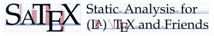

<!-- generated from doc/src/wiki/lints.md.in by satex-doc; do not edit -->

<p align="center"><a href="https://eagleoutice.github.io/satex-analyzer/"></a></p>

# Lint rules

`satex lint` checks the input file with every rule below. `--all` also checks the packages and classes it loads. `--rules` lists the codes, `--explain CODE` prints one rule's explanation. See [Chktex-Coverage](Chktex-Coverage) for the chktex warning each rule follows, and [Primitive-coverage](Primitive-coverage) and [Domains](Domains) for how satex gets the facts a rule reads.

Every rule has a stable number: its category's letter and a count, such as `C012`. The letters are `C` correctness, `X` security, `S` style, `P` performance and `A` precision (of the analysis). Output shows it before the code: the text and GitHub formats, SARIF's rule id and the editor's diagnostic code. `--explain`, `lint_off` and the suppression comments take the number in place of the code. A new rule gets the next free number of its category in [`src/data/lint-numbers.txt`](https://github.com/EagleoutIce/satex-analyzer/blob/main/src/data/lint-numbers.txt). A removed rule keeps its line there, so a number never changes meaning. A rule that moves to another category keeps its number, so suppressions and links that name it stay valid.

## Rules

Every rule, with a link to its explanation below. The shape gives the severity: ◆ error, ▲ warning, ● info. The badge gives the category. The engine column names the engines a rule is about, when not all of them. The origin names the [chktex](Chktex-Coverage) warnings a rule follows. On the site the table comes in pages, and the columns icon in its header hides columns or wraps long summaries. Hovering a rule's name anywhere on the site shows its card.

| no. | code | kind | engine | quick fix | summary | since | origin |
| --- | --- | --- | --- | --- | --- | --- | --- |
| C001 | [`already-defined`](#already-defined) | <span class="sev sev-error" title="default: error">◆</span> <span class="cat cat-correctness">correctness</span> | — | <span class="fix fix-safe" title="safe: the fix keeps the document's meaning, --fix applies it">S</span> <span class="fix fix-unsafe" title="unsafe: the fix may change the meaning, only --unsafe-fixes applies it">U</span> | command already defined | 0.1.0 | — |
| C043 | [`assertion-refuted`](#assertion-refuted) | <span class="sev sev-error" title="default: error">◆</span> <span class="cat cat-correctness">correctness</span> | — | — | assertion fails | 0.2.0 | — |
| C002 | [`bibtex-command-under-biblatex`](#bibtex-command-under-biblatex) | <span class="sev sev-error" title="default: error">◆</span> <span class="cat cat-correctness">correctness</span> | — | <span class="fix fix-unsafe" title="unsafe: the fix may change the meaning, only --unsafe-fixes applies it">U</span> | BibTeX command under biblatex | 0.2.0 | — |
| C003 | [`build-bibliography-disabled`](#build-bibliography-disabled) | <span class="sev sev-error" title="default: error">◆</span> <span class="cat cat-correctness">correctness</span> | — | — | build never runs BibTeX or biber | 0.1.0 | — |
| C004 | [`build-command-placeholders`](#build-command-placeholders) | <span class="sev sev-error" title="default: error">◆</span> <span class="cat cat-correctness">correctness</span> | — | — | engine command lacks %S or %O | 0.1.0 | — |
| C005 | [`build-engine-mismatch`](#build-engine-mismatch) | <span class="sev sev-error" title="default: error">◆</span> <span class="cat cat-correctness">correctness</span> | — | — | build uses the wrong engine or output | 0.1.0 | — |
| C006 | [`build-shell-escape-missing`](#build-shell-escape-missing) | <span class="sev sev-error" title="default: error">◆</span> <span class="cat cat-correctness">correctness</span> | — | — | build forbids needed shell escape | 0.1.0 | — |
| C007 | [`caused-library-error`](#caused-library-error) | <span class="sev sev-error" title="default: error">◆</span> <span class="cat cat-correctness">correctness</span> | — | — | package error caused by the document | 0.2.0 | — |
| C046 | [`invalid-directive`](#invalid-directive) | <span class="sev sev-error" title="default: error">◆</span> <span class="cat cat-correctness">correctness</span> | — | — | unreadable satex directive | 0.2.0 | — |
| C008 | [`math-still-open`](#math-still-open) | <span class="sev sev-error" title="default: error">◆</span> <span class="cat cat-correctness">correctness</span> | — | — | math mode left open | 0.2.0 | <a class="from" href="Chktex-Coverage" title="follows chktex warning 16">chktex 16</a> |
| C055 | [`metadata-after-class`](#metadata-after-class) | <span class="sev sev-error" title="default: error">◆</span> <span class="cat cat-correctness">correctness</span> | — | <span class="fix fix-unsafe" title="unsafe: the fix may change the meaning, only --unsafe-fixes applies it">U</span> | DocumentMetadata after documentclass | 0.2.5 | — |
| C047 | [`missing-end`](#missing-end) | <span class="sev sev-error" title="default: error">◆</span> <span class="cat cat-correctness">correctness</span> | — | <span class="fix fix-safe" title="safe: the fix keeps the document's meaning, --fix applies it">S</span> | document has no end | 0.2.0 | — |
| C009 | [`missing-graphic`](#missing-graphic) | <span class="sev sev-error" title="default: error">◆</span> <span class="cat cat-correctness">correctness</span> | — | — | image missing for this output | 0.1.0 | — |
| C010 | [`new-redefines`](#new-redefines) | <span class="sev sev-error" title="default: error">◆</span> <span class="cat cat-correctness">correctness</span> | — | — | declaration redefines a command | 0.2.0 | — |
| C011 | [`not-defined`](#not-defined) | <span class="sev sev-error" title="default: error">◆</span> <span class="cat cat-correctness">correctness</span> | — | <span class="fix fix-safe" title="safe: the fix keeps the document's meaning, --fix applies it">S</span> | renewing an undefined command | 0.1.0 | — |
| C012 | [`option-clash`](#option-clash) | <span class="sev sev-error" title="default: error">◆</span> <span class="cat cat-correctness">correctness</span> | — | <span class="fix fix-unsafe" title="unsafe: the fix may change the meaning, only --unsafe-fixes applies it">U</span> | package loaded with clashing options | 0.1.0 | — |
| C013 | [`raised-error`](#raised-error) | <span class="sev sev-error" title="default: error">◆</span> <span class="cat cat-correctness">correctness</span> | — | — | TeX error in the document | 0.1.0 | — |
| C014 | [`undefined-color`](#undefined-color) | <span class="sev sev-error" title="default: error">◆</span> <span class="cat cat-correctness">correctness</span> | — | — | color used before it is defined | 0.2.0 | — |
| C015 | [`undefined-control-sequence`](#undefined-control-sequence) | <span class="sev sev-error" title="default: error">◆</span> <span class="cat cat-correctness">correctness</span> | — | <span class="fix fix-unsafe" title="unsafe: the fix may change the meaning, only --unsafe-fixes applies it">U</span> | undefined command | 0.1.0 | — |
| C016 | [`undefined-environment`](#undefined-environment) | <span class="sev sev-error" title="default: error">◆</span> <span class="cat cat-correctness">correctness</span> | — | <span class="fix fix-unsafe" title="unsafe: the fix may change the meaning, only --unsafe-fixes applies it">U</span> | undefined environment | 0.1.0 | — |
| C017 | [`undefined-glossary-entry`](#undefined-glossary-entry) | <span class="sev sev-error" title="default: error">◆</span> <span class="cat cat-correctness">correctness</span> | — | — | glossary entry never declared | 0.1.0 | — |
| C018 | [`unguarded-recursion`](#unguarded-recursion) | <span class="sev sev-error" title="default: error">◆</span> <span class="cat cat-correctness">correctness</span> | — | — | recursion that never stops | 0.1.0 | — |
| C052 | [`bibliography-entry-missing-field`](#bibliography-entry-missing-field) | <span class="sev sev-warning" title="default: warning">▲</span> <span class="cat cat-correctness">correctness</span> | — | — | cited entry lacks a required field | 0.2.0 | — |
| C019 | [`build-missing-custom-dependency`](#build-missing-custom-dependency) | <span class="sev sev-warning" title="default: warning">▲</span> <span class="cat cat-correctness">correctness</span> | — | — | glossary files have no latexmk rule | 0.1.0 | — |
| C020 | [`catcode-escapes-group`](#catcode-escapes-group) | <span class="sev sev-warning" title="default: warning">▲</span> <span class="cat cat-correctness">correctness</span> | — | — | category code change outlives its group | 0.1.0 | — |
| C021 | [`conflicting-color-definition`](#conflicting-color-definition) | <span class="sev sev-warning" title="default: warning">▲</span> <span class="cat cat-correctness">correctness</span> | — | — | color name defined twice | 0.2.0 | — |
| C022 | [`delimiter-not-followed`](#delimiter-not-followed) | <span class="sev sev-warning" title="default: warning">▲</span> <span class="cat cat-correctness">correctness</span> | — | <span class="fix fix-unsafe" title="unsafe: the fix may change the meaning, only --unsafe-fixes applies it">U</span> | \left or \right before a brace | 0.2.0 | <a class="from" href="Chktex-Coverage" title="follows chktex warning 43">chktex 43</a> |
| C023 | [`duplicate-bibliography-entry`](#duplicate-bibliography-entry) | <span class="sev sev-warning" title="default: warning">▲</span> <span class="cat cat-correctness">correctness</span> | — | — | key declared twice | 0.1.0 | — |
| C050 | [`duplicate-bibliography-load`](#duplicate-bibliography-load) | <span class="sev sev-warning" title="default: warning">▲</span> <span class="cat cat-correctness">correctness</span> | — | <span class="fix fix-safe" title="safe: the fix keeps the document's meaning, --fix applies it">S</span> | database loaded twice | 0.2.0 | — |
| C051 | [`duplicate-bibliography-work`](#duplicate-bibliography-work) | <span class="sev sev-warning" title="default: warning">▲</span> <span class="cat cat-correctness">correctness</span> | — | <span class="fix fix-unsafe" title="unsafe: the fix may change the meaning, only --unsafe-fixes applies it">U</span> | one work under two keys | 0.2.0 | — |
| C024 | [`duplicate-label`](#duplicate-label) | <span class="sev sev-warning" title="default: warning">▲</span> <span class="cat cat-correctness">correctness</span> | — | — | label defined twice | 0.1.0 | — |
| C025 | [`environment-mismatch`](#environment-mismatch) | <span class="sev sev-warning" title="default: warning">▲</span> <span class="cat cat-correctness">correctness</span> | — | <span class="fix fix-unsafe" title="unsafe: the fix may change the meaning, only --unsafe-fixes applies it">U</span> | wrong environment closed | 0.1.0 | <a class="from" href="Chktex-Coverage" title="follows chktex warning 9, 10, 15">chktex 9, 10, 15</a> |
| C026 | [`expl-syntax-left-on`](#expl-syntax-left-on) | <span class="sev sev-warning" title="default: warning">▲</span> <span class="cat cat-correctness">correctness</span> | — | — | ExplSyntaxOn never turned off | 0.1.0 | — |
| C027 | [`expl3-constant-set`](#expl3-constant-set) | <span class="sev sev-warning" title="default: warning">▲</span> <span class="cat cat-correctness">correctness</span> | — | — | expl3 constant set again | 0.2.0 | — |
| C028 | [`expl3-signature-mismatch`](#expl3-signature-mismatch) | <span class="sev sev-warning" title="default: warning">▲</span> <span class="cat cat-correctness">correctness</span> | — | — | expl3 argument signature mismatch | 0.1.0 | — |
| C057 | [`graphic-without-alt`](#graphic-without-alt) | <span class="sev sev-warning" title="default: warning">▲</span> <span class="cat cat-correctness">correctness</span> | — | — | graphic without alternative text | 0.2.5 | — |
| C029 | [`ignored-verbatim-tail`](#ignored-verbatim-tail) | <span class="sev sev-warning" title="default: warning">▲</span> <span class="cat cat-correctness">correctness</span> | — | <span class="fix fix-unsafe" title="unsafe: the fix may change the meaning, only --unsafe-fixes applies it">U</span> | text lost after verbatim end | 0.2.0 | <a class="from" href="Chktex-Coverage" title="follows chktex warning 31">chktex 31</a> |
| C030 | [`math-script-braces`](#math-script-braces) | <span class="sev sev-warning" title="default: warning">▲</span> <span class="cat cat-correctness">correctness</span> | — | <span class="fix fix-safe" title="safe: the fix keeps the document's meaning, --fix applies it">S</span> | script needs braces | 0.2.0 | <a class="from" href="Chktex-Coverage" title="follows chktex warning 3, 25">chktex 3, 25</a> |
| C031 | [`missing-dependency`](#missing-dependency) | <span class="sev sev-warning" title="default: warning">▲</span> <span class="cat cat-correctness">correctness</span> | — | <span class="fix fix-safe" title="safe: the fix keeps the document's meaning, --fix applies it">S</span> | package missing from the dependency file | 0.1.0 | — |
| C063 | [`misspelled-magic-comment`](#misspelled-magic-comment) | <span class="sev sev-warning" title="default: warning">▲</span> <span class="cat cat-correctness">correctness</span> | — | <span class="fix fix-unsafe" title="unsafe: the fix may change the meaning, only --unsafe-fixes applies it">U</span> | misspelled magic comment | 0.2.5 | — |
| C064 | [`package-call-error`](#package-call-error) | <span class="sev sev-warning" title="default: warning">▲</span> <span class="cat cat-correctness">correctness</span> | — | — | a package command fails on some call | 0.2.5 | — |
| C061 | [`package-load-order`](#package-load-order) | <span class="sev sev-warning" title="default: warning">▲</span> <span class="cat cat-correctness">correctness</span> | — | <span class="fix fix-unsafe" title="unsafe: the fix may change the meaning, only --unsafe-fixes applies it">U</span> | package overrides an earlier one | 0.2.5 | — |
| C058 | [`pdfua-without-title`](#pdfua-without-title) | <span class="sev sev-warning" title="default: warning">▲</span> <span class="cat cat-correctness">correctness</span> | — | <span class="fix fix-safe" title="safe: the fix keeps the document's meaning, --fix applies it">S</span> | PDF/UA without a title | 0.2.5 | — |
| C054 | [`reference-name-mismatch`](#reference-name-mismatch) | <span class="sev sev-warning" title="default: warning">▲</span> <span class="cat cat-correctness">correctness</span> | — | <span class="fix fix-unsafe" title="unsafe: the fix may change the meaning, only --unsafe-fixes applies it">U</span> | name does not match the label | 0.2.4 | — |
| C056 | [`tagging-incompatible-package`](#tagging-incompatible-package) | <span class="sev sev-warning" title="default: warning">▲</span> <span class="cat cat-correctness">correctness</span> | — | — | package incompatible with tagging | 0.2.5 | — |
| C060 | [`tagging-unsupported-engine`](#tagging-unsupported-engine) | <span class="sev sev-warning" title="default: warning">▲</span> <span class="cat cat-correctness">correctness</span> | <span class="eng" title="only under xetex, tex">xetex, tex</span> | — | engine does not support tagging | 0.2.5 | — |
| C059 | [`tagging-without-language`](#tagging-without-language) | <span class="sev sev-warning" title="default: warning">▲</span> <span class="cat cat-correctness">correctness</span> | — | <span class="fix fix-safe" title="safe: the fix keeps the document's meaning, --fix applies it">S</span> | tagging without a language | 0.2.5 | — |
| C032 | [`unbalanced-brackets`](#unbalanced-brackets) | <span class="sev sev-warning" title="default: warning">▲</span> <span class="cat cat-correctness">correctness</span> | — | — | unbalanced brackets | 0.2.0 | <a class="from" href="Chktex-Coverage" title="follows chktex warning 17">chktex 17</a> |
| C033 | [`unbalanced-color-stack`](#unbalanced-color-stack) | <span class="sev sev-warning" title="default: warning">▲</span> <span class="cat cat-correctness">correctness</span> | <span class="eng" title="only under pdftex, luatex">pdftex, luatex</span> | — | unbalanced color stack | 0.2.0 | — |
| C034 | [`unbalanced-pdf-content`](#unbalanced-pdf-content) | <span class="sev sev-warning" title="default: warning">▲</span> <span class="cat cat-correctness">correctness</span> | <span class="eng" title="only under pdftex, luatex, xetex">pdftex, luatex, xetex</span> | — | unclosed PDF literal | 0.1.0 | — |
| C053 | [`undefined-bibliography-string`](#undefined-bibliography-string) | <span class="sev sev-warning" title="default: warning">▲</span> <span class="cat cat-correctness">correctness</span> | — | — | undefined @string constant | 0.2.0 | — |
| C035 | [`undefined-citation`](#undefined-citation) | <span class="sev sev-warning" title="default: warning">▲</span> <span class="cat cat-correctness">correctness</span> | — | <span class="fix fix-unsafe" title="unsafe: the fix may change the meaning, only --unsafe-fixes applies it">U</span> | citation key not in the bibliography | 0.1.0 | — |
| C048 | [`undefined-cref-format`](#undefined-cref-format) | <span class="sev sev-warning" title="default: warning">▲</span> <span class="cat cat-correctness">correctness</span> | — | <span class="fix fix-unsafe" title="unsafe: the fix may change the meaning, only --unsafe-fixes applies it">U</span> | cleveref has no name for this label | 0.2.0 | — |
| C036 | [`undefined-optional-content`](#undefined-optional-content) | <span class="sev sev-warning" title="default: warning">▲</span> <span class="cat cat-correctness">correctness</span> | — | — | unknown optional content group | 0.1.0 | — |
| C037 | [`undefined-reference`](#undefined-reference) | <span class="sev sev-warning" title="default: warning">▲</span> <span class="cat cat-correctness">correctness</span> | — | — | reference to an undefined label | 0.1.0 | — |
| C038 | [`uninstalled-package`](#uninstalled-package) | <span class="sev sev-warning" title="default: warning">▲</span> <span class="cat cat-correctness">correctness</span> | — | — | package not installed | 0.2.0 | — |
| C049 | [`unknown-code-language`](#unknown-code-language) | <span class="sev sev-warning" title="default: warning">▲</span> <span class="cat cat-correctness">correctness</span> | — | — | unknown listings language | 0.2.0 | — |
| C062 | [`unknown-package-name`](#unknown-package-name) | <span class="sev sev-warning" title="default: warning">▲</span> <span class="cat cat-correctness">correctness</span> | — | <span class="fix fix-unsafe" title="unsafe: the fix may change the meaning, only --unsafe-fixes applies it">U</span> | package name misspelled | 0.2.5 | — |
| C039 | [`unresolved-file`](#unresolved-file) | <span class="sev sev-warning" title="default: warning">▲</span> <span class="cat cat-correctness">correctness</span> | — | — | file not installed | 0.1.0 | <a class="from" href="Chktex-Coverage" title="follows chktex warning 27">chktex 27</a> |
| C045 | [`assumption-made`](#assumption-made) | <span class="sev sev-info" title="default: info">●</span> <span class="cat cat-correctness">correctness</span> | — | — | document assumes a condition | 0.2.0 | — |
| C040 | [`expected-load`](#expected-load) | <span class="sev sev-info" title="default: info">●</span> <span class="cat cat-correctness">correctness</span> | — | — | file read before a package it expects | 0.2.0 | — |
| C041 | [`math-mode-mismatch`](#math-mode-mismatch) | <span class="sev sev-info" title="default: info">●</span> <span class="cat cat-correctness">correctness</span> | — | — | math delimiter in the wrong mode | 0.2.0 | <a class="from" href="Chktex-Coverage" title="follows chktex warning 49">chktex 49</a> |
| C042 | [`unintended-escape`](#unintended-escape) | <span class="sev sev-info" title="default: info">●</span> <span class="cat cat-correctness">correctness</span> | — | <span class="fix fix-unsafe" title="unsafe: the fix may change the meaning, only --unsafe-fixes applies it">U</span> | command followed by escaped punctuation | 0.2.0 | <a class="from" href="Chktex-Coverage" title="follows chktex warning 21">chktex 21</a> |
| C044 | [`assertion-proved`](#assertion-proved) | <span class="sev sev-hint" title="default: hint">●</span> <span class="cat cat-correctness">correctness</span> | — | — | assertion always holds | 0.2.0 | — |
| X001 | [`build-shell-escape-unneeded`](#build-shell-escape-unneeded) | <span class="sev sev-warning" title="default: warning">▲</span> <span class="cat cat-security">security</span> | — | — | build allows unused shell escape | 0.1.0 | — |
| X002 | [`shell-escape`](#shell-escape) | <span class="sev sev-warning" title="default: warning">▲</span> <span class="cat cat-security">security</span> | — | — | document runs a program | 0.1.0 | — |
| S001 | [`accent-on-dotted-letter`](#accent-on-dotted-letter) | <span class="sev sev-warning" title="default: warning">▲</span> <span class="cat cat-style">style</span> | — | <span class="fix fix-unsafe" title="unsafe: the fix may change the meaning, only --unsafe-fixes applies it">U</span> | accent on a dotted i or j | 0.2.0 | <a class="from" href="Chktex-Coverage" title="follows chktex warning 7">chktex 7</a> |
| S002 | [`command-terminated-space`](#command-terminated-space) | <span class="sev sev-warning" title="default: warning">▲</span> <span class="cat cat-style">style</span> | — | <span class="fix fix-safe" title="safe: the fix keeps the document's meaning, --fix applies it">S</span> | space eaten after a command | 0.2.0 | <a class="from" href="Chktex-Coverage" title="follows chktex warning 1">chktex 1</a> |
| S003 | [`dimension-times`](#dimension-times) | <span class="sev sev-warning" title="default: warning">▲</span> <span class="cat cat-style">style</span> | — | <span class="fix fix-unsafe" title="unsafe: the fix may change the meaning, only --unsafe-fixes applies it">U</span> | x instead of a times sign | 0.2.0 | <a class="from" href="Chktex-Coverage" title="follows chktex warning 29">chktex 29</a> |
| S004 | [`double-space`](#double-space) | <span class="sev sev-warning" title="default: warning">▲</span> <span class="cat cat-style">style</span> | — | <span class="fix fix-safe" title="safe: the fix keeps the document's meaning, --fix applies it">S</span> <span class="fix fix-unsafe" title="unsafe: the fix may change the meaning, only --unsafe-fixes applies it">U</span> | double space | 0.2.0 | <a class="from" href="Chktex-Coverage" title="follows chktex warning 30, 39">chktex 30, 39</a> |
| S060 | [`doubled-punctuation`](#doubled-punctuation) | <span class="sev sev-warning" title="default: warning">▲</span> <span class="cat cat-style">style</span> | — | <span class="fix fix-unsafe" title="unsafe: the fix may change the meaning, only --unsafe-fixes applies it">U</span> | doubled punctuation | 0.2.4 | — |
| S005 | [`ellipsis-dots`](#ellipsis-dots) | <span class="sev sev-warning" title="default: warning">▲</span> <span class="cat cat-style">style</span> | — | <span class="fix fix-unsafe" title="unsafe: the fix may change the meaning, only --unsafe-fixes applies it">U</span> | three periods, not an ellipsis | 0.2.0 | <a class="from" href="Chktex-Coverage" title="follows chktex warning 11">chktex 11</a> |
| S054 | [`et-al`](#et-al) | <span class="sev sev-warning" title="default: warning">▲</span> <span class="cat cat-style">style</span> | — | <span class="fix fix-unsafe" title="unsafe: the fix may change the meaning, only --unsafe-fixes applies it">U</span> | et al. spelled by hand | 0.2.0 | — |
| S006 | [`expl3-scope`](#expl3-scope) | <span class="sev sev-warning" title="default: warning">▲</span> <span class="cat cat-style">style</span> | — | — | expl3 scope prefix mismatch | 0.2.0 | — |
| S007 | [`expl3-type`](#expl3-type) | <span class="sev sev-warning" title="default: warning">▲</span> <span class="cat cat-style">style</span> | — | — | expl3 type suffix mismatch | 0.2.0 | — |
| S008 | [`group-local-definition`](#group-local-definition) | <span class="sev sev-warning" title="default: warning">▲</span> <span class="cat cat-style">style</span> | — | — | definition lost when its group closes | 0.1.0 | — |
| S067 | [`low-contrast-color`](#low-contrast-color) | <span class="sev sev-warning" title="default: warning">▲</span> <span class="cat cat-style">style</span> | — | <span class="fix fix-unsafe" title="unsafe: the fix may change the meaning, only --unsafe-fixes applies it">U</span> | text color with too little contrast | 0.2.5 | — |
| S009 | [`math-operator-name`](#math-operator-name) | <span class="sev sev-warning" title="default: warning">▲</span> <span class="cat cat-style">style</span> | — | <span class="fix fix-unsafe" title="unsafe: the fix may change the meaning, only --unsafe-fixes applies it">U</span> | operator name in math italic | 0.2.0 | <a class="from" href="Chktex-Coverage" title="follows chktex warning 35">chktex 35</a> |
| S010 | [`missing-italic-correction`](#missing-italic-correction) | <span class="sev sev-warning" title="default: warning">▲</span> <span class="cat cat-style">style</span> | — | <span class="fix fix-unsafe" title="unsafe: the fix may change the meaning, only --unsafe-fixes applies it">U</span> | missing italic correction | 0.2.0 | <a class="from" href="Chktex-Coverage" title="follows chktex warning 6">chktex 6</a> |
| S011 | [`missing-nonbreaking-space`](#missing-nonbreaking-space) | <span class="sev sev-warning" title="default: warning">▲</span> <span class="cat cat-style">style</span> | — | <span class="fix fix-unsafe" title="unsafe: the fix may change the meaning, only --unsafe-fixes applies it">U</span> | missing tie before a reference | 0.2.0 | <a class="from" href="Chktex-Coverage" title="follows chktex warning 2">chktex 2</a> |
| S063 | [`overfull-box`](#overfull-box) | <span class="sev sev-warning" title="default: warning">▲</span> <span class="cat cat-style">style</span> | — | — | hbox too wide for its width | 0.2.5 | — |
| S062 | [`overfull-line`](#overfull-line) | <span class="sev sev-warning" title="default: warning">▲</span> <span class="cat cat-style">style</span> | — | — | line wider than the text block | 0.2.5 | — |
| S012 | [`parenthesis-spacing`](#parenthesis-spacing) | <span class="sev sev-warning" title="default: warning">▲</span> <span class="cat cat-style">style</span> | — | <span class="fix fix-unsafe" title="unsafe: the fix may change the meaning, only --unsafe-fixes applies it">U</span> | parenthesis takes the wrong space | 0.2.0 | <a class="from" href="Chktex-Coverage" title="follows chktex warning 36, 37">chktex 36, 37</a> |
| S013 | [`quote-direction`](#quote-direction) | <span class="sev sev-warning" title="default: warning">▲</span> <span class="cat cat-style">style</span> | — | <span class="fix fix-unsafe" title="unsafe: the fix may change the meaning, only --unsafe-fixes applies it">U</span> | quotation mark points the wrong way | 0.2.0 | <a class="from" href="Chktex-Coverage" title="follows chktex warning 32, 33, 34">chktex 32, 33, 34</a> |
| S061 | [`sentence-capital`](#sentence-capital) | <span class="sev sev-warning" title="default: warning">▲</span> <span class="cat cat-style">style</span> | — | <span class="fix fix-unsafe" title="unsafe: the fix may change the meaning, only --unsafe-fixes applies it">U</span> | sentence starts lowercase | 0.2.4 | — |
| S014 | [`sentence-spacing`](#sentence-spacing) | <span class="sev sev-warning" title="default: warning">▲</span> <span class="cat cat-style">style</span> | — | <span class="fix fix-unsafe" title="unsafe: the fix may change the meaning, only --unsafe-fixes applies it">U</span> | wrong space after a period | 0.2.0 | <a class="from" href="Chktex-Coverage" title="follows chktex warning 12, 13">chktex 12, 13</a> |
| S015 | [`space-before-command`](#space-before-command) | <span class="sev sev-warning" title="default: warning">▲</span> <span class="cat cat-style">style</span> | — | <span class="fix fix-unsafe" title="unsafe: the fix may change the meaning, only --unsafe-fixes applies it">U</span> | line may break before a mark | 0.2.0 | <a class="from" href="Chktex-Coverage" title="follows chktex warning 24, 42">chktex 24, 42</a> |
| S016 | [`space-before-punctuation`](#space-before-punctuation) | <span class="sev sev-warning" title="default: warning">▲</span> <span class="cat cat-style">style</span> | — | <span class="fix fix-safe" title="safe: the fix keeps the document's meaning, --fix applies it">S</span> | space before punctuation | 0.2.0 | <a class="from" href="Chktex-Coverage" title="follows chktex warning 26">chktex 26</a> |
| S017 | [`stray-italic-correction`](#stray-italic-correction) | <span class="sev sev-warning" title="default: warning">▲</span> <span class="cat cat-style">style</span> | — | <span class="fix fix-safe" title="safe: the fix keeps the document's meaning, --fix applies it">S</span> <span class="fix fix-unsafe" title="unsafe: the fix may change the meaning, only --unsafe-fixes applies it">U</span> | stray italic correction | 0.2.0 | <a class="from" href="Chktex-Coverage" title="follows chktex warning 5, 28">chktex 5, 28</a> |
| S018 | [`unknown-suppress-code`](#unknown-suppress-code) | <span class="sev sev-warning" title="default: warning">▲</span> <span class="cat cat-style">style</span> | — | — | suppression names no rule | 0.1.0 | — |
| S019 | [`user-pattern`](#user-pattern) | <span class="sev sev-warning" title="default: warning">▲</span> <span class="cat cat-style">style</span> | — | — | matches a project pattern | 0.2.0 | <a class="from" href="Chktex-Coverage" title="follows chktex warning 20, 44">chktex 20, 44</a> |
| S064 | [`wider-than-line`](#wider-than-line) | <span class="sev sev-warning" title="default: warning">▲</span> <span class="cat cat-style">style</span> | — | <span class="fix fix-unsafe" title="unsafe: the fix may change the meaning, only --unsafe-fixes applies it">U</span> | box wider than its lines | 0.2.5 | — |
| S020 | [`wrong-dash`](#wrong-dash) | <span class="sev sev-warning" title="default: warning">▲</span> <span class="cat cat-style">style</span> | — | <span class="fix fix-unsafe" title="unsafe: the fix may change the meaning, only --unsafe-fixes applies it">U</span> | wrong dash length | 0.2.0 | <a class="from" href="Chktex-Coverage" title="follows chktex warning 8">chktex 8</a> |
| S021 | [`wrong-quote-character`](#wrong-quote-character) | <span class="sev sev-warning" title="default: warning">▲</span> <span class="cat cat-style">style</span> | — | <span class="fix fix-unsafe" title="unsafe: the fix may change the meaning, only --unsafe-fixes applies it">U</span> | wrong character used as a quote | 0.2.0 | <a class="from" href="Chktex-Coverage" title="follows chktex warning 18, 19">chktex 18, 19</a> |
| S022 | [`zero-italic-correction`](#zero-italic-correction) | <span class="sev sev-warning" title="default: warning">▲</span> <span class="cat cat-style">style</span> | — | <span class="fix fix-safe" title="safe: the fix keeps the document's meaning, --fix applies it">S</span> | useless italic correction | 0.2.0 | <a class="from" href="Chktex-Coverage" title="follows chktex warning 4">chktex 4</a> |
| S059 | [`bare-reference`](#bare-reference) | <span class="sev sev-info" title="default: info">●</span> <span class="cat cat-style">style</span> | — | <span class="fix fix-unsafe" title="unsafe: the fix may change the meaning, only --unsafe-fixes applies it">U</span> | reference without a name | 0.2.4 | — |
| S023 | [`build-bibliography-unneeded`](#build-bibliography-unneeded) | <span class="sev sev-info" title="default: info">●</span> <span class="cat cat-style">style</span> | — | — | build runs BibTeX without a bibliography | 0.1.0 | — |
| S024 | [`build-engine-options`](#build-engine-options) | <span class="sev sev-info" title="default: info">●</span> <span class="cat cat-style">style</span> | — | — | engine command lacks file:line or SyncTeX | 0.1.0 | — |
| S025 | [`build-unused-custom-dependency`](#build-unused-custom-dependency) | <span class="sev sev-info" title="default: info">●</span> <span class="cat cat-style">style</span> | — | — | unused latexmk dependency | 0.1.0 | — |
| S053 | [`clones`](#clones) | <span class="sev sev-info" title="default: info">●</span> <span class="cat cat-style">style</span> | — | <span class="fix fix-unsafe" title="unsafe: the fix may change the meaning, only --unsafe-fixes applies it">U</span> | repeated block of source | 0.2.0 | — |
| S026 | [`comment-marker`](#comment-marker) | <span class="sev sev-info" title="default: info">●</span> <span class="cat cat-style">style</span> | — | — | TODO marker in a comment | 0.2.0 | <a class="from" href="Chktex-Coverage" title="follows chktex warning 22">chktex 22</a> |
| S027 | [`computer-modern-in-t1`](#computer-modern-in-t1) | <span class="sev sev-info" title="default: info">●</span> <span class="cat cat-style">style</span> | <span class="eng" title="only under pdftex">pdftex</span> | <span class="fix fix-unsafe" title="unsafe: the fix may change the meaning, only --unsafe-fixes applies it">U</span> | T1 text relies on cm-super | 0.1.0 | — |
| S028 | [`csquotes-available`](#csquotes-available) | <span class="sev sev-info" title="default: info">●</span> <span class="cat cat-style">style</span> | — | <span class="fix fix-unsafe" title="unsafe: the fix may change the meaning, only --unsafe-fixes applies it">U</span> | hand-set quotes, csquotes not loaded | 0.2.0 | <a class="from" href="Chktex-Coverage" title="follows chktex warning 18">chktex 18</a> |
| S029 | [`dead-definition`](#dead-definition) | <span class="sev sev-info" title="default: info">●</span> <span class="cat cat-style">style</span> | — | <span class="fix fix-safe" title="safe: the fix keeps the document's meaning, --fix applies it">S</span> <span class="fix fix-unsafe" title="unsafe: the fix may change the meaning, only --unsafe-fixes applies it">U</span> | definition replaced before use | 0.1.0 | — |
| S030 | [`duplicate-color-value`](#duplicate-color-value) | <span class="sev sev-info" title="default: info">●</span> <span class="cat cat-style">style</span> | — | — | two names for one color | 0.2.0 | — |
| S031 | [`duplicate-package`](#duplicate-package) | <span class="sev sev-info" title="default: info">●</span> <span class="cat cat-style">style</span> | — | <span class="fix fix-safe" title="safe: the fix keeps the document's meaning, --fix applies it">S</span> | package loaded twice | 0.1.0 | — |
| S032 | [`hand-set-quantity`](#hand-set-quantity) | <span class="sev sev-info" title="default: info">●</span> <span class="cat cat-style">style</span> | — | <span class="fix fix-unsafe" title="unsafe: the fix may change the meaning, only --unsafe-fixes applies it">U</span> | hand-set number and unit | 0.2.0 | — |
| S052 | [`hand-written-author`](#hand-written-author) | <span class="sev sev-info" title="default: info">●</span> <span class="cat cat-style">style</span> | — | <span class="fix fix-unsafe" title="unsafe: the fix may change the meaning, only --unsafe-fixes applies it">U</span> | author name typed before a citation | 0.2.0 | — |
| S051 | [`hand-written-reference`](#hand-written-reference) | <span class="sev sev-info" title="default: info">●</span> <span class="cat cat-style">style</span> | — | <span class="fix fix-unsafe" title="unsafe: the fix may change the meaning, only --unsafe-fixes applies it">U</span> | number typed after a reference name | 0.2.0 | — |
| S033 | [`inconsistent-precision`](#inconsistent-precision) | <span class="sev sev-info" title="default: info">●</span> <span class="cat cat-style">style</span> | — | — | different decimals in a column | 0.2.0 | — |
| S068 | [`indistinct-colors`](#indistinct-colors) | <span class="sev sev-info" title="default: info">●</span> <span class="cat cat-style">style</span> | — | <span class="fix fix-unsafe" title="unsafe: the fix may change the meaning, only --unsafe-fixes applies it">U</span> | colors alike with color blindness | 0.2.5 | — |
| S057 | [`itemize-described`](#itemize-described) | <span class="sev sev-info" title="default: info">●</span> <span class="cat cat-style">style</span> | — | <span class="fix fix-unsafe" title="unsafe: the fix may change the meaning, only --unsafe-fixes applies it">U</span> | labelled items in an itemize | 0.2.1 | — |
| S056 | [`itemize-numbered`](#itemize-numbered) | <span class="sev sev-info" title="default: info">●</span> <span class="cat cat-style">style</span> | — | <span class="fix fix-safe" title="safe: the fix keeps the document's meaning, --fix applies it">S</span> <span class="fix fix-unsafe" title="unsafe: the fix may change the meaning, only --unsafe-fixes applies it">U</span> | numbered items in an itemize | 0.2.1 | — |
| S034 | [`math-punctuation`](#math-punctuation) | <span class="sev sev-info" title="default: info">●</span> <span class="cat cat-style">style</span> | — | — | punctuation on the wrong side of a formula | 0.2.0 | <a class="from" href="Chktex-Coverage" title="follows chktex warning 40">chktex 40</a> |
| S035 | [`math-shift-dollars`](#math-shift-dollars) | <span class="sev sev-info" title="default: info">●</span> <span class="cat cat-style">style</span> | — | <span class="fix fix-safe" title="safe: the fix keeps the document's meaning, --fix applies it">S</span> | $$ instead of \[ | 0.2.0 | <a class="from" href="Chktex-Coverage" title="follows chktex warning 45, 46">chktex 45, 46</a> |
| S036 | [`microtype-available`](#microtype-available) | <span class="sev sev-info" title="default: info">●</span> <span class="cat cat-style">style</span> | <span class="eng" title="only under pdftex, luatex">pdftex, luatex</span> | <span class="fix fix-unsafe" title="unsafe: the fix may change the meaning, only --unsafe-fixes applies it">U</span> | microtype not loaded | 0.1.0 | — |
| S037 | [`numbers-not-aligned`](#numbers-not-aligned) | <span class="sev sev-info" title="default: info">●</span> <span class="cat cat-style">style</span> | — | — | numbers not aligned | 0.2.0 | — |
| S038 | [`ot1-font-encoding`](#ot1-font-encoding) | <span class="sev sev-info" title="default: info">●</span> <span class="cat cat-style">style</span> | <span class="eng" title="only under pdftex">pdftex</span> | <span class="fix fix-unsafe" title="unsafe: the fix may change the meaning, only --unsafe-fixes applies it">U</span> | accents built with \accent in OT1 | 0.1.0 | — |
| S058 | [`package-successor`](#package-successor) | <span class="sev sev-info" title="default: info">●</span> <span class="cat cat-style">style</span> | — | <span class="fix fix-unsafe" title="unsafe: the fix may change the meaning, only --unsafe-fixes applies it">U</span> | package has a successor | 0.2.1 | — |
| S039 | [`prefer-cleveref`](#prefer-cleveref) | <span class="sev sev-info" title="default: info">●</span> <span class="cat cat-style">style</span> | — | <span class="fix fix-unsafe" title="unsafe: the fix may change the meaning, only --unsafe-fixes applies it">U</span> | hand-written name before a reference | 0.2.0 | — |
| S040 | [`primitive-tex-command`](#primitive-tex-command) | <span class="sev sev-info" title="default: info">●</span> <span class="cat cat-style">style</span> | — | <span class="fix fix-unsafe" title="unsafe: the fix may change the meaning, only --unsafe-fixes applies it">U</span> | plain TeX primitive in LaTeX | 0.1.0 | <a class="from" href="Chktex-Coverage" title="follows chktex warning 41">chktex 41</a> |
| S041 | [`quote-ligature`](#quote-ligature) | <span class="sev sev-info" title="default: info">●</span> <span class="cat cat-style">style</span> | — | <span class="fix fix-unsafe" title="unsafe: the fix may change the meaning, only --unsafe-fixes applies it">U</span> | quotes run together | 0.2.0 | <a class="from" href="Chktex-Coverage" title="follows chktex warning 23">chktex 23</a> |
| S042 | [`quote-punctuation`](#quote-punctuation) | <span class="sev sev-info" title="default: info">●</span> <span class="cat cat-style">style</span> | — | <span class="fix fix-unsafe" title="unsafe: the fix may change the meaning, only --unsafe-fixes applies it">U</span> | punctuation inside the quote | 0.2.0 | <a class="from" href="Chktex-Coverage" title="follows chktex warning 38">chktex 38</a> |
| S066 | [`redundant-package-load`](#redundant-package-load) | <span class="sev sev-info" title="default: info">●</span> <span class="cat cat-style">style</span> | — | <span class="fix fix-safe" title="safe: the fix keeps the document's meaning, --fix applies it">S</span> | package loaded already | 0.2.5 | — |
| S043 | [`stray-space`](#stray-space) | <span class="sev sev-info" title="default: info">●</span> <span class="cat cat-style">style</span> | — | <span class="fix fix-safe" title="safe: the fix keeps the document's meaning, --fix applies it">S</span> | space from a line end in a macro | 0.1.0 | — |
| S044 | [`table-rules`](#table-rules) | <span class="sev sev-info" title="default: info">●</span> <span class="cat cat-style">style</span> | — | — | vertical rules or hline in a table | 0.2.0 | — |
| S065 | [`tagged-math-without-mathml`](#tagged-math-without-mathml) | <span class="sev sev-info" title="default: info">●</span> <span class="cat cat-style">style</span> | <span class="eng" title="only under pdftex">pdftex</span> | — | formulas without MathML | 0.2.5 | — |
| S055 | [`uncited-bibliography-entry`](#uncited-bibliography-entry) | <span class="sev sev-info" title="default: info">●</span> <span class="cat cat-style">style</span> | — | <span class="fix fix-unsafe" title="unsafe: the fix may change the meaning, only --unsafe-fixes applies it">U</span> | database entry never cited | 0.2.0 | — |
| S045 | [`unit-in-cells`](#unit-in-cells) | <span class="sev sev-info" title="default: info">●</span> <span class="cat cat-style">style</span> | — | — | unit repeated in every cell | 0.2.0 | — |
| S046 | [`unreferenced-numbered-display`](#unreferenced-numbered-display) | <span class="sev sev-info" title="default: info">●</span> <span class="cat cat-style">style</span> | — | <span class="fix fix-unsafe" title="unsafe: the fix may change the meaning, only --unsafe-fixes applies it">U</span> | numbered display never referenced | 0.2.0 | — |
| S047 | [`unused-bibitem`](#unused-bibitem) | <span class="sev sev-info" title="default: info">●</span> <span class="cat cat-style">style</span> | — | — | bibitem never cited | 0.1.0 | — |
| S048 | [`unused-color`](#unused-color) | <span class="sev sev-info" title="default: info">●</span> <span class="cat cat-style">style</span> | — | — | color never used | 0.2.0 | — |
| S049 | [`unused-definition`](#unused-definition) | <span class="sev sev-info" title="default: info">●</span> <span class="cat cat-style">style</span> | — | <span class="fix fix-unsafe" title="unsafe: the fix may change the meaning, only --unsafe-fixes applies it">U</span> | macro never used | 0.1.0 | — |
| S050 | [`unused-label`](#unused-label) | <span class="sev sev-info" title="default: info">●</span> <span class="cat cat-style">style</span> | — | <span class="fix fix-unsafe" title="unsafe: the fix may change the meaning, only --unsafe-fixes applies it">U</span> | label never referenced | 0.1.0 | — |
| P001 | [`package-after-preamble`](#package-after-preamble) | <span class="sev sev-warning" title="default: warning">▲</span> <span class="cat cat-performance">performance</span> | — | <span class="fix fix-unsafe" title="unsafe: the fix may change the meaning, only --unsafe-fixes applies it">U</span> | package loaded after the preamble | 0.1.0 | — |
| P002 | [`includeonly-available`](#includeonly-available) | <span class="sev sev-info" title="default: info">●</span> <span class="cat cat-performance">performance</span> | — | <span class="fix fix-unsafe" title="unsafe: the fix may change the meaning, only --unsafe-fixes applies it">U</span> | parts built whole | 0.2.0 | — |
| P003 | [`preamble-cost`](#preamble-cost) | <span class="sev sev-info" title="default: info">●</span> <span class="cat cat-performance">performance</span> | — | <span class="fix fix-unsafe" title="unsafe: the fix may change the meaning, only --unsafe-fixes applies it">U</span> | slow preamble | 0.1.0 | — |
| P004 | [`recursive-macro`](#recursive-macro) | <span class="sev sev-info" title="default: info">●</span> <span class="cat cat-performance">performance</span> | — | — | recursive macro | 0.1.0 | — |
| P005 | [`unused-dependency`](#unused-dependency) | <span class="sev sev-info" title="default: info">●</span> <span class="cat cat-performance">performance</span> | — | <span class="fix fix-unsafe" title="unsafe: the fix may change the meaning, only --unsafe-fixes applies it">U</span> | unused entry in the dependency file | 0.1.0 | — |
| P006 | [`unused-package`](#unused-package) | <span class="sev sev-info" title="default: info">●</span> <span class="cat cat-performance">performance</span> | — | <span class="fix fix-unsafe" title="unsafe: the fix may change the meaning, only --unsafe-fixes applies it">U</span> | unused package | 0.1.0 | — |
| A003 | [`unread-document`](#unread-document) | <span class="sev sev-error" title="default: error">◆</span> <span class="cat cat-precision">precision</span> | — | — | document not fully read | 0.2.1 | — |
| A001 | [`analysis-imprecision`](#analysis-imprecision) | <span class="sev sev-info" title="default: info">●</span> <span class="cat cat-precision">precision</span> | — | — | analysis had to widen | 0.1.0 | — |
| A002 | [`assertion-unknown`](#assertion-unknown) | <span class="sev sev-info" title="default: info">●</span> <span class="cat cat-precision">precision</span> | — | — | assertion not decided | 0.2.0 | — |

## Early findings

Each rule declares the facts it needs. Most need the whole run. A few need only the files' text, or the text and the standard meaning of a few names: which files `\input`, `\include` and `\subfile` read, and which environments, such as `verbatim`, take their content as plain text. The `keys` tier also reads what the text's commands name, by their standard meaning: `\label` defines a label, `\ref` and `\cref` refer to one, `\cite` cites a key of the databases `\bibliography` and `\addbibresource` name, `\usepackage` loads a package, and `\includegraphics` includes a file that graphics finds with one of its extensions. A later pass can still change these findings, so the editor does not keep them between passes, as it keeps `text` and `names` ones. These rules run first, on a rough copy of the document, before the run starts. `lints.early` in `satex.yaml` lists the names, and the rough copy reports this as the assumption `early-standard-names`.

| needs | rules |
| --- | --- |
| text | [`build-command-placeholders`](#build-command-placeholders), [`misspelled-magic-comment`](#misspelled-magic-comment), [`build-engine-options`](#build-engine-options) |
| names | [`user-pattern`](#user-pattern), [`clones`](#clones), [`comment-marker`](#comment-marker) |
| keys | [`missing-graphic`](#missing-graphic), [`unresolved-file`](#unresolved-file), [`duplicate-package`](#duplicate-package) |

An early finding is provisional. `satex lint` prints it on stderr at once, marked `early`. The editor shows it before the run ends, on `satex/settled` with `data.provisional`. A file opened for the first time also gets the early set as its diagnostics, each marked provisional, so any client shows them. The run's findings then replace the early ones. A finding the run makes too is confirmed and keeps its place and message. One the run does not make is retracted: `satex lint` names it on stderr, and the editor drops it. A `% TODO` in a file that only a skipped `\iffalse` branch inputs is such a case. `lints.early.enabled: false` turns early findings off.

## Errors caused in package code

An engine error can arise inside a package while the document's own call caused it. `satex lint` then shows it at that call, as `caused-library-error`. The message names the package line, e.g. `error in expl3-code.tex:24703: Argument has an extra }, caused here`. The call is the innermost place in the user's own files on the input stack. These are the main file, the files it reads, and other files below its directory. One row stands for each call line and error code, with a count when it repeats. An error on a path satex approximated may not be TeX's. It is a precision note, which the text output folds into a count and an editor does not show. An exact error after such a one may be its echo, so it is a warning that names the earlier one. A finding that something is absent from the whole document, such as an undefined reference or an unused label, is a precision note too when the run left a project file unread. `query diagnostics` gives the call as `origin`. A runaway over an argument the document itself leaves open is the document's error. It is a `raised-error` at the call, e.g. `File ended while scanning use of \pgfkeys@@set: the argument of \pgfkeys opened here never closes, the file ends inside it`.

## Suppressing findings

A comment in the document silences findings. Without codes it silences every rule, with codes (comma-separated) only those. `lint_off` in `satex.yaml` turns a rule off everywhere.

* `% satex-disable-next-line CODE,…` silences the next line.
* `% satex-disable-line CODE,…` at the end of a line silences that line.
* `% satex-disable CODE,…` … `% satex-enable CODE,…` silences a region.
* `% satex-disable-file CODE,…` silences the whole file.

They apply to every output format and to `--fix`. An unknown code is reported as `unknown-suppress-code`.

`satex lint --style` lists the rules the project breaks so often that they may be its style, as an editor asks about them (`lints.style-prompt` in `satex.yaml`).

## Assertions

A comment can state a property for satex to check. TeX skips the comment. satex runs it where it reads it, on every path.

```latex
%\satex@assert{\thepage < 5}
%\satex@assume{\value{section} <= 3 and \ifdefined\mymacro}
%\satex@configure{limits.site_forks=8, opaque_conditionals=[ifdraft]}
```

* `\satex@assert{⟨condition⟩}`: Checks a condition on every path that reaches it.
* `\satex@assume{⟨condition⟩}`: Drops the paths where a condition fails.
* `\satex@configure{⟨key⟩=⟨value⟩, …}`: Changes settings of `satex.yaml` until the group ends.

* `⟨condition⟩` is ⟨test⟩s joined by `or` and `and`, `and` binding tighter, each maybe after `not`.
* `⟨test⟩` is ⟨operand⟩ ⟨relation⟩ ⟨operand⟩, or a TeX conditional such as `\ifdefined\x`.
* `⟨operand⟩` is a TeX number (`\value{page}`, `\c@page`, `\numexpr…`), a dimension when one side has a unit (`\wd0 < 3cm`), `\the⟨counter⟩` the counter's value (`\thepage`).
* `⟨relation⟩` is one of `<` `=` `>` `<=` `>=` `!=` `==`.
* `⟨key⟩` is a setting of `satex.yaml`, dotted or written with `/`.
* `⟨value⟩` is what the setting takes, as in `satex.yaml`.

* `\satex@assert{cond}` checks `cond`. It is [`assertion-proved`](#assertion-proved) when it holds on every path that reads it. It is [`assertion-refuted`](#assertion-refuted), an error, when it fails on a path that approximated nothing. The message names what the operands are there. Otherwise it is [`assertion-unknown`](#assertion-unknown), with the reason: a value the run does not know, a path that approximated, or no path that reads it.
* `\satex@assume{cond}` drops the paths where `cond` fails. On the others it narrows the registers a conjunction of comparisons reads, as an `\ifnum` arm does. It is listed as [`assumption-made`](#assumption-made).
* `\satex@configure{key=value, …}` changes settings of `satex.yaml` until the current TeX group ends. Keys are dotted, or written with `/`. A setting the run reads only at its start keeps its value.

`\thepage < 5` compares the page number whether `\pagenumbering` prints it in arabic or roman numerals. Only the document's own files are read for directives. A package's comments and text a conditional skips are not. A directive that cannot be read is [`invalid-directive`](#invalid-directive).

## Quick-fixes

A finding's `fix` says what to do. Where that is mechanical it carries the edits, e.g. removing a `\usepackage` line or one name in `\usepackage{a,b,c}`, a `\label{…}`, or turning `\newcommand` into `\renewcommand`. The text output marks them `[fix]` or `[unsafe fix]`:

* **safe** fixes keep the document's meaning: a duplicate `\usepackage`, a definition replaced before it is read, `\renewcommand` of an undefined name.
* **unsafe** fixes may change what the document means, so check them before you keep them: removing a package that may have side effects, an unused label, `\newcommand` turned into `\renewcommand`.

`--fix` applies the safe fixes, `--unsafe-fixes` adds the unsafe ones, `--diff` prints the edits instead of writing them. Only project files change. Overlapping fixes wait for the next round. The document is re-analyzed after each round, up to eight.

`--format json` gives each fix as `applicability` and `edits` (`path`, 1-based `start`/`end`, `replacement`), `--format sarif` as `fixes`, `--format lsp` as diagnostics with `quickfix` code actions.

In the rule list below, `S` marks a rule with a safe fix and `U` one with an unsafe fix. A rule with both is safe where its fix cannot change what the document means and unsafe where it might. Each finding names its own kind.

## Explanations

One group per category, each with its first rules. A group's button shows the rest.

<div class="fold" id="category-correctness">
<h3 class="fold-head"><b>correctness</b> (64 rules)</h3>

### already-defined

<p class="badges"><code class="num" title="rule number">C001</code> <span class="sev sev-error" title="default: error">default: error</span> <span class="cat cat-correctness">correctness</span> <span class="fix fix-safe" title="safe: the fix keeps the document's meaning, --fix applies it">S</span> <span class="fix fix-unsafe" title="unsafe: the fix may change the meaning, only --unsafe-fixes applies it">U</span> <span class="since" title="first release">since 0.1.0</span></p>

**command already defined**

`\newcommand` refuses to redefine and raises `Command … already defined`. The finding names the definition it ran into: the package that made it, or its place in the document.

The same definition again is no conflict: `\providecommand` keeps the first, and the fix uses it. A package's command is that package's: `\renewcommand` overrides it where the package uses it too (amsmath's `\text` inside its own math), so another name is often the better fix. Else use `\renewcommand` if the redefinition is intended, or pick another name.

See [source2e § ltdefns.dtx](https://ctan.org/pkg/source2e).

### assertion-refuted

<p class="badges"><code class="num" title="rule number">C043</code> <span class="sev sev-error" title="default: error">default: error</span> <span class="cat cat-correctness">correctness</span> <span class="since" title="first release">since 0.2.0</span></p>

**assertion fails**

The condition of `%\satex@assert` is false on a path that approximated nothing, so a run of the document reaches it false. The finding names the values the condition read there.

See [Assertions](#assertions).

### bibtex-command-under-biblatex

<p class="badges"><code class="num" title="rule number">C002</code> <span class="sev sev-error" title="default: error">default: error</span> <span class="cat cat-correctness">correctness</span> <span class="fix fix-unsafe" title="unsafe: the fix may change the meaning, only --unsafe-fixes applies it">U</span> <span class="since" title="first release">since 0.2.0</span></p>

**BibTeX command under biblatex**

biblatex makes the commands of a BibTeX bibliography raise errors where it has its own: the style is its `style` option, not `\bibliographystyle`, and the databases are named in the preamble with `\addbibresource` and printed with `\printbibliography`, not with `\bibliography` ([biblatex manual, §3.7.1](https://ctan.org/pkg/biblatex) and [§3.7.2](https://ctan.org/pkg/biblatex)). Only a call the run reached and that raised the error is reported.

Fix by deleting `\bibliographystyle` (choose a style with `\usepackage[style=…]{biblatex}`), and by writing `\printbibliography` for `\bibliography` with an `\addbibresource` per database in the preamble.

See [biblatex §3.7](https://ctan.org/pkg/biblatex).

### build-bibliography-disabled

<p class="badges"><code class="num" title="rule number">C003</code> <span class="sev sev-error" title="default: error">default: error</span> <span class="cat cat-correctness">correctness</span> <span class="since" title="first release">since 0.1.0</span></p>

**build never runs BibTeX or biber**

`$bibtex_use = 0` tells latexmk never to run BibTeX or biber (latexmk(1), `$bibtex_use`), so the `.bbl` file the bibliography is read from is never made and every citation stays undefined.

Fix by removing the setting. latexmk's default, 1, runs them whenever the `.bib` files exist.

See [latexmk § $bibtex_use](https://ctan.org/pkg/latexmk).

### build-command-placeholders

<p class="badges"><code class="num" title="rule number">C004</code> <span class="sev sev-error" title="default: error">default: error</span> <span class="cat cat-correctness">correctness</span> <span class="since" title="first release">since 0.1.0</span></p>

**engine command lacks %S or %O**

latexmk substitutes `%S` with the source file and `%O` with the options it passes itself (latexmk(1), "FORMAT OF COMMAND SPECIFICATIONS"). A command without `%S` compiles nothing, and one without `%O` loses `-jobname`, `-output-directory` and the options given on latexmk's own command line.

Fix by ending the command with `%O %S`.

See [latexmk § FORMAT OF COMMAND SPECIFICATIONS](https://ctan.org/pkg/latexmk).

### build-engine-mismatch

<p class="badges"><code class="num" title="rule number">C005</code> <span class="sev sev-error" title="default: error">default: error</span> <span class="cat cat-correctness">correctness</span> <span class="since" title="first release">since 0.1.0</span></p>

**build uses the wrong engine or output**

latexmk's `$pdf_mode` picks the engine: 1 runs `$pdflatex`, 4 `$lualatex`, 5 `$xelatex`, and 0, 2 and 3 run `$latex` for DVI (latexmk(1), `$pdf_mode`). The document contradicts it when a `% !TeX program` line names another engine, when it uses a primitive only another engine has (`\directlua` is LuaTeX's, `\XeTeXrevision` XeTeX's), or when it sets `\pdfoutput` to the other output than latexmk waits for.

Fix by setting `$pdf_mode` to the engine the document is written for.

See [latexmk § $pdf_mode](https://ctan.org/pkg/latexmk).

### build-shell-escape-missing

<p class="badges"><code class="num" title="rule number">C006</code> <span class="sev sev-error" title="default: error">default: error</span> <span class="cat cat-correctness">correctness</span> <span class="since" title="first release">since 0.1.0</span></p>

**build forbids needed shell escape**

The run reached `\write18`, which only hands its text to the shell when the engine is started with `-shell-escape` (or `-shell-restricted` and a program TeX Live allows). latexmk starts the engine with the command in `$pdflatex`, `$lualatex`, `$xelatex` or `$latex`, whichever `$pdf_mode` selects (latexmk(1), `$pdf_mode`). arara's `pdflatex`, `lualatex` and `xelatex` rules take `shell: yes` ([arara manual, "The official rules"](https://ctan.org/pkg/arara)).

Fix by adding `-shell-escape` to the command, e.g. `$pdflatex = 'pdflatex -shell-escape %O %S';`, or `set_tex_cmds('-shell-escape %O %S');` for every engine at once.

See [latexmk § $pdf_mode](https://ctan.org/pkg/latexmk), [arara § The official rules](https://ctan.org/pkg/arara).

### caused-library-error

<p class="badges"><code class="num" title="rule number">C007</code> <span class="sev sev-error" title="default: error">default: error</span> <span class="cat cat-correctness">correctness</span> <span class="since" title="first release">since 0.2.0</span></p>

**package error caused by the document**

An engine error such as `Argument has an extra }` arises inside package code. The cause is the document's own call into that code. The finding sits at that call and names the package line where the error arose. A runaway over the document's own unclosed argument is not one: `raised-error` reports it. Each call and error code is one finding, with a count when it repeats.

When satex had to approximate on the way, the error may not be TeX's: it is a precision note, not a finding. An exact error after such a one may be its echo, as TeX's recovery left a state that may not be TeX's. The finding is then a warning that names the earlier error.

See [The TeXbook, chapter 27](https://ctan.org/pkg/texbook).

### invalid-directive

<p class="badges"><code class="num" title="rule number">C046</code> <span class="sev sev-error" title="default: error">default: error</span> <span class="cat cat-correctness">correctness</span> <span class="since" title="first release">since 0.2.0</span></p>

**unreadable satex directive**

A directive is a comment, so TeX skips it: `%\satex@assert{cond}`, `%\satex@assume{cond}` or `%\satex@configure{key=value, ...}`. A condition compares two TeX numbers (`\thepage < 5`, `\value{section} >= 2`) or two dimensions when one has a unit (`\wd0 <= 3cm`), with `<`, `<=`, `=`, `!=`, `>=` or `>`. It may also be a TeX conditional such as `\ifdefined\foo`. `and`, `or` and `not` combine tests. `\the<counter>` is the counter's value, however `\pagenumbering` prints it.

See [Assertions](#assertions).

### math-still-open

<p class="badges"><code class="num" title="rule number">C008</code> <span class="sev sev-error" title="default: error">default: error</span> <span class="cat cat-correctness">correctness</span> <a class="from" href="Chktex-Coverage" title="follows chktex warning 16">chktex 16</a> <span class="since" title="first release">since 0.2.0</span></p>

**math mode left open**

A `$` that is never closed leaves TeX in math mode. The next `\par` makes TeX report `Missing $ inserted` and close the formula itself ([tex.web § 1047](https://github.com/TeX-Live/texlive-source/blob/dce038dd1bd98fac739254da4a2066c8347cdf6c/texk/web2c/tex.web#L20410) `insert_dollar_sign`), and everything up to there is set as mathematics.

The rule reports what the interpreter already saw: the `missing-dollar` diagnostic it raised, or, where no `\par` followed, a last character still carrying a math mode (unless a limit stopped the run before the text's end). It reports one finding, never both.

Fix by closing the formula.

See [chktex 16](https://www.nongnu.org/chktex/), [tex.web § 1047](https://github.com/TeX-Live/texlive-source/blob/dce038dd1bd98fac739254da4a2066c8347cdf6c/texk/web2c/tex.web#L20410).

### metadata-after-class

<p class="badges"><code class="num" title="rule number">C055</code> <span class="sev sev-error" title="default: error">default: error</span> <span class="cat cat-correctness">correctness</span> <span class="fix fix-unsafe" title="unsafe: the fix may change the meaning, only --unsafe-fixes applies it">U</span> <span class="since" title="first release">since 0.2.5</span></p>

**DocumentMetadata after documentclass**

`\DocumentMetadata` sets up the PDF management and tagging code before anything else is loaded, so it has to be the first command of the document. After `\documentclass` it raises an error, and none of its keys take effect: no tagging, no PDF standard, no language. A second call after a first one before the class is fine: it only sets more keys.

Fix by moving the call above `\documentclass`.

See [latex-lab § documentmetadata-support](https://ctan.org/pkg/latex-lab).

### missing-end

<p class="badges"><code class="num" title="rule number">C047</code> <span class="sev sev-error" title="default: error">default: error</span> <span class="cat cat-correctness">correctness</span> <span class="fix fix-safe" title="safe: the fix keeps the document's meaning, --fix applies it">S</span> <span class="since" title="first release">since 0.2.0</span></p>

**document has no end**

Every path of the run reads the document to its end without meeting TeX's `\end`: plain TeX's `\bye`, or LaTeX's `\end{document}`. TeX then stops with `*** (job aborted, no legal \end found)` and writes no last page. A file that is no document of its own (a chapter `\input` by another) ends this way by design and is not reported.

Fix by ending the document with `\bye` (plain TeX) or `\end{document}` (LaTeX).

See [The TeXbook, chapter 23](https://ctan.org/pkg/texbook).

### missing-graphic

<p class="badges"><code class="num" title="rule number">C009</code> <span class="sev sev-error" title="default: error">default: error</span> <span class="cat cat-correctness">correctness</span> <span class="since" title="first release">since 0.1.0</span></p>

**image missing for this output**

`\includegraphics` names a file that graphicx cannot find, with any extension in `\Gin@extensions`, beside the document or on `\graphicspath`. Which extensions count is the driver's (pdftex.def, dvips.def, xetex.def), so it follows the output.

Fix by adding the file, or by producing the format the driver reads.

See [graphics § pdftex.def](https://ctan.org/pkg/graphics).

### new-redefines

<p class="badges"><code class="num" title="rule number">C010</code> <span class="sev sev-error" title="default: error">default: error</span> <span class="cat cat-correctness">correctness</span> <span class="since" title="first release">since 0.2.0</span></p>

**declaration redefines a command**

A LaTeX `\new…` command declares a fresh name, and some do not check that it is: `\newif\begin` makes `\begin` a conditional (and defines `\gintrue` and `\ginfalse` from what follows its first two letters), `\newcount` and `\newtoks` overwrite whatever the name meant. Every later use of the name then does something else, and the error a run reports is somewhere after it, often far away. Reported where the document's own `\new…` call made the definition of a name its own files spell.

Fix by giving the declaration the name it was meant to have (a conditional's name begins with `if`), or by declaring the argument it lacks.

See [source2e § ltdefns.dtx](https://ctan.org/pkg/source2e).

### not-defined

<p class="badges"><code class="num" title="rule number">C011</code> <span class="sev sev-error" title="default: error">default: error</span> <span class="cat cat-correctness">correctness</span> <span class="fix fix-safe" title="safe: the fix keeps the document's meaning, --fix applies it">S</span> <span class="since" title="first release">since 0.1.0</span></p>

**renewing an undefined command**

`\renewcommand` requires an existing definition and raises `Undefined control sequence`.

Fix with `\newcommand`, or load the package that was supposed to define it.

See [source2e § ltdefns.dtx](https://ctan.org/pkg/source2e).

### option-clash

<p class="badges"><code class="num" title="rule number">C012</code> <span class="sev sev-error" title="default: error">default: error</span> <span class="cat cat-correctness">correctness</span> <span class="fix fix-unsafe" title="unsafe: the fix may change the meaning, only --unsafe-fixes applies it">U</span> <span class="since" title="first release">since 0.1.0</span></p>

**package loaded with clashing options**

LaTeX loads a package once. A second `\usepackage` with options the first one did not have raises `Option clash for package`.

Fix by giving all the options to the first load, or by using `\PassOptionsToPackage` before it.

See [source2e § ltclass.dtx](https://ctan.org/pkg/source2e).

### raised-error

<p class="badges"><code class="num" title="rule number">C013</code> <span class="sev sev-error" title="default: error">default: error</span> <span class="cat cat-correctness">correctness</span> <span class="since" title="first release">since 0.1.0</span></p>

**TeX error in the document**

Running the document reaches `\errmessage`, which every LaTeX error (`\PackageError`, `\msg_error:nn`, the kernel's own) ends in: a real run stops there. A more specific rule that explains the same error reports it instead. An error reached only on a path satex could not decide, or after it lost track of the mode, is not one a real run need reach, and is not reported. A runaway in package code over an argument the document leaves open is the document's error too: it is shown at the call that opens it.

### undefined-color

<p class="badges"><code class="num" title="rule number">C014</code> <span class="sev sev-error" title="default: error">default: error</span> <span class="cat cat-correctness">correctness</span> <span class="since" title="first release">since 0.2.0</span></p>

**color used before it is defined**

xcolor reaches every color through `\color@⟨name⟩` ([xcolor § 2.5](https://ctan.org/pkg/xcolor)). A name the run never defined there raises `Undefined color` when xcolor itself looks it up. The rule reads the same lookup the run made: a name a `\color`, `\textcolor` or `\colorlet` reached while nothing had defined it.

Fix by defining the color first, or by correcting its name.

See [xcolor § 2.5](https://ctan.org/pkg/xcolor).

### undefined-control-sequence

<p class="badges"><code class="num" title="rule number">C015</code> <span class="sev sev-error" title="default: error">default: error</span> <span class="cat cat-correctness">correctness</span> <span class="fix fix-unsafe" title="unsafe: the fix may change the meaning, only --unsafe-fixes applies it">U</span> <span class="since" title="first release">since 0.1.0</span></p>

**undefined command**

The name has no meaning at the point it is used, so a real run would stop with `Undefined control sequence`. When the message says "not on every path", the definition sits in a conditional arm that this use does not depend on.

Fix by loading the package that provides it, defining it before the use, or correcting the spelling.

See [The TeXbook, chapter 27](https://ctan.org/pkg/texbook).

### undefined-environment

<p class="badges"><code class="num" title="rule number">C016</code> <span class="sev sev-error" title="default: error">default: error</span> <span class="cat cat-correctness">correctness</span> <span class="fix fix-unsafe" title="unsafe: the fix may change the meaning, only --unsafe-fixes applies it">U</span> <span class="since" title="first release">since 0.1.0</span></p>

**undefined environment**

`\begin{name}` expands `\name`, and nothing defines it. A real run reports `Environment name undefined`.

Fix by loading the package that provides the environment or by defining it with `\newenvironment{name}{…}{…}`.

See [source2e § ltmiscen.dtx](https://ctan.org/pkg/source2e).

### undefined-glossary-entry

<p class="badges"><code class="num" title="rule number">C017</code> <span class="sev sev-error" title="default: error">default: error</span> <span class="cat cat-correctness">correctness</span> <span class="since" title="first release">since 0.1.0</span></p>

**glossary entry never declared**

`\gls` and its relatives name an entry that no `\newglossaryentry`, `\newacronym`, `\acro` or `\DeclareAcronym` declares. A real run stops with `Glossary entry ... has not been defined`.

Fix by declaring the entry, or by correcting the key.

See [glossaries § Defining glossary entries](https://ctan.org/pkg/glossaries).

### unguarded-recursion

<p class="badges"><code class="num" title="rule number">C018</code> <span class="sev sev-error" title="default: error">default: error</span> <span class="cat cat-correctness">correctness</span> <span class="since" title="first release">since 0.1.0</span></p>

**recursion that never stops**

The run saw the macro's expansion reach the macro again, could not see the recursion end, and found no conditional (no `\if…`, `\else` or `\fi`) to end it. A macro nothing expands is judged by the names its replacement text holds. A real run expands until TeX runs out of memory: `TeX capacity exceeded, sorry [main memory size]`.

Fix by adding the test that stops it, or by removing the self-reference.

### bibliography-entry-missing-field

<p class="badges"><code class="num" title="rule number">C052</code> <span class="sev sev-warning" title="default: warning">default: warning</span> <span class="cat cat-correctness">correctness</span> <span class="since" title="first release">since 0.2.0</span></p>

**cited entry lacks a required field**

The style's data model requires fields per entry type: the `.bst`'s `output.check`s (BibTeX warns `empty journal in knuth84`), or biblatex's mandatory constraints (biber warns under `--validate-datamodel`). An entry with `crossref` or `xref` inherits fields and is not reported. Only cited entries are checked.

Fix by adding the field.

See [btxdoc § Using BibTeX](https://ctan.org/pkg/bibtex), [biblatex §2.1](https://ctan.org/pkg/biblatex).

### build-missing-custom-dependency

<p class="badges"><code class="num" title="rule number">C019</code> <span class="sev sev-warning" title="default: warning">default: warning</span> <span class="cat cat-correctness">correctness</span> <span class="since" title="first release">since 0.1.0</span></p>

**glossary files have no latexmk rule**

latexmk runs BibTeX, biber and makeindex by itself, but a glossary is sorted by a program it does not know about (`makeglossaries`, `makeindex` with a glossary style, `bib2gls`). Without a custom dependency (latexmk(1), "CUSTOM DEPENDENCIES") the glossary files are never made and the glossary stays empty. The glossaries manual gives the rule, e.g.

```text
add_cus_dep('glo', 'gls', 0, 'makeglossaries');
sub makeglossaries { system("makeglossaries '$_[0]'"); }
```

See [latexmk § CUSTOM DEPENDENCIES](https://ctan.org/pkg/latexmk), [glossaries § bib2gls](https://ctan.org/pkg/glossaries).

### catcode-escapes-group

<p class="badges"><code class="num" title="rule number">C020</code> <span class="sev sev-warning" title="default: warning">default: warning</span> <span class="cat cat-correctness">correctness</span> <span class="since" title="first release">since 0.1.0</span></p>

**category code change outlives its group**

`\catcode` is local, so a change made inside a group is undone by the closing brace. One still in force at the end of the document was made at the outer level, and everything read after it is tokenized differently.

Fix by wrapping the change in `{…}` or `\begingroup…\endgroup`, or by restoring the old value explicitly. `satex query catcodes` shows the current table.

See [The TeXbook, chapter 5](https://ctan.org/pkg/texbook).

### conflicting-color-definition

<p class="badges"><code class="num" title="rule number">C021</code> <span class="sev sev-warning" title="default: warning">default: warning</span> <span class="cat cat-correctness">correctness</span> <span class="since" title="first release">since 0.2.0</span></p>

**color name defined twice**

Two `\definecolor`-family calls store different colors under the same name. Only the last one is ever read back. Silent where the first is a package's: a default the document recolors on purpose.

Fix by giving the second color its own name, or by removing the earlier definition.

See [xcolor § 2.5](https://ctan.org/pkg/xcolor).

### delimiter-not-followed

<p class="badges"><code class="num" title="rule number">C022</code> <span class="sev sev-warning" title="default: warning">default: warning</span> <span class="cat cat-correctness">correctness</span> <span class="fix fix-unsafe" title="unsafe: the fix may change the meaning, only --unsafe-fixes applies it">U</span> <a class="from" href="Chktex-Coverage" title="follows chktex warning 43">chktex 43</a> <span class="since" title="first release">since 0.2.0</span></p>

**\left or \right before a brace**

`\left`, `\right` and `\middle` scan a delimiter: one character with a `\delcode`, or one control sequence made by `\delimiter` ([tex.web § 1161](https://github.com/TeX-Live/texlive-source/blob/dce038dd1bd98fac739254da4a2066c8347cdf6c/texk/web2c/tex.web#L22057)). A `{`, a `}` or a `$` is none of those, so TeX reports `Missing delimiter (. inserted)` and sets nothing.

The rule asks what each command means rather than matching its name, so it covers `\middle` and any `\let` alias, which chktex's name list does not.

Fix by writing `\{` and `\}` for brace delimiters, or `\left.` where no delimiter is wanted.

See [chktex 43](https://www.nongnu.org/chktex/), [tex.web § 1161](https://github.com/TeX-Live/texlive-source/blob/dce038dd1bd98fac739254da4a2066c8347cdf6c/texk/web2c/tex.web#L22057).

### duplicate-bibliography-entry

<p class="badges"><code class="num" title="rule number">C023</code> <span class="sev sev-warning" title="default: warning">default: warning</span> <span class="cat cat-correctness">correctness</span> <span class="since" title="first release">since 0.1.0</span></p>

**key declared twice**

Two `\bibitem`s with one key make LaTeX warn `Label … multiply defined` and every citation resolves to the later one. Two `.bib` entries with one key make BibTeX stop with `Repeated entry`.

Fix by renaming or deleting one of them.

See [btxdoc § Using BibTeX](https://ctan.org/pkg/bibtex).

### duplicate-bibliography-load

<p class="badges"><code class="num" title="rule number">C050</code> <span class="sev sev-warning" title="default: warning">default: warning</span> <span class="cat cat-correctness">correctness</span> <span class="fix fix-safe" title="safe: the fix keeps the document's meaning, --fix applies it">S</span> <span class="since" title="first release">since 0.2.0</span></p>

**database loaded twice**

A `.bib` file named twice (`\bibliography{a,a}`, `\addbibresource` twice, or `\bibliography` and `\addbibresource` both) is read twice. BibTeX reports every entry as a `Repeated entry`. biber warns about each duplicate key.

Fix by dropping the second load.

See [btxdoc § Using BibTeX](https://ctan.org/pkg/bibtex).

### duplicate-bibliography-work

<p class="badges"><code class="num" title="rule number">C051</code> <span class="sev sev-warning" title="default: warning">default: warning</span> <span class="cat cat-correctness">correctness</span> <span class="fix fix-unsafe" title="unsafe: the fix may change the meaning, only --unsafe-fixes applies it">U</span> <span class="since" title="first release">since 0.2.0</span></p>

**one work under two keys**

Two entries with the same DOI, or the same title and year, are one work under two keys, in one database or in two. Citing both prints it twice in the bibliography.

Fix by merging them: the entry with more fields stays, gains the fields only the other has, and the citations of the other key cite the kept one.

See [btxdoc § Using BibTeX](https://ctan.org/pkg/bibtex).

### duplicate-label

<p class="badges"><code class="num" title="rule number">C024</code> <span class="sev sev-warning" title="default: warning">default: warning</span> <span class="cat cat-correctness">correctness</span> <span class="since" title="first release">since 0.1.0</span></p>

**label defined twice**

LaTeX warns `Label … multiply defined` and every reference resolves to the later one. The finding stands at the innermost command of the document's text that writes the label: the `\begin` inside a `\sbox` argument, not the `\sbox`. Only the kernel's `\newlabel` (and zref's) warn: a name another package writes to the `.aux` file twice, such as a tikzmark, is not checked.

Fix by renaming one of them.

See [source2e § ltxref.dtx](https://ctan.org/pkg/source2e).

### environment-mismatch

<p class="badges"><code class="num" title="rule number">C025</code> <span class="sev sev-warning" title="default: warning">default: warning</span> <span class="cat cat-correctness">correctness</span> <span class="fix fix-unsafe" title="unsafe: the fix may change the meaning, only --unsafe-fixes applies it">U</span> <a class="from" href="Chktex-Coverage" title="follows chktex warning 9, 10, 15">chktex 9, 10, 15</a> <span class="since" title="first release">since 0.1.0</span></p>

**wrong environment closed**

Environments nest like brackets: the name `\end` gives has to match the one `\begin` most recently opened. chktex tracks this as warnings 9 (`'%s' expected, found '%s'`), 10 (`Solo '%s' found`) and 15 (`No match found for '%s'`) for brackets and environments alike. satex only records `\begin`/`\end` occurrences, so this rule covers environments and not generic `{}`, `[]` or `()` nesting.

An error raised inside the environment before the `\end` may have ended it early, through TeX's recovery or the analysis's approximation of its input. The finding is then a note that names that error, as is one the analysis reached on only some of its paths.

Fix by naming the environment that is actually open, or by closing the inner environments first.

See [chktex 9](https://www.nongnu.org/chktex/), [chktex 10](https://www.nongnu.org/chktex/), [chktex 15](https://www.nongnu.org/chktex/), [source2e § ltmiscen.dtx](https://ctan.org/pkg/source2e).

### expl-syntax-left-on

<p class="badges"><code class="num" title="rule number">C026</code> <span class="sev sev-warning" title="default: warning">default: warning</span> <span class="cat cat-correctness">correctness</span> <span class="since" title="first release">since 0.1.0</span></p>

**ExplSyntaxOn never turned off**

With expl3 syntax on, spaces are ignored and `_` and `:` are letters, so ordinary text stops working.

Fix by adding `\ExplSyntaxOff` after the code that needs it.

See [source2e § ltfiles.dtx](https://ctan.org/pkg/source2e).

### expl3-constant-set

<p class="badges"><code class="num" title="rule number">C027</code> <span class="sev sev-warning" title="default: warning">default: warning</span> <span class="cat cat-correctness">correctness</span> <span class="since" title="first release">since 0.2.0</span></p>

**expl3 constant set again**

A `\c_…` variable is a constant ([interface3](https://ctan.org/pkg/l3kernel)): it is made once, by `\…_const:N…` or `\…_new:N`, and never set. The run set this one again.

Fix by making it a variable (`\l_…` or `\g_…`) or by not changing it.

See [interface3 § Naming functions and variables](https://ctan.org/pkg/l3kernel).

### expl3-signature-mismatch

<p class="badges"><code class="num" title="rule number">C028</code> <span class="sev sev-warning" title="default: warning">default: warning</span> <span class="cat cat-correctness">correctness</span> <span class="since" title="first release">since 0.1.0</span></p>

**expl3 argument signature mismatch**

An expl3 name carries its signature after the colon ([interface3](https://ctan.org/pkg/expl3), "Naming conventions"): one letter per argument, `N` a single token, `n` a braced group.

What the function really consumes (the calls the run saw, or probe input for one the document defines) takes a different number of arguments, or an optional one or a star, which no expl3 signature has. `\foo:nn⟨a⟩` that takes one argument leaves the second for whatever follows.

Fix by renaming the function to the signature it has, or its parameter text.

See [interface3 § Naming conventions](https://ctan.org/pkg/l3kernel).

### graphic-without-alt

<p class="badges"><code class="num" title="rule number">C057</code> <span class="sev sev-warning" title="default: warning">default: warning</span> <span class="cat cat-correctness">correctness</span> <span class="since" title="first release">since 0.2.5</span></p>

**graphic without alternative text**

With tagging on, every `\includegraphics` becomes a `Figure` structure element, which needs alternative text (PDF/UA, ISO 14289-1 [§§ 7](https://github.com/TeX-Live/texlive-source/blob/dce038dd1bd98fac739254da4a2066c8347cdf6c/texk/web2c/tex.web#L290), [3](https://github.com/TeX-Live/texlive-source/blob/dce038dd1bd98fac739254da4a2066c8347cdf6c/texk/web2c/tex.web#L195)). Without `alt=`, latex-lab warns and uses the file name instead, which a screen reader then reads out. A purely decorative graphic is marked `artifact` instead, and `actualtext=` stands for a graphic that shows text.

The rule reads the keys of the call as written. A call whose options come from a macro is left alone. There is no automatic fix: only the author knows what the graphic shows. The image dialog has a field for it.

See [latex-lab § latex-lab-graphic](https://ctan.org/pkg/latex-lab), [Matterhorn Protocol § 13](https://pdfa.org/resource/the-matterhorn-protocol/).

### ignored-verbatim-tail

<p class="badges"><code class="num" title="rule number">C029</code> <span class="sev sev-warning" title="default: warning">default: warning</span> <span class="cat cat-correctness">correctness</span> <span class="fix fix-unsafe" title="unsafe: the fix may change the meaning, only --unsafe-fixes applies it">U</span> <a class="from" href="Chktex-Coverage" title="follows chktex warning 31">chktex 31</a> <span class="since" title="first release">since 0.2.0</span></p>

**text lost after verbatim end**

A verbatim environment that reads its body line by line throws away whatever follows `\end{…}` on the same line. `fancyvrb` does this and the kernel's `verbatim` does not, so chktex reports warning 31 for both.

satex reports only where the text was really lost. It knows which environments the run read verbatim, because opening one changed the category code of `\`, and reports the tail only where the run set none of it.

Fix by moving the text to the next line.

See [chktex 31](https://www.nongnu.org/chktex/).

### math-script-braces

<p class="badges"><code class="num" title="rule number">C030</code> <span class="sev sev-warning" title="default: warning">default: warning</span> <span class="cat cat-correctness">correctness</span> <span class="fix fix-safe" title="safe: the fix keeps the document's meaning, --fix applies it">S</span> <a class="from" href="Chktex-Coverage" title="follows chktex warning 3, 25">chktex 3, 25</a> <span class="since" title="first release">since 0.2.0</span></p>

**script needs braces**

`^` and `_` attach the single next token to the atom before them ([The TeXbook, chapter 16](https://ctan.org/pkg/texbook)). `x^12` sets the exponent 1 and then a 2 of its own size, and `(a+b)^2` puts the exponent on the closing parenthesis alone.

The rule lexes the source with TeX's own mouth where the run really was in math mode, so a `^` under another catcode regime is not one, and `\left( … \right)^2` is one atom the script attaches to.

Fix by putting the script between `{` and `}`.

See [chktex 3](https://www.nongnu.org/chktex/), [chktex 25](https://www.nongnu.org/chktex/), [The TeXbook, chapter 16](https://ctan.org/pkg/texbook).

### missing-dependency

<p class="badges"><code class="num" title="rule number">C031</code> <span class="sev sev-warning" title="default: warning">default: warning</span> <span class="cat cat-correctness">correctness</span> <span class="fix fix-safe" title="safe: the fix keeps the document's meaning, --fix applies it">S</span> <span class="since" title="first release">since 0.1.0</span></p>

**package missing from the dependency file**

depp names the TeX Live package of every file a run reads by where it sits in the tree (`tex/⟨format⟩/⟨package⟩/`) and writes them to `DEPENDS.txt`. The project's dependency file lacks one of them, so an installation made from it (a minimal Docker image, a `texlive.withPackages`) cannot build the document.

Fix by adding the package to the dependency file, or by rerunning depp.

### misspelled-magic-comment

<p class="badges"><code class="num" title="rule number">C063</code> <span class="sev sev-warning" title="default: warning">default: warning</span> <span class="cat cat-correctness">correctness</span> <span class="fix fix-unsafe" title="unsafe: the fix may change the meaning, only --unsafe-fixes applies it">U</span> <span class="since" title="first release">since 0.2.5</span></p>

**misspelled magic comment**

Editors and satex read `% !TeX program = …`, `% !TeX root = …` and their kin before the run: the engine, the root file, the encoding. A typo in the head or the key (`% !rex program`, `% !TeX progam`) turns the line into a plain comment, so the document builds with another engine or root than you meant.

The rule reports a comment that is one or two letters away from a known head (`magic.prefixes`) or key. Fix by writing the head or key as it should be.

### package-call-error

<p class="badges"><code class="num" title="rule number">C064</code> <span class="sev sev-warning" title="default: warning">default: warning</span> <span class="cat cat-correctness">correctness</span> <span class="since" title="first release">since 0.2.5</span></p>

**a package command fails on some call**

When you analyze a package or class itself, satex calls each command it defines once, the way a static analyzer checks a function: every mandatory argument holds unknown text and optional ones are left out. A TeX error that call raises (an undefined command, a missing number, a runaway argument) is one some document using the package will meet.

The rule reports it at the definition, with TeX's message. Unknown text over-approximates every argument, so the error may need a particular argument: check what the command does with it.

### package-load-order

<p class="badges"><code class="num" title="rule number">C061</code> <span class="sev sev-warning" title="default: warning">default: warning</span> <span class="cat cat-correctness">correctness</span> <span class="fix fix-unsafe" title="unsafe: the fix may change the meaning, only --unsafe-fixes applies it">U</span> <span class="since" title="first release">since 0.2.5</span></p>

**package overrides an earlier one**

A package loaded later redefines a command an earlier package made, and the document uses that command. The later definition wins, often by accident. The finding names the command and both packages, as the run saw them.

Where the earlier package defines the command without checking that it is new, loading the later package first keeps the earlier version. The fix then moves the later `\usepackage` above the earlier one. The rule stays quiet where the later package names the earlier one in its own file: it adapts it on purpose, often after `\@ifpackageloaded`.

See [source2e § ltclass.dtx](https://ctan.org/pkg/source2e).

### pdfua-without-title

<p class="badges"><code class="num" title="rule number">C058</code> <span class="sev sev-warning" title="default: warning">default: warning</span> <span class="cat cat-correctness">correctness</span> <span class="fix fix-safe" title="safe: the fix keeps the document's meaning, --fix applies it">S</span> <span class="since" title="first release">since 0.2.5</span></p>

**PDF/UA without a title**

PDF/UA requires a document title in the XMP metadata (`dc:title`), shown by the viewer in place of the file name. pdfmanagement writes it from the document property `hyperref/pdftitle`. With tagging on, latex-lab's title code fills that property from `\title{…}`. Without it, only `\hypersetup{pdftitle={…}}` does. The run ended with the property empty.

Fix with `\title{…}` under tagging, or `\hypersetup{pdftitle={…}}`. Where `\title` is there but latex-lab's title code did not take it, the fix writes `\title[pdftitle={…}]{…}` from the title as the run rendered it.

See [Matterhorn Protocol § 06](https://pdfa.org/resource/the-matterhorn-protocol/), [latex-lab § latex-lab-title](https://ctan.org/pkg/latex-lab).

### reference-name-mismatch

<p class="badges"><code class="num" title="rule number">C054</code> <span class="sev sev-warning" title="default: warning">default: warning</span> <span class="cat cat-correctness">correctness</span> <span class="fix fix-unsafe" title="unsafe: the fix may change the meaning, only --unsafe-fixes applies it">U</span> <span class="since" title="first release">since 0.2.4</span></p>

**name does not match the label**

`Subsection~\ref{sec:a}` or `Chapter~\ref{sec:a}` for a section, or `Figure~\ref{tab:b}`, names the wrong kind of thing. The general word for a deeper unit is fine (a subsection is a section), and so is `Appendix` for a section or chapter. Names come from the counter, `\<counter>name` (babel) and cleveref.

Fix by writing the label's own name, or `\Cref`.

See [cleveref § 2](https://ctan.org/pkg/cleveref).

### tagging-incompatible-package

<p class="badges"><code class="num" title="rule number">C056</code> <span class="sev sev-warning" title="default: warning">default: warning</span> <span class="cat cat-correctness">correctness</span> <span class="since" title="first release">since 0.2.5</span></p>

**package incompatible with tagging**

The LaTeX tagging project keeps a status for each package and class, and TeX Live ships it as `latex-tagging-status.ltx` (what `\DocumentMetadata{check-tagging-status}` reports from). satex runs that file and looks up every file the run loaded. A file marked *currently incompatible* or *no support* breaks the structure tree or the tagged content in ways the run does not report: the PDF may fail validation, or read wrongly in a screen reader.

Fix by replacing the package (the status page names alternatives), or by switching tagging off until it is supported.

See [LaTeX tagging project § tagging-status](https://latex3.github.io/tagging-project/).

### tagging-unsupported-engine

<p class="badges"><code class="num" title="rule number">C060</code> <span class="sev sev-warning" title="default: warning">default: warning</span> <span class="cat cat-correctness">correctness</span> <span class="eng" title="only under xetex, tex">xetex, tex</span> <span class="since" title="first release">since 0.2.5</span></p>

**engine does not support tagging**

The tagging code supports pdfLaTeX and LuaLaTeX. Under XeLaTeX (and other DVI-based routes) tagpdf cannot mark interword spaces as real space characters, so text extracted from the PDF runs together, and the structure code is not tested there.

Fix by compiling with LuaLaTeX, which the tagging project recommends, or pdfLaTeX.

See [LaTeX tagging project § usage-instructions](https://latex3.github.io/tagging-project/).

### tagging-without-language

<p class="badges"><code class="num" title="rule number">C059</code> <span class="sev sev-warning" title="default: warning">default: warning</span> <span class="cat cat-correctness">correctness</span> <span class="fix fix-safe" title="safe: the fix keeps the document's meaning, --fix applies it">S</span> <span class="since" title="first release">since 0.2.5</span></p>

**tagging without a language**

A tagged PDF names its natural language in the catalog's `/Lang`, which screen readers use to pick a voice (PDF/UA, ISO 14289-1 [§§ 7](https://github.com/TeX-Live/texlive-source/blob/dce038dd1bd98fac739254da4a2066c8347cdf6c/texk/web2c/tex.web#L290), [2](https://github.com/TeX-Live/texlive-source/blob/dce038dd1bd98fac739254da4a2066c8347cdf6c/texk/web2c/tex.web#L131)). `\DocumentMetadata{lang=…}` sets it. Without the key, LaTeX guesses at `\begin{document}` from babel's main language, or `en` without babel, and warns (`lang-missing`). The guess is wrong for a document in another language that does not load babel.

The fix writes the language LaTeX guessed, which changes nothing in the PDF and silences the warning: check that it is the right one.

See [Matterhorn Protocol § 11](https://pdfa.org/resource/the-matterhorn-protocol/), [latex-lab § documentmetadata-support](https://ctan.org/pkg/latex-lab).

### unbalanced-brackets

<p class="badges"><code class="num" title="rule number">C032</code> <span class="sev sev-warning" title="default: warning">default: warning</span> <span class="cat cat-correctness">correctness</span> <a class="from" href="Chktex-Coverage" title="follows chktex warning 17">chktex 17</a> <span class="since" title="first release">since 0.2.0</span></p>

**unbalanced brackets**

TeX gives `(`, `)`, `[` and `]` no meaning of their own, but a document uses them for structure, so a count that does not match lost a bracket (chktex 17).

This rule counts the brackets the run really set, so one a macro produced counts and one a macro read as an argument does not. A bracket in math is a delimiter, and one read verbatim is program text. The finding points at the first bracket left over.

Fix by adding the bracket that is missing.

See [chktex 17](https://www.nongnu.org/chktex/), [The TeXbook, chapter 2](https://ctan.org/pkg/texbook).

### unbalanced-color-stack

<p class="badges"><code class="num" title="rule number">C033</code> <span class="sev sev-warning" title="default: warning">default: warning</span> <span class="cat cat-correctness">correctness</span> <span class="eng" title="only under pdftex, luatex">pdftex, luatex</span> <span class="since" title="first release">since 0.2.0</span></p>

**unbalanced color stack**

`\pdfcolorstack⟨stack⟩ push` and `pop` nest like `q`/`Q` in the page's own content stream ([pdfTeX manual, § 8.9.8](https://ctan.org/pkg/pdftex)): a viewer that reads the stack back after the page still expects it empty. A stack number the run could not decide is left out, since satex would otherwise be guessing which stack a push or pop belongs to.

Fix by balancing every push with a pop in the same group.

See [pdftex § 8.9.8](https://ctan.org/pkg/pdftex).

### unbalanced-pdf-content

<p class="badges"><code class="num" title="rule number">C034</code> <span class="sev sev-warning" title="default: warning">default: warning</span> <span class="cat cat-correctness">correctness</span> <span class="eng" title="only under pdftex, luatex, xetex">pdftex, luatex, xetex</span> <span class="since" title="first release">since 0.1.0</span></p>

**unclosed PDF literal**

`\pdfliteral` and `\special{pdf:…}` (what ocgx2, ocg-p and pdfbase use to write raw PDF) drop `q`/`Q` and `BMC`/`BDC`/`EMC` straight into the page's content stream. `q`/`Q` save and restore the graphics state: color, line width, the current transform. `BMC`/`BDC`/`EMC` bracket marked content, an optional content group among them. Both have to nest within the page ([PDF 32000](https://opensource.adobe.com/dc-acrobat-sdk-docs/pdfstandards/PDF32000_2008.pdf), [§§ 8](https://github.com/TeX-Live/texlive-source/blob/dce038dd1bd98fac739254da4a2066c8347cdf6c/texk/web2c/tex.web#L316), [4](https://github.com/TeX-Live/texlive-source/blob/dce038dd1bd98fac739254da4a2066c8347cdf6c/texk/web2c/tex.web#L231), [2](https://github.com/TeX-Live/texlive-source/blob/dce038dd1bd98fac739254da4a2066c8347cdf6c/texk/web2c/tex.web#L131), [14](https://github.com/TeX-Live/texlive-source/blob/dce038dd1bd98fac739254da4a2066c8347cdf6c/texk/web2c/tex.web#L463), [6](https://github.com/TeX-Live/texlive-source/blob/dce038dd1bd98fac739254da4a2066c8347cdf6c/texk/web2c/tex.web#L279)). One left open leaks its state into everything typeset after it. A viewer may also just reject the page.

satex does not break pages into content streams itself, so it checks the order the run executes the literals in.

Fix by closing what is opened in the same group, or by using one environment for both ends.

See [PDF 32000 § 8.4.2](https://opensource.adobe.com/dc-acrobat-sdk-docs/pdfstandards/PDF32000_2008.pdf), [PDF 32000 § 14.6](https://opensource.adobe.com/dc-acrobat-sdk-docs/pdfstandards/PDF32000_2008.pdf).

### undefined-bibliography-string

<p class="badges"><code class="num" title="rule number">C053</code> <span class="sev sev-warning" title="default: warning">default: warning</span> <span class="cat cat-correctness">correctness</span> <span class="since" title="first release">since 0.2.0</span></p>

**undefined @string constant**

A bare word in a field value is a constant: an `@string` of the databases, or one the style predefines (`jan`). Any other is undefined: BibTeX warns `I don't have a string` and writes nothing for it.

Fix by defining the constant, or by writing the value in braces.

See [btxdoc § The database files](https://ctan.org/pkg/bibtex).

### undefined-citation

<p class="badges"><code class="num" title="rule number">C035</code> <span class="sev sev-warning" title="default: warning">default: warning</span> <span class="cat cat-correctness">correctness</span> <span class="fix fix-unsafe" title="unsafe: the fix may change the meaning, only --unsafe-fixes applies it">U</span> <span class="since" title="first release">since 0.1.0</span></p>

**citation key not in the bibliography**

No `\bibitem` and no entry of the `.bib` databases `\bibliography` names declares this key, so LaTeX prints `?` and warns `Citation … undefined`. Citations are observed rather than listed: a citation command writes its key to the `.aux` for the bibliography program (`\citation{⟨key⟩}`) and reads the name the entry defines when the file is read back (`\b@⟨key⟩`). Any line written so is a citation. Without any bibliography every citation is undefined. Nothing is reported while a named database cannot be found, or while a file of the document was not read.

Fix by adding the entry, or by correcting the key. The quick fix adds a stub entry to the first database, to fill in.

See [source2e § ltbibl.dtx](https://ctan.org/pkg/source2e).

### undefined-cref-format

<p class="badges"><code class="num" title="rule number">C048</code> <span class="sev sev-warning" title="default: warning">default: warning</span> <span class="cat cat-correctness">correctness</span> <span class="fix fix-unsafe" title="unsafe: the fix may change the meaning, only --unsafe-fixes applies it">U</span> <span class="since" title="first release">since 0.2.0</span></p>

**cleveref has no name for this label**

cleveref prints a reference with the format of the label's type: `\cref` the `cref` one, `\Cref` the `Cref` one, `\crefrange` the range ones. `\crefname` makes them all. cleveref names the common types itself, and a theorem's from its heading, but a counter of the document's own (a `\newcounter` stepped with `\refstepcounter`) has none. The reference then prints `?? 1`, and cleveref warns that the `cref` reference format for label type `task` is undefined.

The finding is that warning, raised by cleveref's own code in the run, at the first reference of each type. Where it was raised on only some paths of the analysis, or after code the run could not follow, it is a hint.

Fix by naming the type after `\usepackage{cleveref}`: `\crefname{task}{task}{tasks}`.

See [cleveref § 8.1.2](https://ctan.org/pkg/cleveref).

### undefined-optional-content

<p class="badges"><code class="num" title="rule number">C036</code> <span class="sev sev-warning" title="default: warning">default: warning</span> <span class="cat cat-correctness">correctness</span> <span class="since" title="first release">since 0.1.0</span></p>

**unknown optional content group**

`/OC /name BDC` refers to `/name` in the page's `/Properties` resources, which maps it to an optional content group ([PDF 32000, § 8.11.3.2](https://opensource.adobe.com/dc-acrobat-sdk-docs/pdfstandards/PDF32000_2008.pdf)). A name that no `\pdfpageresources`, `\pdfobj` or `pdf:` object mentions is unknown to the viewer, and the content is shown or hidden at its whim. The rule is silent while the run observed no such resources at all.

Fix by declaring the group, or by correcting the name.

See [PDF 32000 § 8.11.3.2](https://opensource.adobe.com/dc-acrobat-sdk-docs/pdfstandards/PDF32000_2008.pdf).

### undefined-reference

<p class="badges"><code class="num" title="rule number">C037</code> <span class="sev sev-warning" title="default: warning">default: warning</span> <span class="cat cat-correctness">correctness</span> <span class="since" title="first release">since 0.1.0</span></p>

**reference to an undefined label**

No `\label` in the document or its inputs declares this key, so the reference prints `??`. When the run left a project file unread, the label may stand there: the finding is then a precision note.

Fix by adding the `\label`, or by correcting the key.

See [source2e § ltxref.dtx](https://ctan.org/pkg/source2e).

### uninstalled-package

<p class="badges"><code class="num" title="rule number">C038</code> <span class="sev sev-warning" title="default: warning">default: warning</span> <span class="cat cat-correctness">correctness</span> <span class="since" title="first release">since 0.2.0</span></p>

**package not installed**

The file was not found in any tree the run searched, and the distribution's package manager names a package that ships it. The load is therefore no typo: the package is only missing from this machine. A LaTeX package and the package that carries it often differ in name, so the finding names both.

Fix by running the command the finding gives, or `satex install`, which never runs as part of `lint --fix`. The question is off by default because it reads the package repository: turn on `plugins.packages` in `satex.yaml`.

See [TeX Live manual § tlmgr](https://tug.org/texlive/doc.html), [MiKTeX manual § miktex packages](https://docs.miktex.org/manual/).

### unknown-code-language

<p class="badges"><code class="num" title="rule number">C049</code> <span class="sev sev-warning" title="default: warning">default: warning</span> <span class="cat cat-correctness">correctness</span> <span class="since" title="first release">since 0.2.0</span></p>

**unknown listings language**

listings finds a language through the driver `\lstlang@⟨language⟩$⟨dialect⟩`, which `\lstdefinelanguage` defines and the language files (`\lstlanguagefiles`, `lstlang1.sty` and its siblings) declare. A name none of them defines raises `Couldn't load requested language`, and the listing is typeset without highlighting.

The rule reads the keys whose values the run formed such a driver from (`language=`), and checks every value of those keys against the run's definitions and the declarations of the language files. Where the run did not know the list of language files, the finding is a note.

Fix by correcting the name, or by defining the language with `\lstdefinelanguage`.

### unknown-package-name

<p class="badges"><code class="num" title="rule number">C062</code> <span class="sev sev-warning" title="default: warning">default: warning</span> <span class="cat cat-correctness">correctness</span> <span class="fix fix-unsafe" title="unsafe: the fix may change the meaning, only --unsafe-fixes applies it">U</span> <span class="since" title="first release">since 0.2.5</span></p>

**package name misspelled**

No file of this name is installed, and an installed package has a name a letter or two away. The load is then most likely a typo, and LaTeX stops with `File … not found`. A name the package manager can install is `uninstalled-package` instead, and a name with no close match stays `unresolved-file`.

Fix by loading the installed package the finding names.

See [source2e § ltclass.dtx](https://ctan.org/pkg/source2e).

### unresolved-file

<p class="badges"><code class="num" title="rule number">C039</code> <span class="sev sev-warning" title="default: warning">default: warning</span> <span class="cat cat-correctness">correctness</span> <a class="from" href="Chktex-Coverage" title="follows chktex warning 27">chktex 27</a> <span class="since" title="first release">since 0.1.0</span></p>

**file not installed**

The file was searched for in the document's directory, the configured search paths and the TEXMF trees, and not found. Case mismatches on case-insensitive filesystems are also reported: they work on Windows or macOS but break on Linux. `satex query distribution` shows which installation was searched.

Fix by installing the package, adding its directory to `search_paths` in `satex.yaml`, pointing `texmf.roots` at the right installation, or (for case mismatches) renaming the file to match the requested name.

See [chktex 27](https://www.nongnu.org/chktex/).

### assumption-made

<p class="badges"><code class="num" title="rule number">C045</code> <span class="sev sev-info" title="default: info">default: info</span> <span class="cat cat-correctness">correctness</span> <span class="since" title="first release">since 0.2.0</span></p>

**document assumes a condition**

`%\satex@assume` drops the paths where its condition is false and narrows the registers it compares on the others. What the run proves after it holds for the runs where the assumption does.

See [Assertions](#assertions).

### expected-load

<p class="badges"><code class="num" title="rule number">C040</code> <span class="sev sev-info" title="default: info">default: info</span> <span class="cat cat-correctness">correctness</span> <span class="since" title="first release">since 0.2.0</span></p>

**file read before a package it expects**

A package or class read on its own may use names that another one defines, as a beamer theme uses beamer's. When `load.expect_detect` is on, SaTeX looks up which classes and packages on disk define those names, and reads the file again after the one that defines most of them. It keeps that run when it leaves fewer names undefined.

Fix by naming what the file expects in `load.expect`, or by loading it with `\RequirePackage` in the file itself.

### math-mode-mismatch

<p class="badges"><code class="num" title="rule number">C041</code> <span class="sev sev-info" title="default: info">default: info</span> <span class="cat cat-correctness">correctness</span> <a class="from" href="Chktex-Coverage" title="follows chktex warning 49">chktex 49</a> <span class="since" title="first release">since 0.2.0</span></p>

**math delimiter in the wrong mode**

LaTeX's four math delimiters each test the mode before they act. `\(` and `\[` require that math is off, `\)` inner math and `\]` display math. Where the test fails they call `\@badmath`, which reports `Bad math environment delimiter` ([source2e](https://ctan.org/pkg/source2e), ltmath.dtx).

The rule reads the mode each one really ran in, so it sees a `\(` nested in a `$ … $` and a delimiter reached through a macro, where chktex follows the source and misses both.

Fix by pairing each delimiter with its own partner.

See [chktex 49](https://www.nongnu.org/chktex/), [source2e § ltmath.dtx](https://ctan.org/pkg/source2e).

### unintended-escape

<p class="badges"><code class="num" title="rule number">C042</code> <span class="sev sev-info" title="default: info">default: info</span> <span class="cat cat-correctness">correctness</span> <span class="fix fix-unsafe" title="unsafe: the fix may change the meaning, only --unsafe-fixes applies it">U</span> <a class="from" href="Chktex-Coverage" title="follows chktex warning 21">chktex 21</a> <span class="since" title="first release">since 0.2.0</span></p>

**command followed by escaped punctuation**

`\TeX\. Right?` does not set `TeX. Right?`. `\.` is the dot accent, so it takes the `R` and sets `TeXṘight?` (chktex 21).

The rule looks for a control word followed with nothing between by `\.`, `\,`, `\;`, `\:`, `\!` or `\?`, where a space and a word follow. It stays quiet in math mode, where `\,` is a thin space, inside a body the run read verbatim, and where the run really did set that mark there.

Fix by removing the backslash.

See [chktex 21](https://www.nongnu.org/chktex/), [The TeXbook, chapter 9](https://ctan.org/pkg/texbook).

### assertion-proved

<p class="badges"><code class="num" title="rule number">C044</code> <span class="sev sev-hint" title="default: hint">default: hint</span> <span class="cat cat-correctness">correctness</span> <span class="since" title="first release">since 0.2.0</span></p>

**assertion always holds**

The condition of `%\satex@assert` is true on every path that reads it. The paths cover every run of the document, so the property holds, under the assumptions the run reports.

See [Assertions](#assertions).

</div>

<div class="fold" id="category-security">
<h3 class="fold-head"><b>security</b> (2 rules)</h3>

### build-shell-escape-unneeded

<p class="badges"><code class="num" title="rule number">X001</code> <span class="sev sev-warning" title="default: warning">default: warning</span> <span class="cat cat-security">security</span> <span class="since" title="first release">since 0.1.0</span></p>

**build allows unused shell escape**

`-shell-escape` lets every package and every `.aux` or `.bbl` line the document reads run any program as you. The run reached no `\write18`, so the permission buys nothing and only widens what a hostile input file can do.

Fix by removing `-shell-escape` from the engine command (or `shell: yes` from the arara directive).

See [pdftex § -shell-escape](https://ctan.org/pkg/pdftex).

### shell-escape

<p class="badges"><code class="num" title="rule number">X002</code> <span class="sev sev-warning" title="default: warning">default: warning</span> <span class="cat cat-security">security</span> <span class="since" title="first release">since 0.1.0</span></p>

**document runs a program**

`\write18` hands its text to the shell. A run only does that when the engine was started with `--shell-escape`, or with `--shell-restricted` and the program is one TeX Live allows. `shell_escape` in `satex.yaml` says which of the three this build is.

Fix by running with the flag the document needs, or by removing the call.

See [pdftex § -shell-escape](https://ctan.org/pkg/pdftex).

</div>

<div class="fold" id="category-style">
<h3 class="fold-head"><b>style</b> (68 rules)</h3>

### accent-on-dotted-letter

<p class="badges"><code class="num" title="rule number">S001</code> <span class="sev sev-warning" title="default: warning">default: warning</span> <span class="cat cat-style">style</span> <span class="fix fix-unsafe" title="unsafe: the fix may change the meaning, only --unsafe-fixes applies it">U</span> <a class="from" href="Chktex-Coverage" title="follows chktex warning 7">chktex 7</a> <span class="since" title="first release">since 0.2.0</span></p>

**accent on a dotted i or j**

An accent is placed over the whole character, so an `i` keeps its dot under it ([The TeXbook, chapter 9](https://ctan.org/pkg/texbook)). `\i` and `\j` are the dotless letters, and math has `\imath` and `\jmath` ([fntguide § 5](https://ctan.org/pkg/fntguide)).

The rule reads the character the `\accent` or `\mathaccent` primitive really took, and how far the argument reaches from the source, so `\^{}i` is left alone. In OT1 `\'i` is a composite for `\'\i` and in T1 the glyph `í`, so neither is reported.

Fix by writing the dotless letter under the accent.

See [chktex 7](https://www.nongnu.org/chktex/), [The TeXbook, chapter 9](https://ctan.org/pkg/texbook), [fntguide § 5](https://ctan.org/pkg/fntguide).

### command-terminated-space

<p class="badges"><code class="num" title="rule number">S002</code> <span class="sev sev-warning" title="default: warning">default: warning</span> <span class="cat cat-style">style</span> <span class="fix fix-safe" title="safe: the fix keeps the document's meaning, --fix applies it">S</span> <a class="from" href="Chktex-Coverage" title="follows chktex warning 1">chktex 1</a> <span class="since" title="first release">since 0.2.0</span></p>

**space eaten after a command**

TeX reads a control word and then discards the spaces after it ([The TeXbook, chapter 3](https://ctan.org/pkg/texbook)), so `\TeX ok` sets `TEXok`.

A space the source has after a control word and the run never turned into glue is one TeX swallowed. The rule reports it only where the command put a character on the page and the next word starts against it, so `\rm text` and `\noindent text` stay silent.

Fix by writing `\TeX{} ok`, or `\TeX\ ok` where a space belongs. Where the joined word is meant (`\TeX book` for TeXbook), write `\TeX{}book`: no space is swallowed there, so the rule stays silent and the intent shows.

See [chktex 1](https://www.nongnu.org/chktex/), [The TeXbook, chapter 3](https://ctan.org/pkg/texbook).

### dimension-times

<p class="badges"><code class="num" title="rule number">S003</code> <span class="sev sev-warning" title="default: warning">default: warning</span> <span class="cat cat-style">style</span> <span class="fix fix-unsafe" title="unsafe: the fix may change the meaning, only --unsafe-fixes applies it">U</span> <a class="from" href="Chktex-Coverage" title="follows chktex warning 29">chktex 29</a> <span class="since" title="first release">since 0.2.0</span></p>

**x instead of a times sign**

`640x480` sets the letter x between the numbers. The sign for a product is `\times`, a binary operator with the spacing of one ([The TeXbook, chapter 16](https://ctan.org/pkg/texbook)).

The rule reads the characters the run set, so it finds a dimension a macro assembled as well as one typed out. It names `\times` where the letter was already in math mode and `$\times$` where it was in text.

Fix by writing the operator.

See [chktex 29](https://www.nongnu.org/chktex/), [The TeXbook, chapter 16](https://ctan.org/pkg/texbook).

### double-space

<p class="badges"><code class="num" title="rule number">S004</code> <span class="sev sev-warning" title="default: warning">default: warning</span> <span class="cat cat-style">style</span> <span class="fix fix-safe" title="safe: the fix keeps the document's meaning, --fix applies it">S</span> <span class="fix fix-unsafe" title="unsafe: the fix may change the meaning, only --unsafe-fixes applies it">U</span> <a class="from" href="Chktex-Coverage" title="follows chktex warning 30, 39">chktex 30, 39</a> <span class="since" title="first release">since 0.2.0</span></p>

**double space**

TeX reads a run of spaces as one space token ([The TeXbook, chapter 8](https://ctan.org/pkg/texbook)), so two spaces in the source set one on the page. satex reports only the spaces that really reached it.

Two do when a tie stands beside an ordinary space, as in `Dr.~ Smith`, and when the run appended two glues in a row, as in `a {} b`. That second case is chktex's warning 30, off by default, so it comes as a note.

Fix by deleting the ordinary space.

See [chktex 39](https://www.nongnu.org/chktex/), [chktex 30](https://www.nongnu.org/chktex/), [The TeXbook, chapter 8](https://ctan.org/pkg/texbook).

### doubled-punctuation

<p class="badges"><code class="num" title="rule number">S060</code> <span class="sev sev-warning" title="default: warning">default: warning</span> <span class="cat cat-style">style</span> <span class="fix fix-unsafe" title="unsafe: the fix may change the meaning, only --unsafe-fixes applies it">U</span> <span class="since" title="first release">since 0.2.4</span></p>

**doubled punctuation**

`etc..` sets two periods where one does both jobs. `,,`, `;;`, `?.`, `!.`, `,.`, `;.` and `:.` are the same slip. It counts a period a command set too. Three periods (`ellipsis-dots`) and `e.g.,` are fine.

Fix by deleting the extra mark.

### ellipsis-dots

<p class="badges"><code class="num" title="rule number">S005</code> <span class="sev sev-warning" title="default: warning">default: warning</span> <span class="cat cat-style">style</span> <span class="fix fix-unsafe" title="unsafe: the fix may change the meaning, only --unsafe-fixes applies it">U</span> <a class="from" href="Chktex-Coverage" title="follows chktex warning 11">chktex 11</a> <span class="since" title="first release">since 0.2.0</span></p>

**three periods, not an ellipsis**

Three `.` characters are set with the spacing of three periods, which is tighter than an ellipsis ([The TeXbook, chapter 18](https://ctan.org/pkg/texbook)). `\ldots` sets them on the baseline and `\cdots` at the height of a binary operator.

The rule reads the periods that reached the page, so an ellipsis a command produced is already excluded. In math it names `\cdots` between the operators chktex lists.

Fix by writing the command.

See [chktex 11](https://www.nongnu.org/chktex/), [The TeXbook, chapter 18](https://ctan.org/pkg/texbook).

### et-al

<p class="badges"><code class="num" title="rule number">S054</code> <span class="sev sev-warning" title="default: warning">default: warning</span> <span class="cat cat-style">style</span> <span class="fix fix-unsafe" title="unsafe: the fix may change the meaning, only --unsafe-fixes applies it">U</span> <span class="since" title="first release">since 0.2.0</span></p>

**et al. spelled by hand**

`et al.` shortens *et alii*. `et` is a whole word, so only `al.` takes a period. `et. al.`, `et.al.`, `et al` and the spelled-out `et alii` or `et alia` read as slips. The fix writes `et al.` and keeps a tie the source had.

A number in brackets typed after it, as in `Smith et al. [3]`, is a citation typed by hand, so it does not follow the bibliography. Write `\cite`, or `\textcite` (biblatex) and `\citet` (natbib), which print the authors too.

Text in math, verbatim or a comment is never read. The space after `al.` is the business of `sentence-spacing`.

See [The LaTeX Companion § 16.3](https://ctan.org/pkg/tlc3-examples).

### expl3-scope

<p class="badges"><code class="num" title="rule number">S006</code> <span class="sev sev-warning" title="default: warning">default: warning</span> <span class="cat cat-style">style</span> <span class="since" title="first release">since 0.2.0</span></p>

**expl3 scope prefix mismatch**

A variable named `\l_…` is local and `\g_…` global ([interface3](https://ctan.org/pkg/l3kernel)). The run set this one the other way: a `\l_` variable by a global function (`\tl_gset:Nn`), or a `\g_` variable by a local one. Declarations (`\…_new:N`) are global for every variable and do not count.

Fix by renaming the variable or using the function of the other scope.

See [interface3 § Naming functions and variables](https://ctan.org/pkg/l3kernel).

### expl3-type

<p class="badges"><code class="num" title="rule number">S007</code> <span class="sev sev-warning" title="default: warning">default: warning</span> <span class="cat cat-style">style</span> <span class="since" title="first release">since 0.2.0</span></p>

**expl3 type suffix mismatch**

A variable's name ends in its type (`_tl`, `_seq`, `_int`, … in [interface3](https://ctan.org/pkg/l3kernel)). The run made or set this one with another module's function, as `\seq_set_split:Nnn` on a `_tl` variable. A string and a comma list are token lists, so token list functions on them are fine.

Fix by renaming the variable or using the functions of its type.

See [interface3 § Naming functions and variables](https://ctan.org/pkg/l3kernel).

### group-local-definition

<p class="badges"><code class="num" title="rule number">S008</code> <span class="sev sev-warning" title="default: warning">default: warning</span> <span class="cat cat-style">style</span> <span class="since" title="first release">since 0.1.0</span></p>

**definition lost when its group closes**

`\def` and `\newcommand` are local. Inside `{…}`, `\begingroup…\endgroup` or an environment, the definition disappears at the closing brace.

Fix by moving the definition out of the group, or by prefixing it with `\global`.

See [The TeXbook, chapter 5](https://ctan.org/pkg/texbook).

### low-contrast-color

<p class="badges"><code class="num" title="rule number">S067</code> <span class="sev sev-warning" title="default: warning">default: warning</span> <span class="cat cat-style">style</span> <span class="fix fix-unsafe" title="unsafe: the fix may change the meaning, only --unsafe-fixes applies it">U</span> <span class="since" title="first release">since 0.2.5</span></p>

**text color with too little contrast**

Text needs a contrast ratio of at least 4.5:1 against its background to be readable for people with low vision (WCAG 2, success criterion 1.4.3). Large text needs 3:1: from 18pt, or 14pt in bold. The rule reads the color each character was set in, as the run computed it. The background is the page, `\pagecolor`, or the `\colorbox` the character sits in. Text over something satex does not read, such as a TikZ fill or a page background drawn at shipout, is left alone.

The fix darkens or lightens the color in its hue until it reaches the ratio. It rewrites the document's own `\definecolor` where there is one. The limits are `lints.low-contrast-color`.

See [WCAG 2.2 § 1.4.3](https://www.w3.org/TR/WCAG22/).

### math-operator-name

<p class="badges"><code class="num" title="rule number">S009</code> <span class="sev sev-warning" title="default: warning">default: warning</span> <span class="cat cat-style">style</span> <span class="fix fix-unsafe" title="unsafe: the fix may change the meaning, only --unsafe-fixes applies it">U</span> <a class="from" href="Chktex-Coverage" title="follows chktex warning 35">chktex 35</a> <span class="since" title="first release">since 0.2.0</span></p>

**operator name in math italic**

Letters in math mode are set in math italic, one variable per letter, with the spacing of a product ([The TeXbook, chapter 18](https://ctan.org/pkg/texbook)), so `$sin(x)$` sets a product of three variables.

satex decides this from the run, not from a list of names: the name the letters spell has to be a command this document has whose body sets exactly those letters. So `\argmax` from `\DeclareMathOperator` is suggested too, and `\mathrm{sin}` is left alone.

Fix by writing the command.

See [chktex 35](https://www.nongnu.org/chktex/), [The TeXbook, chapter 18](https://ctan.org/pkg/texbook).

### missing-italic-correction

<p class="badges"><code class="num" title="rule number">S010</code> <span class="sev sev-warning" title="default: warning">default: warning</span> <span class="cat cat-style">style</span> <span class="fix fix-unsafe" title="unsafe: the fix may change the meaning, only --unsafe-fixes applies it">U</span> <a class="from" href="Chktex-Coverage" title="follows chktex warning 6">chktex 6</a> <span class="since" title="first release">since 0.2.0</span></p>

**missing italic correction**

A slanted letter leans over the space after it, and `\/` adds the kern the font asks for ([The TeXbook, chapter 4](https://ctan.org/pkg/texbook)).

satex compares each character's `\f@shape` against the kernel's `\itdefault` and `\sldefault` ([fntguide § 2](https://ctan.org/pkg/fntguide)), and the character's italic correction in its own font says whether the kern is worth having. So `{\it …}`, `\emph{…}` and a shape a package selects are all seen alike, where chktex knows only a list of names.

Fix by writing `\/` after the last slanted character.

See [chktex 6](https://www.nongnu.org/chktex/), [The TeXbook, chapter 4](https://ctan.org/pkg/texbook), [tex.web § 1113](https://github.com/TeX-Live/texlive-source/blob/dce038dd1bd98fac739254da4a2066c8347cdf6c/texk/web2c/tex.web#L21365).

### missing-nonbreaking-space

<p class="badges"><code class="num" title="rule number">S011</code> <span class="sev sev-warning" title="default: warning">default: warning</span> <span class="cat cat-style">style</span> <span class="fix fix-unsafe" title="unsafe: the fix may change the meaning, only --unsafe-fixes applies it">U</span> <a class="from" href="Chktex-Coverage" title="follows chktex warning 2">chktex 2</a> <span class="since" title="first release">since 0.2.0</span></p>

**missing tie before a reference**

A reference should not begin a line on its own, so a tie belongs in front of it. `~` is an interword space TeX may not break at ([The TeXbook, chapter 14](https://ctan.org/pkg/texbook)).

The rule reads the reference and citation sites the run recorded, so it follows a `\ref` inside a macro of yours without a list of names, and it reports only where the space really became glue ([tex.web § 1043](https://github.com/TeX-Live/texlive-source/blob/dce038dd1bd98fac739254da4a2066c8347cdf6c/texk/web2c/tex.web#L20358)).

Fix by writing `Figure~\ref{fig:one}`.

See [chktex 2](https://www.nongnu.org/chktex/), [The TeXbook, chapter 14](https://ctan.org/pkg/texbook), [tex.web § 1043](https://github.com/TeX-Live/texlive-source/blob/dce038dd1bd98fac739254da4a2066c8347cdf6c/texk/web2c/tex.web#L20358).

### overfull-box

<p class="badges"><code class="num" title="rule number">S063</code> <span class="sev sev-warning" title="default: warning">default: warning</span> <span class="cat cat-style">style</span> <span class="since" title="first release">since 0.2.5</span></p>

**hbox too wide for its width**

`\hbox to ⟨width⟩{…}`, and the LaTeX boxes built on it such as `\makebox[⟨width⟩][s]{…}`, pack their material to a given width ([tex.web § 649](https://github.com/TeX-Live/texlive-source/blob/dce038dd1bd98fac739254da4a2066c8347cdf6c/texk/web2c/tex.web#L12910)). Material wider than that, after all its glue shrank, sticks out of the box, and TeX writes `Overfull \hbox (…pt too wide) detected at line …` to the log ([§ 666](https://github.com/TeX-Live/texlive-source/blob/dce038dd1bd98fac739254da4a2066c8347cdf6c/texk/web2c/tex.web#L13130)). The rule reports that line's box by the same amount, only where its material and width were known on every visit.

Fix by widening the box, shortening its material, or giving it infinitely shrinkable glue (`\hss`) where sticking out is meant.

See [tex.web § 664](https://github.com/TeX-Live/texlive-source/blob/dce038dd1bd98fac739254da4a2066c8347cdf6c/texk/web2c/tex.web#L13104), [tex.web § 666](https://github.com/TeX-Live/texlive-source/blob/dce038dd1bd98fac739254da4a2066c8347cdf6c/texk/web2c/tex.web#L13130).

### overfull-line

<p class="badges"><code class="num" title="rule number">S062</code> <span class="sev sev-warning" title="default: warning">default: warning</span> <span class="cat cat-style">style</span> <span class="since" title="first release">since 0.2.5</span></p>

**line wider than the text block**

TeX breaks a paragraph into lines and packs each to the line width ([tex.web § 889](https://github.com/TeX-Live/texlive-source/blob/dce038dd1bd98fac739254da4a2066c8347cdf6c/texk/web2c/tex.web#L17420)). A line whose natural width, less all its glue can shrink, still passes the width sticks out into the right margin, and TeX writes `Overfull \hbox (…pt too wide) in paragraph` to the log ([§ 666](https://github.com/TeX-Live/texlive-source/blob/dce038dd1bd98fac739254da4a2066c8347cdf6c/texk/web2c/tex.web#L13130)).

satex runs TeX's own line breaker ([§§ 813](https://github.com/TeX-Live/texlive-source/blob/dce038dd1bd98fac739254da4a2066c8347cdf6c/texk/web2c/tex.web#L15997)–[890](https://github.com/TeX-Live/texlive-source/blob/dce038dd1bd98fac739254da4a2066c8347cdf6c/texk/web2c/tex.web#L17438)) on the paragraph, so it reports exactly the lines TeX reports, at the user's line that ended the paragraph, by the same amount. It stays silent where any width, font or parameter is not known, where character protrusion or font expansion (microtype) is on, and where the paragraph may be set differently on another path.

Fix the text, not the measure: allow a hyphenation point in the long word (`\-`, or `\hyphenation{…}`), let the paragraph space out (`\begin{sloppypar}` or `\emergencystretch`), or rephrase it. satex never rewrites the text itself.

See [tex.web § 889](https://github.com/TeX-Live/texlive-source/blob/dce038dd1bd98fac739254da4a2066c8347cdf6c/texk/web2c/tex.web#L17420), [tex.web § 666](https://github.com/TeX-Live/texlive-source/blob/dce038dd1bd98fac739254da4a2066c8347cdf6c/texk/web2c/tex.web#L13130), [The TeXbook, chapter 14](https://ctan.org/pkg/texbook).

### parenthesis-spacing

<p class="badges"><code class="num" title="rule number">S012</code> <span class="sev sev-warning" title="default: warning">default: warning</span> <span class="cat cat-style">style</span> <span class="fix fix-unsafe" title="unsafe: the fix may change the meaning, only --unsafe-fixes applies it">U</span> <a class="from" href="Chktex-Coverage" title="follows chktex warning 36, 37">chktex 36, 37</a> <span class="since" title="first release">since 0.2.0</span></p>

**parenthesis takes the wrong space**

A parenthesis takes the space of the text around it, never of the text inside it: `text (inside) text`, not `text( inside )text`.

The rule reads the characters the run set, skips math, where `f(x)` is right, and reports a space inside the parentheses only where a real space token became glue. A missing space is the noisier half, because `word(s)` is ordinary English, so those findings come as notes.

Code shown as text is not prose. Every prose rule skips text in math, in verbatim and in the typewriter family (`\ttdefault`, as `\texttt` and `\url` set), and this one a call too: a `(` right after a name, around a list of single words or nothing, as in `plot(x, y)` or `c(1, 2, 3)`. What an undefined command or environment leaves behind is unknown code as well, so every prose rule skips it: the command's arguments and the rest of its statement or line, an environment's body up to its `\end`.

Fix by moving the space to the other side of the parenthesis.

See [chktex 36](https://www.nongnu.org/chktex/), [chktex 37](https://www.nongnu.org/chktex/).

### quote-direction

<p class="badges"><code class="num" title="rule number">S013</code> <span class="sev sev-warning" title="default: warning">default: warning</span> <span class="cat cat-style">style</span> <span class="fix fix-unsafe" title="unsafe: the fix may change the meaning, only --unsafe-fixes applies it">U</span> <a class="from" href="Chktex-Coverage" title="follows chktex warning 32, 33, 34">chktex 32, 33, 34</a> <span class="since" title="first release">since 0.2.0</span></p>

**quotation mark points the wrong way**

A backtick opens a quotation and an apostrophe closes it ([The TeXbook, chapter 2](https://ctan.org/pkg/texbook)). A mark the other way round sets the wrong glyph, and `` `' `` sets an empty quotation.

satex reads the direction from the characters around the mark in the typeset text. An apostrophe inside a word, an elision such as `'90s`, and a prime in math are left alone, and `` `{}` `` counts as two marks because the group stops the ligature.

Fix by turning the mark the right way round.

See [chktex 32](https://www.nongnu.org/chktex/), [chktex 33](https://www.nongnu.org/chktex/), [chktex 34](https://www.nongnu.org/chktex/), [The TeXbook, chapter 2](https://ctan.org/pkg/texbook).

### sentence-capital

<p class="badges"><code class="num" title="rule number">S061</code> <span class="sev sev-warning" title="default: warning">default: warning</span> <span class="cat cat-style">style</span> <span class="fix fix-unsafe" title="unsafe: the fix may change the meaning, only --unsafe-fixes applies it">U</span> <span class="since" title="first release">since 0.2.4</span></p>

**sentence starts lowercase**

In the languages of `lints.sentence-capital.languages` (by `\languagename`), a sentence starts with a capital. A finding needs `.`, `!` or `?`, a space, then a lowercase word. No sentence ends after a number, an ellipsis or an abbreviation: three letters or less (`etc.`), a period inside (`e.g.`), or listed in `conventions.ties.abbreviations` or `lints.sentence-capital.exceptions` (those go to `sentence-spacing`). A listed word (`iPhone`) or one with a capital inside may start a sentence.

Fix by writing the capital, or `\Cref` for a `\cref`.

### sentence-spacing

<p class="badges"><code class="num" title="rule number">S014</code> <span class="sev sev-warning" title="default: warning">default: warning</span> <span class="cat cat-style">style</span> <span class="fix fix-unsafe" title="unsafe: the fix may change the meaning, only --unsafe-fixes applies it">U</span> <a class="from" href="Chktex-Coverage" title="follows chktex warning 12, 13">chktex 12, 13</a> <span class="since" title="first release">since 0.2.0</span></p>

**wrong space after a period**

How wide a space TeX sets follows the space factor of the character before it ([tex.web § 1034](https://github.com/TeX-Live/texlive-source/blob/dce038dd1bd98fac739254da4a2066c8347cdf6c/texk/web2c/tex.web#L20114)). A period raises it to 3000, which asks for the wider space between sentences, but a period after an uppercase letter leaves it at 1000. Under `\frenchspacing` a period sets 1000 too, so nothing is reported.

So `etc. and` gets a sentence space and `the ABC. Next` a word space, both the wrong way round. The rule reads the characters the run set and reports only where a real space token became glue. A lowercase word counts as the sentence running on only when the source writes it right after the space, in the same line and group, unless the word before the period is a listed abbreviation.

Fix by writing `etc.\ and`, or `the ABC\@. Next`.

See [chktex 12](https://www.nongnu.org/chktex/), [chktex 13](https://www.nongnu.org/chktex/), [tex.web § 1034](https://github.com/TeX-Live/texlive-source/blob/dce038dd1bd98fac739254da4a2066c8347cdf6c/texk/web2c/tex.web#L20114).

### space-before-command

<p class="badges"><code class="num" title="rule number">S015</code> <span class="sev sev-warning" title="default: warning">default: warning</span> <span class="cat cat-style">style</span> <span class="fix fix-unsafe" title="unsafe: the fix may change the meaning, only --unsafe-fixes applies it">U</span> <a class="from" href="Chktex-Coverage" title="follows chktex warning 24, 42">chktex 24, 42</a> <span class="since" title="first release">since 0.2.0</span></p>

**line may break before a mark**

`\label` records the page its own position falls on, and `\index` and `\footnote` mark the word they stand after ([source2e](https://ctan.org/pkg/source2e), ltxref.dtx). A space in front of one is glue TeX may break the line at, so the mark can land on the next line.

The rule finds the label sites the run recorded, so a `\label` your own macro calls counts too, and reports the space only where the run turned it into glue.

Fix by deleting the space, so the command touches the word.

See [chktex 24](https://www.nongnu.org/chktex/), [chktex 42](https://www.nongnu.org/chktex/), [source2e § ltxref.dtx](https://ctan.org/pkg/source2e).

### space-before-punctuation

<p class="badges"><code class="num" title="rule number">S016</code> <span class="sev sev-warning" title="default: warning">default: warning</span> <span class="cat cat-style">style</span> <span class="fix fix-safe" title="safe: the fix keeps the document's meaning, --fix applies it">S</span> <a class="from" href="Chktex-Coverage" title="follows chktex warning 26">chktex 26</a> <span class="since" title="first release">since 0.2.0</span></p>

**space before punctuation**

Punctuation belongs against the word it follows. A space in front of a comma or a period is glue, and the reader sees it on the page.

The rule reports only a real space token that became glue in horizontal mode ([tex.web § 1043](https://github.com/TeX-Live/texlive-source/blob/dce038dd1bd98fac739254da4a2066c8347cdf6c/texk/web2c/tex.web#L20358)). A thin space a language package inserts before `:` comes from that package's own code, which the run keeps out of the text, so French typography is not reported.

Fix by deleting the space.

See [chktex 26](https://www.nongnu.org/chktex/), [tex.web § 1043](https://github.com/TeX-Live/texlive-source/blob/dce038dd1bd98fac739254da4a2066c8347cdf6c/texk/web2c/tex.web#L20358).

### stray-italic-correction

<p class="badges"><code class="num" title="rule number">S017</code> <span class="sev sev-warning" title="default: warning">default: warning</span> <span class="cat cat-style">style</span> <span class="fix fix-safe" title="safe: the fix keeps the document's meaning, --fix applies it">S</span> <span class="fix fix-unsafe" title="unsafe: the fix may change the meaning, only --unsafe-fixes applies it">U</span> <a class="from" href="Chktex-Coverage" title="follows chktex warning 5, 28">chktex 5, 28</a> <span class="since" title="first release">since 0.2.0</span></p>

**stray italic correction**

`\/` appends a kern as wide as the italic correction of the last character on the current list ([The TeXbook, chapter 4](https://ctan.org/pkg/texbook)). The rule reports two places where that kern does not belong: a second `\/` with nothing typeset in between, which finds a kern rather than a character ([tex.web § 1113](https://github.com/TeX-Live/texlive-source/blob/dce038dd1bd98fac739254da4a2066c8347cdf6c/texk/web2c/tex.web#L21365)), and one in front of a period or a comma (chktex 28).

satex reads the characters the document set, so it sees through a closing brace: in `\textit{word\/}.` the next character set is the period.

Fix by deleting the `\/`.

See [chktex 5](https://www.nongnu.org/chktex/), [chktex 28](https://www.nongnu.org/chktex/), [tex.web § 1113](https://github.com/TeX-Live/texlive-source/blob/dce038dd1bd98fac739254da4a2066c8347cdf6c/texk/web2c/tex.web#L21365).

### unknown-suppress-code

<p class="badges"><code class="num" title="rule number">S018</code> <span class="sev sev-warning" title="default: warning">default: warning</span> <span class="cat cat-style">style</span> <span class="since" title="first release">since 0.1.0</span></p>

**suppression names no rule**

A `satex-disable…`/`satex-enable` magic comment named a code that `satex lint --rules` does not list, most often a typo. It suppresses nothing, since matching a finding's own code is all these comments do.

Fix by correcting the code, or removing it if the rule was renamed or never existed.

### user-pattern

<p class="badges"><code class="num" title="rule number">S019</code> <span class="sev sev-warning" title="default: warning">default: warning</span> <span class="cat cat-style">style</span> <a class="from" href="Chktex-Coverage" title="follows chktex warning 20, 44">chktex 20, 44</a> <span class="since" title="first release">since 0.2.0</span></p>

**matches a project pattern**

chktex keeps two lists of its own in `chktexrc`: `UserWarn`, literal strings to report (warning 20), and `UserWarnRegex`, regular expressions (warning 44).

satex reads both from `lints.user-pattern` in `satex.yaml`, and both are empty by default. A regex is written as [the `regex` crate](https://docs.rs/regex) reads it, and one that does not compile is skipped. A match inside a comment or a verbatim body is not reported.

Fix by writing what the project's own rule asks for, or by removing the pattern from `satex.yaml`.

See [chktex 20](https://www.nongnu.org/chktex/), [chktex 44](https://www.nongnu.org/chktex/).

### wider-than-line

<p class="badges"><code class="num" title="rule number">S064</code> <span class="sev sev-warning" title="default: warning">default: warning</span> <span class="cat cat-style">style</span> <span class="fix fix-unsafe" title="unsafe: the fix may change the meaning, only --unsafe-fixes applies it">U</span> <span class="since" title="first release">since 0.2.5</span></p>

**box wider than its lines**

A box or rule set in a paragraph, such as an `\includegraphics`, a `tabular` or a `tikzpicture`, that is wider than the line width (`\linewidth`) cannot fit on any line: it sticks out into the margin however the paragraph breaks ([tex.web § 889](https://github.com/TeX-Live/texlive-source/blob/dce038dd1bd98fac739254da4a2066c8347cdf6c/texk/web2c/tex.web#L17420)). The rule reports the call that set it, by how much it passes the line, where its width and the line width were known on every visit.

An `\includegraphics` whose `width=` is the reason gets the fix `width=\linewidth`, where every other key leaves that its final width (no `height`, `scale`, `angle`, `bb` or a key satex does not know, no comment). It changes the picture's size, so it is unsafe. Otherwise scale the material down (`\resizebox`, a smaller font), or let it stick out on purpose (`\makebox[\linewidth]{…}`), which TeX does not report.

See [tex.web § 889](https://github.com/TeX-Live/texlive-source/blob/dce038dd1bd98fac739254da4a2066c8347cdf6c/texk/web2c/tex.web#L17420), [graphics § 4.4](https://ctan.org/pkg/graphics).

### wrong-dash

<p class="badges"><code class="num" title="rule number">S020</code> <span class="sev sev-warning" title="default: warning">default: warning</span> <span class="cat cat-style">style</span> <span class="fix fix-unsafe" title="unsafe: the fix may change the meaning, only --unsafe-fixes applies it">U</span> <a class="from" href="Chktex-Coverage" title="follows chktex warning 8">chktex 8</a> <span class="since" title="first release">since 0.2.0</span></p>

**wrong dash length**

TeX's text fonts turn `-` into a hyphen, `--` into an en-dash and `---` into an em-dash ([The TeXbook, chapter 2](https://ctan.org/pkg/texbook)).

The rule reads the characters the document set, following chktex's counts: one or three hyphens between letters, two between digits, three between spaces. `lints.wrong-dash` in `satex.yaml` changes them and its `except` list names spellings to leave alone. A source scan misses that `-{}-` sets two hyphens, the group having broken the ligature, and that every `-` in math is a minus sign.

Fix by writing the run of hyphens the surrounding text calls for.

See [chktex 8](https://www.nongnu.org/chktex/), [The TeXbook, chapter 2](https://ctan.org/pkg/texbook).

### wrong-quote-character

<p class="badges"><code class="num" title="rule number">S021</code> <span class="sev sev-warning" title="default: warning">default: warning</span> <span class="cat cat-style">style</span> <span class="fix fix-unsafe" title="unsafe: the fix may change the meaning, only --unsafe-fixes applies it">U</span> <a class="from" href="Chktex-Coverage" title="follows chktex warning 18, 19">chktex 18, 19</a> <span class="since" title="first release">since 0.2.0</span></p>

**wrong character used as a quote**

TeX sets a quotation from two backticks and two apostrophes, which the font's ligature program pairs into the marks ([The TeXbook, chapter 2](https://ctan.org/pkg/texbook)).

What a straight `"` sets depends on the encoding, so the rule reads `\encodingdefault`: OT1 has a right double quote there, T1 and TU the typewriter one. `´` is an acute accent, not the apostrophe `'`. A prime in math is never reported, and the rule is silent outside an English `\languagename`.

Fix by opening with two backticks and closing with two apostrophes, or with `\enquote{…}` from csquotes.

See [chktex 18](https://www.nongnu.org/chktex/), [chktex 19](https://www.nongnu.org/chktex/), [The TeXbook, chapter 2](https://ctan.org/pkg/texbook).

### zero-italic-correction

<p class="badges"><code class="num" title="rule number">S022</code> <span class="sev sev-warning" title="default: warning">default: warning</span> <span class="cat cat-style">style</span> <span class="fix fix-safe" title="safe: the fix keeps the document's meaning, --fix applies it">S</span> <a class="from" href="Chktex-Coverage" title="follows chktex warning 4">chktex 4</a> <span class="since" title="first release">since 0.2.0</span></p>

**useless italic correction**

`\/` appends a kern as wide as the italic correction the font gives the last character on the current list ([tex.web § 1113](https://github.com/TeX-Live/texlive-source/blob/dce038dd1bd98fac739254da4a2066c8347cdf6c/texk/web2c/tex.web#L21365)). Where that correction is zero the `\/` does nothing.

Every character carries the font it was set in ([fntguide § 2](https://ctan.org/pkg/fntguide)), and satex reads the correction out of that font's TFM. That is a measurement, where chktex decides from a list of command names. In math, and after a space, the kern is zero whatever the font.

Fix by deleting the `\/`.

See [chktex 4](https://www.nongnu.org/chktex/), [tex.web § 1113](https://github.com/TeX-Live/texlive-source/blob/dce038dd1bd98fac739254da4a2066c8347cdf6c/texk/web2c/tex.web#L21365), [The TeXbook, chapter 4](https://ctan.org/pkg/texbook).

### bare-reference

<p class="badges"><code class="num" title="rule number">S059</code> <span class="sev sev-info" title="default: info">default: info</span> <span class="cat cat-style">style</span> <span class="fix fix-unsafe" title="unsafe: the fix may change the meaning, only --unsafe-fixes applies it">U</span> <span class="since" title="first release">since 0.2.4</span></p>

**reference without a name**

`see \ref{sec:x}` sets `see 2`: a number, not what it numbers.

A finding needs a `\ref` to a label of a named kind (a sectioning unit, a figure, anything with a `\<counter>name` or cleveref name) with no word, `\S` or section sign before it. Equations in parentheses, items, footnotes and the next `\ref` of a list never count.

The fix writes what the document uses: its own one-argument reference command (as last defined), else `\cref` (`\Cref` opening a sentence), else `\autoref`, else `\<counter>name~\ref`, else `\S~\ref` for a section.

See [cleveref § 2](https://ctan.org/pkg/cleveref), [hyperref § 4](https://ctan.org/pkg/hyperref).

### build-bibliography-unneeded

<p class="badges"><code class="num" title="rule number">S023</code> <span class="sev sev-info" title="default: info">default: info</span> <span class="cat cat-style">style</span> <span class="since" title="first release">since 0.1.0</span></p>

**build runs BibTeX without a bibliography**

The latexmkrc sets `$bibtex_use`, `$bibtex` or `$biber`, but the document names no bibliography database (`\bibliography`, `\addbibresource`), so the setting never takes effect (latexmk(1), `$bibtex_use`).

Fix by removing the setting.

See [latexmk § $bibtex_use](https://ctan.org/pkg/latexmk).

### build-engine-options

<p class="badges"><code class="num" title="rule number">S024</code> <span class="sev sev-info" title="default: info">default: info</span> <span class="cat cat-style">style</span> <span class="since" title="first release">since 0.1.0</span></p>

**engine command lacks file:line or SyncTeX**

`-file-line-error` makes the engine report `file:line: message` instead of `! message`, which editors and satex's log reading can jump to. `-synctex=1` writes the data that links the PDF back to the source.

Fix by adding them to the command, e.g. `$pdflatex = 'pdflatex -file-line-error -synctex=1 %O %S';`.

See [pdftex § -file-line-error](https://ctan.org/pkg/pdftex), [luatex § -synctex](https://ctan.org/pkg/luatex).

### build-unused-custom-dependency

<p class="badges"><code class="num" title="rule number">S025</code> <span class="sev sev-info" title="default: info">default: info</span> <span class="cat cat-style">style</span> <span class="since" title="first release">since 0.1.0</span></p>

**unused latexmk dependency**

`add_cus_dep(from, to, …)` makes latexmk run a program when a file with the `from` extension is newer than the `to` file it produces (latexmk(1), "CUSTOM DEPENDENCIES"). The document writes no glossary or index, and no file with the `from` extension is in the project, so the rule never runs.

Fix by removing the rule, or keep it if another document of the project needs it.

See [latexmk § CUSTOM DEPENDENCIES](https://ctan.org/pkg/latexmk).

### clones

<p class="badges"><code class="num" title="rule number">S053</code> <span class="sev sev-info" title="default: info">default: info</span> <span class="cat cat-style">style</span> <span class="fix fix-unsafe" title="unsafe: the fix may change the meaning, only --unsafe-fixes applies it">U</span> <span class="since" title="first release">since 0.2.0</span></p>

**repeated block of source**

Two figures that differ only in the width, the file, the caption and the label are one macro used twice. Copies drift apart when one is edited and the other is not.

The rule reads the document's own files token by token, as TeX reads them, with comments and spaces dropped. A run of letters and other characters is a value. Blocks that match up to their values are clones, and so are blocks that match after a few inserted or deleted tokens (`lints.clones.similarity`). The finding stands at the first block and names the other places. Its message lists each hole, the places where the blocks differ, with the values there.

A clone shares at least `min_tokens` tokens, and its values take at most `max_value_share` of it, so paragraphs and lists of items are no clones. Library code is never read. Two of the document's macros with the same body are reported too.

A clone is reported only when a macro saves text: the shared characters each further place drops must exceed `parameter_cost` (12) per argument at every call by `min_saved` (20). Two places of a short line with three values are no clone. Fifty characters with one short value are. A clone needing more than `max_parameters` (TeX allows 9) is not reported at all.

Fix by defining one macro with a parameter per hole and using it at every place. It is unsafe: the macro's name is a guess.

### comment-marker

<p class="badges"><code class="num" title="rule number">S026</code> <span class="sev sev-info" title="default: info">default: info</span> <span class="cat cat-style">style</span> <a class="from" href="Chktex-Coverage" title="follows chktex warning 22">chktex 22</a> <span class="since" title="first release">since 0.2.0</span></p>

**TODO marker in a comment**

chktex's warning 22 prints every comment it finds, which is noise in a document of any size.

This rule reports only the comments carrying a marker that says the note is unfinished work. The defaults are `TODO`, `FIXME`, `XXX` and `HACK`, matched as whole words and case-sensitively, and `lints.comment-marker` in `satex.yaml` sets its own list. A `%` inside a body the run read verbatim is a character, not a comment.

Fix by doing what the note asks and deleting it.

See [chktex 22](https://www.nongnu.org/chktex/).

### computer-modern-in-t1

<p class="badges"><code class="num" title="rule number">S027</code> <span class="sev sev-info" title="default: info">default: info</span> <span class="cat cat-style">style</span> <span class="eng" title="only under pdftex">pdftex</span> <span class="fix fix-unsafe" title="unsafe: the fix may change the meaning, only --unsafe-fixes applies it">U</span> <span class="since" title="first release">since 0.1.0</span></p>

**T1 text relies on cm-super**

Computer Modern in T1 is the EC family, which TeX Live ships as scalable Type 1 fonts only through cm-super. Without it the PDF gets bitmap fonts that look blurred on screen. [Latin Modern](https://ctan.org/pkg/lm) is the same design with T1 glyphs of its own.

The rule reads the encoding and the family of every character the document set, so it fires on the characters really set in T1 `cmr`.

Fix by loading `\usepackage{lmodern}`, or by making sure cm-super is installed.

See [lmodern § Latin Modern](https://ctan.org/pkg/lm), [fntguide § 5](https://ctan.org/pkg/fntguide).

### csquotes-available

<p class="badges"><code class="num" title="rule number">S028</code> <span class="sev sev-info" title="default: info">default: info</span> <span class="cat cat-style">style</span> <span class="fix fix-unsafe" title="unsafe: the fix may change the meaning, only --unsafe-fixes applies it">U</span> <a class="from" href="Chktex-Coverage" title="follows chktex warning 18">chktex 18</a> <span class="since" title="first release">since 0.2.0</span></p>

**hand-set quotes, csquotes not loaded**

`\enquote{…}` sets the marks the current language wants, nests an inner quotation inside an outer one, and keeps one spelling for the whole document ([csquotes](https://ctan.org/pkg/csquotes) [§§ 3](https://github.com/TeX-Live/texlive-source/blob/dce038dd1bd98fac739254da4a2066c8347cdf6c/texk/web2c/tex.web#L195), [1](https://github.com/TeX-Live/texlive-source/blob/dce038dd1bd98fac739254da4a2066c8347cdf6c/texk/web2c/tex.web#L95)).

The rule fires where the run set quotation marks itself and csquotes is not loaded. Apostrophes inside a word and primes in math do not count.

Fix by loading `\usepackage{csquotes}` and writing `\enquote{…}`.

See [chktex 18](https://www.nongnu.org/chktex/), [csquotes § 3.1](https://ctan.org/pkg/csquotes).

### dead-definition

<p class="badges"><code class="num" title="rule number">S029</code> <span class="sev sev-info" title="default: info">default: info</span> <span class="cat cat-style">style</span> <span class="fix fix-safe" title="safe: the fix keeps the document's meaning, --fix applies it">S</span> <span class="fix fix-unsafe" title="unsafe: the fix may change the meaning, only --unsafe-fixes applies it">U</span> <span class="since" title="first release">since 0.1.0</span></p>

**definition replaced before use**

The name is defined, and defined again, with no use in between: the first replacement text never reaches the typesetter. Both definitions are made on every path, so this is not a conditional fallback. The first is no `\providecommand`, which yields to a later definition on purpose, and both are statements the file reads in order: a definition inside a macro body runs whenever the macro is called, so a default that a key handler or a later call overrides is left alone.

Fix by deleting the first definition, or by checking which one was meant.

### duplicate-color-value

<p class="badges"><code class="num" title="rule number">S030</code> <span class="sev sev-info" title="default: info">default: info</span> <span class="cat cat-style">style</span> <span class="since" title="first release">since 0.2.0</span></p>

**two names for one color**

Two `\definecolor`-family calls, the later one the document's own, store the same model and components under different names. Not wrong, but one name likely means to be the other.

Silent unless the run could read both colors back exactly, and for a `\colorlet` given exactly another color's name: an alias, such as a role named after the color it takes.

See [xcolor § 2.5](https://ctan.org/pkg/xcolor).

### duplicate-package

<p class="badges"><code class="num" title="rule number">S031</code> <span class="sev sev-info" title="default: info">default: info</span> <span class="cat cat-style">style</span> <span class="fix fix-safe" title="safe: the fix keeps the document's meaning, --fix applies it">S</span> <span class="since" title="first release">since 0.1.0</span></p>

**package loaded twice**

The second request is ignored by LaTeX. It costs nothing at run time but it hides which load carries the options. A request with options the first did not have is an option clash instead (`option-clash`).

Fix by deleting the later `\usepackage`.

See [source2e § ltclass.dtx](https://ctan.org/pkg/source2e).

### hand-set-quantity

<p class="badges"><code class="num" title="rule number">S032</code> <span class="sev sev-info" title="default: info">default: info</span> <span class="cat cat-style">style</span> <span class="fix fix-unsafe" title="unsafe: the fix may change the meaning, only --unsafe-fixes applies it">U</span> <span class="since" title="first release">since 0.2.0</span></p>

**hand-set number and unit**

`2ms` sets the number and the unit as one word, so the line may break between them and the unit is italic in math. The [SI brochure](https://www.bipm.org/en/publications/si-brochure) (9th ed., [§§ 5](https://github.com/TeX-Live/texlive-source/blob/dce038dd1bd98fac739254da4a2066c8347cdf6c/texk/web2c/tex.web#L268), [4](https://github.com/TeX-Live/texlive-source/blob/dce038dd1bd98fac739254da4a2066c8347cdf6c/texk/web2c/tex.web#L231), [3](https://github.com/TeX-Live/texlive-source/blob/dce038dd1bd98fac739254da4a2066c8347cdf6c/texk/web2c/tex.web#L195)) asks for a non-breaking space and an upright unit, and [siunitx](https://ctan.org/pkg/siunitx) does both.

The rule reads what the run typeset: a digit run followed by letters with no space token between them, where the unit is an SI symbol and the document set it itself.

Fix by loading `\usepackage{siunitx}` and writing `\qty{⟨number⟩}{⟨unit⟩}`.

See [SI brochure § 5.4.3](https://www.bipm.org/en/publications/si-brochure), [siunitx § \qty](https://ctan.org/pkg/siunitx).

### hand-written-author

<p class="badges"><code class="num" title="rule number">S052</code> <span class="sev sev-info" title="default: info">default: info</span> <span class="cat cat-style">style</span> <span class="fix fix-unsafe" title="unsafe: the fix may change the meaning, only --unsafe-fixes applies it">U</span> <span class="since" title="first release">since 0.2.0</span></p>

**author name typed before a citation**

In `Knuth \cite{knuth84}` the name is typed by hand. natbib's `\citet` and biblatex's `\textcite` print the author from the entry and the citation after it, so the two always agree.

A finding needs a citation of one key whose entry, in a database the run read, has that author's last name right before it. `Knuth and Plass` and `Knuth et al.` count, as does a citation in brackets, `Knuth~[\cite{k}]`. It needs natbib or biblatex too: without `\textcite`, `\citet` or `\citeauthor`, there is nothing better to write.

Fix by writing `\textcite{knuth84}`, `\citet{knuth84}` or `\citeauthor{knuth84}~\cite{knuth84}`. These shorten a long author list as the style says (biblatex's `maxcitenames`, natbib's `.bst`).

`Plass et al.` before a citation whose entry starts with another name, or has fewer than three authors, gets a hint without an edit: the name or the key may be the slip.

See [biblatex § 3.9.1](https://ctan.org/pkg/biblatex), [The LaTeX Companion § 16.3](https://ctan.org/pkg/tlc3-examples).

### hand-written-reference

<p class="badges"><code class="num" title="rule number">S051</code> <span class="sev sev-info" title="default: info">default: info</span> <span class="cat cat-style">style</span> <span class="fix fix-unsafe" title="unsafe: the fix may change the meaning, only --unsafe-fixes applies it">U</span> <span class="since" title="first release">since 0.2.0</span></p>

**number typed after a reference name**

`see Section 2` stays `2` when a section is added in front of it. `\ref` prints the number the label has in this run, so it never goes stale.

A finding needs a word that names a kind of thing the document labels (a counter's name, its `\<counter>name` text such as `Figure`, a cleveref name, or an abbreviation with a period such as `Eq.`), then a number or a letter typed in the source, as in `Figure 2`, `Eq. (5)` or `Appendix A`. The words come from the run, so babel's names count too. Text in math, verbatim or a comment is never read, and neither is a number `\ref` set.

Where one label of that kind prints that very number, the fix writes `\cref` (`\Cref` after a capital word), and loads cleveref when the document does not. cleveref then prints the word itself. Otherwise the finding asks for a label.

An `\item` of a numbered list counts too, labelled or not, in enumitem's inline lists as well: `see item (b)` or `in step 2`, where one item prints `(b)` or `Step~2`. Its words are the list counter's (`enumi`, its cleveref name `item`) and the word its label format writes (`Step`). The fix puts a `\label` right after that `\item` and refers to it. A number with no word before it, `in 3.)`, is never read.

See [The LaTeX Companion § 2.4](https://ctan.org/pkg/tlc3-examples), [cleveref § 2](https://ctan.org/pkg/cleveref).

### inconsistent-precision

<p class="badges"><code class="num" title="rule number">S033</code> <span class="sev sev-info" title="default: info">default: info</span> <span class="cat cat-style">style</span> <span class="since" title="first release">since 0.2.0</span></p>

**different decimals in a column**

`1.5`, `2.25` and `3` in one column claim three different precisions, and do not line up even at their decimal mark. Give them one precision. An `S` column of [siunitx](https://ctan.org/pkg/siunitx) rounds them with `round-mode = places, round-precision = …`.

See [siunitx § 4.6](https://ctan.org/pkg/siunitx).

### indistinct-colors

<p class="badges"><code class="num" title="rule number">S068</code> <span class="sev sev-info" title="default: info">default: info</span> <span class="cat cat-style">style</span> <span class="fix fix-unsafe" title="unsafe: the fix may change the meaning, only --unsafe-fixes applies it">U</span> <span class="since" title="first release">since 0.2.5</span></p>

**colors alike with color blindness**

Two colors the document uses side by side look alike to readers with a color vision deficiency. Side by side means in one environment below the document, such as a figure or a TikZ picture, or as text colors in one paragraph. satex simulates protanopia, deuteranopia and tritanopia with the matrices of Machado, Oliveira and Fernandes (2009). It then measures the distance of the two colors in CIELAB. A pair that differs clearly for normal vision but comes closer than `lints.indistinct-colors.below` under a simulation is reported, with the deficiency named.

The fix suggests a color of the Okabe-Ito palette, which stays apart under all three. It rewrites the document's own `\definecolor` where there is one. Telling the meanings apart by more than color also helps: line styles, marks or labels.

See [WCAG 2.2 § 1.4.1](https://www.w3.org/TR/WCAG22/).

### itemize-described

<p class="badges"><code class="num" title="rule number">S057</code> <span class="sev sev-info" title="default: info">default: info</span> <span class="cat cat-style">style</span> <span class="fix fix-unsafe" title="unsafe: the fix may change the meaning, only --unsafe-fixes applies it">U</span> <span class="since" title="first release">since 0.2.1</span></p>

**labelled items in an itemize**

An `itemize` whose every `\item[…]` names its item in words is a `description`: that list sets each label in bold and hangs the text after it, where `itemize` squeezes a long label into the space of a bullet. A label counts as words with at least `lints.itemize-described.letters` (4) letters, set or not by a command, and no digit.

### itemize-numbered

<p class="badges"><code class="num" title="rule number">S056</code> <span class="sev sev-info" title="default: info">default: info</span> <span class="cat cat-style">style</span> <span class="fix fix-safe" title="safe: the fix keeps the document's meaning, --fix applies it">S</span> <span class="fix fix-unsafe" title="unsafe: the fix may change the meaning, only --unsafe-fixes applies it">U</span> <span class="since" title="first release">since 0.2.1</span></p>

**numbered items in an itemize**

`\item[1.]`, `\item[2.]`, … in an `itemize` count by hand what `enumerate` counts itself: an item added or moved leaves the numbers wrong, and `\label` cannot refer to them. The fix turns the list into an `enumerate` and drops the labels. Labels of another shape (`(a)`, `iii)`) or a count that does not start at 1 keep their look with [enumitem](https://ctan.org/pkg/enumitem)'s `label` and `start` keys, and a count that goes on from the list before with its `resume`. A list of fewer items than `lints.itemize-numbered.items` (2) is left alone.

### math-punctuation

<p class="badges"><code class="num" title="rule number">S034</code> <span class="sev sev-info" title="default: info">default: info</span> <span class="cat cat-style">style</span> <a class="from" href="Chktex-Coverage" title="follows chktex warning 40">chktex 40</a> <span class="since" title="first release">since 0.2.0</span></p>

**punctuation on the wrong side of a formula**

A formula is part of the sentence around it. Punctuation that ends the sentence goes after the closing delimiter of inline math, and inside a display, where it is set on the display's own line ([The TeXbook, chapter 18](https://ctan.org/pkg/texbook)).

The rule reads the mode, so it treats every display alike, whether it came from `\[`, from `$$` or from an `equation` environment, where chktex follows only `\]` and `$$`.

Fix by moving the punctuation to the other side of the delimiter.

See [chktex 40](https://www.nongnu.org/chktex/), [The TeXbook, chapter 18](https://ctan.org/pkg/texbook).

### math-shift-dollars

<p class="badges"><code class="num" title="rule number">S035</code> <span class="sev sev-info" title="default: info">default: info</span> <span class="cat cat-style">style</span> <span class="fix fix-safe" title="safe: the fix keeps the document's meaning, --fix applies it">S</span> <a class="from" href="Chktex-Coverage" title="follows chktex warning 45, 46">chktex 45, 46</a> <span class="since" title="first release">since 0.2.0</span></p>

**$$ instead of \[**

`$$ … $$` is plain TeX's display. LaTeX spells it `\[ … \]`, which obeys the `fleqn` and `leqno` class options and the class's `\everydisplay` ([source2e](https://ctan.org/pkg/source2e), ltmath.dtx). Inline `$ … $` sets the same as `\( … \)` and is left alone.

Both spellings put the run in the same mode. satex takes the first character set in math mode, lexes the source before it with TeX's own mouth, and reports the math shift characters standing there, so math an environment opened is left alone.

Fix by writing `\[ … \]`.

See [chktex 45](https://www.nongnu.org/chktex/), [chktex 46](https://www.nongnu.org/chktex/), [source2e § ltmath.dtx](https://ctan.org/pkg/source2e).

### microtype-available

<p class="badges"><code class="num" title="rule number">S036</code> <span class="sev sev-info" title="default: info">default: info</span> <span class="cat cat-style">style</span> <span class="eng" title="only under pdftex, luatex">pdftex, luatex</span> <span class="fix fix-unsafe" title="unsafe: the fix may change the meaning, only --unsafe-fixes applies it">U</span> <span class="since" title="first release">since 0.1.0</span></p>

**microtype not loaded**

pdfTeX and LuaTeX writing PDF support character protrusion and font expansion ([pdfTeX manual](https://ctan.org/pkg/pdftex), `\pdfprotrudechars` and `\pdfadjustspacing`), which make margins look straighter and let paragraphs break with fewer hyphens and less uneven spacing. microtype turns both on ([microtype manual § 1](https://ctan.org/pkg/microtype)). The rule fires when both are still off at the end of the run and the body set about a page of text in justified paragraphs, so a figure, a standalone picture or ragged slides are left alone. XeTeX only protrudes, and DVI output supports neither, so the rule stays silent there.

Fix by loading `\usepackage{microtype}`.

See [microtype § 1](https://ctan.org/pkg/microtype), [pdftex § \pdfprotrudechars](https://ctan.org/pkg/pdftex).

### numbers-not-aligned

<p class="badges"><code class="num" title="rule number">S037</code> <span class="sev sev-info" title="default: info">default: info</span> <span class="cat cat-style">style</span> <span class="since" title="first release">since 0.2.0</span></p>

**numbers not aligned**

A column of numbers is read by comparing them, which works when each digit stands under the digit of the same place: the units under the units, the decimal marks under each other. An `l` or `c` column sets numbers of different lengths ragged, and an `r` column lines up only numbers with as many decimals. [siunitx](https://ctan.org/pkg/siunitx)'s `S` column aligns them at the decimal mark ([§§ 7](https://github.com/TeX-Live/texlive-source/blob/dce038dd1bd98fac739254da4a2066c8347cdf6c/texk/web2c/tex.web#L290), [12](https://github.com/TeX-Live/texlive-source/blob/dce038dd1bd98fac739254da4a2066c8347cdf6c/texk/web2c/tex.web#L430) of its manual). Its header, not a number, goes in braces: `{Time}`.

The rule reads the table's source: a column whose cells below the header are all numbers, three or more, set in a column that does not align them.

See [siunitx § 7.12](https://ctan.org/pkg/siunitx).

### ot1-font-encoding

<p class="badges"><code class="num" title="rule number">S038</code> <span class="sev sev-info" title="default: info">default: info</span> <span class="cat cat-style">style</span> <span class="eng" title="only under pdftex">pdftex</span> <span class="fix fix-unsafe" title="unsafe: the fix may change the meaning, only --unsafe-fixes applies it">U</span> <span class="since" title="first release">since 0.1.0</span></p>

**accents built with \accent in OT1**

OT1, LaTeX's default text encoding, has no accented letters: it builds each one with the `\accent` primitive (ot1enc.def, [fntguide § 5](https://ctan.org/pkg/fntguide)). TeX does not hyphenate a word holding an `\accent` ([The TeXbook, appendix H](https://ctan.org/pkg/texbook)), and the PDF's text layer holds an accent and a letter instead of the character.

Every character carries the encoding it was set in, so a document whose default is T1 but which sets one stretch in OT1 is reported for that stretch alone.

Fix by loading `\usepackage[T1]{fontenc}`.

See [source2e § ot1enc.def](https://ctan.org/pkg/source2e), [fntguide § 5](https://ctan.org/pkg/fntguide), [The TeXbook, appendix H](https://ctan.org/pkg/texbook).

### package-successor

<p class="badges"><code class="num" title="rule number">S058</code> <span class="sev sev-info" title="default: info">default: info</span> <span class="cat cat-style">style</span> <span class="fix fix-unsafe" title="unsafe: the fix may change the meaning, only --unsafe-fixes applies it">U</span> <span class="since" title="first release">since 0.2.1</span></p>

**package has a successor**

Some packages have a successor with the same commands and more. For example, `wrapfig2` continues `wrapfig`. The rule names the successor and what changes. Its fix loads the successor instead. It stays quiet where the switch would break something: when another package also loads the old one (wrapfig2 refuses to load next to wrapfig), when the successor is loaded already, or when it is not installed.

The pairs are data, not code: `lints.package-successor.successors` lists each package, its successor and what changes, and a project adds its own or clears the list.

### prefer-cleveref

<p class="badges"><code class="num" title="rule number">S039</code> <span class="sev sev-info" title="default: info">default: info</span> <span class="cat cat-style">style</span> <span class="fix fix-unsafe" title="unsafe: the fix may change the meaning, only --unsafe-fixes applies it">U</span> <span class="since" title="first release">since 0.2.0</span></p>

**hand-written name before a reference**

In `Section~\ref{sec:x}` the word `Section` is typed by hand. If the section becomes an appendix, the word is wrong. cleveref's `\cref` and `\Cref` print the word from the label's counter.

A finding needs a word, or an abbreviation with a period, right before a `\ref`. The word must name the kind of the label: its counter, the counter's `\<counter>name` or a `\crefname` text, singular, plural or a prefix. So `see~\ref{x}` gives no finding, and neither do a label the run never found, `\eqref`, `\pageref` and `(\ref{x})`. `Sections~\ref{a} and~\ref{b}` is one finding.

With cleveref loaded, a finding needs cleveref to print the same word (`Sec.` gives none where it prints `Section`), and the fix writes `\Cref{sec:x}`, or `\cref` after a lowercase word. Without cleveref, the fix also loads it after the last `\usepackage` of the preamble.

Fix by writing `\Cref{sec:x}` and loading cleveref.

See [cleveref § 2](https://ctan.org/pkg/cleveref).

### primitive-tex-command

<p class="badges"><code class="num" title="rule number">S040</code> <span class="sev sev-info" title="default: info">default: info</span> <span class="cat cat-style">style</span> <span class="fix fix-unsafe" title="unsafe: the fix may change the meaning, only --unsafe-fixes applies it">U</span> <a class="from" href="Chktex-Coverage" title="follows chktex warning 41">chktex 41</a> <span class="since" title="first release">since 0.1.0</span></p>

**plain TeX primitive in LaTeX**

chktex warning 41 (`You ought to not use primitive TeX in LaTeX code`) flags the primitives in chktexrc's `Primitives` list. satex reports one only where the name still means the primitive, and names the LaTeX command for the same job.

For `\csname` the job is the one the run saw the name formed for (defined, aliased, tested or used), and the suggestion is [etoolbox](https://ctan.org/pkg/etoolbox)'s command for it when the document has it.

Fix by using LaTeX's interface for the same job.

See [chktex 41](https://www.nongnu.org/chktex/), [l2tabu § 1](https://ctan.org/pkg/l2tabu).

### quote-ligature

<p class="badges"><code class="num" title="rule number">S041</code> <span class="sev sev-info" title="default: info">default: info</span> <span class="cat cat-style">style</span> <span class="fix fix-unsafe" title="unsafe: the fix may change the meaning, only --unsafe-fixes applies it">U</span> <a class="from" href="Chktex-Coverage" title="follows chktex warning 23">chktex 23</a> <span class="since" title="first release">since 0.2.0</span></p>

**quotes run together**

Three backticks in a row set a left double quote followed by a left single quote, glued together ([The TeXbook, chapter 2](https://ctan.org/pkg/texbook)). The reader cannot tell which quotation is the outer one.

satex counts only marks TeX really joined, so a group between two of them already keeps them apart and the rule says nothing.

Fix by putting a thin space `\,` between the double mark and the single one, with the double mark on the outside.

See [chktex 23](https://www.nongnu.org/chktex/), [The TeXbook, chapter 2](https://ctan.org/pkg/texbook).

### quote-punctuation

<p class="badges"><code class="num" title="rule number">S042</code> <span class="sev sev-info" title="default: info">default: info</span> <span class="cat cat-style">style</span> <span class="fix fix-unsafe" title="unsafe: the fix may change the meaning, only --unsafe-fixes applies it">U</span> <a class="from" href="Chktex-Coverage" title="follows chktex warning 38">chktex 38</a> <span class="since" title="first release">since 0.2.0</span></p>

**punctuation inside the quote**

Under the logical convention the closing mark comes directly after the quoted words, and punctuation that belongs to the sentence stands outside it. A full stop written before the closing mark puts it inside the quotation, which claims the stop was part of what was quoted. American practice is the other way round, which is why chktex has this check off by default and satex reports it as a suggestion.

Fix by moving the punctuation after the closing mark.

See [chktex 38](https://www.nongnu.org/chktex/).

### redundant-package-load

<p class="badges"><code class="num" title="rule number">S066</code> <span class="sev sev-info" title="default: info">default: info</span> <span class="cat cat-style">style</span> <span class="fix fix-safe" title="safe: the fix keeps the document's meaning, --fix applies it">S</span> <span class="since" title="first release">since 0.2.5</span></p>

**package loaded already**

The class or an earlier package loads this package already, with the options the document asks for. LaTeX ignores the second request. The document's own request twice is `duplicate-package`, and one with new options is `option-clash`.

Fix by deleting the request. Keep it if the document should still work with another class that does not load the package.

See [source2e § ltclass.dtx](https://ctan.org/pkg/source2e).

### stray-space

<p class="badges"><code class="num" title="rule number">S043</code> <span class="sev sev-info" title="default: info">default: info</span> <span class="cat cat-style">style</span> <span class="fix fix-safe" title="safe: the fix keeps the document's meaning, --fix applies it">S</span> <span class="since" title="first release">since 0.1.0</span></p>

**space from a line end in a macro**

Inside a macro's replacement text, TeX turns the end of a line into a space token unless a control word already skipped it or a `%` swallowed the rest of the line ([tex.web § 347](https://github.com/TeX-Live/texlive-source/blob/dce038dd1bd98fac739254da4a2066c8347cdf6c/texk/web2c/tex.web#L7326)).

The finding follows the modes the run read that space in ([§ 1043](https://github.com/TeX-Live/texlive-source/blob/dce038dd1bd98fac739254da4a2066c8347cdf6c/texk/web2c/tex.web#L20358): a space is glue only in horizontal mode). It says the macro *inserts* a space where every reading was horizontal, and that it *may* where some might have been. Only a space that a character, box or rule follows in its list is reported. The glue that ends a paragraph goes ([§ 816](https://github.com/TeX-Live/texlive-source/blob/dce038dd1bd98fac739254da4a2066c8347cdf6c/texk/web2c/tex.web#L16066)), and glue before it only widens the end of the last line. One an `\unskip` takes is gone too ([§ 1105](https://github.com/TeX-Live/texlive-source/blob/dce038dd1bd98fac739254da4a2066c8347cdf6c/texk/web2c/tex.web#L21264)), as at `\end{center}`.

Fix by writing `%` at the end of that line.

See [tex.web § 347](https://github.com/TeX-Live/texlive-source/blob/dce038dd1bd98fac739254da4a2066c8347cdf6c/texk/web2c/tex.web#L7326), [tex.web § 816](https://github.com/TeX-Live/texlive-source/blob/dce038dd1bd98fac739254da4a2066c8347cdf6c/texk/web2c/tex.web#L16066), [tex.web § 1043](https://github.com/TeX-Live/texlive-source/blob/dce038dd1bd98fac739254da4a2066c8347cdf6c/texk/web2c/tex.web#L20358).

### table-rules

<p class="badges"><code class="num" title="rule number">S044</code> <span class="sev sev-info" title="default: info">default: info</span> <span class="cat cat-style">style</span> <span class="since" title="first release">since 0.2.0</span></p>

**vertical rules or hline in a table**

[booktabs](https://ctan.org/pkg/booktabs) gives a table three rules of different weights, `\toprule`, `\midrule` and `\bottomrule`, with space around them, and asks for no vertical rules at all ([§ 2](https://github.com/TeX-Live/texlive-source/blob/dce038dd1bd98fac739254da4a2066c8347cdf6c/texk/web2c/tex.web#L131) of its manual): the columns are separated by their space, and `\hline` sets every rule alike and too close to the text. A table of fewer rows than `lints.table-rules.rows` (3) is left alone.

See [booktabs § 2](https://ctan.org/pkg/booktabs).

### tagged-math-without-mathml

<p class="badges"><code class="num" title="rule number">S065</code> <span class="sev sev-info" title="default: info">default: info</span> <span class="cat cat-style">style</span> <span class="eng" title="only under pdftex">pdftex</span> <span class="since" title="first release">since 0.2.5</span></p>

**formulas without MathML**

Under LuaLaTeX the tagging code turns each formula into MathML (luamml). pdfLaTeX cannot: it only attaches MathML it reads from `<jobname>-mathml.html`, and the run looked for that file and found none. The formulas are then tagged with their LaTeX source as alternative text, which PDF/UA-2 accepts less well than MathML.

Fix by compiling with LuaLaTeX, or by making the MathML file once with a LuaLaTeX run (or `\tagpdfsetup{math/mathml/write-dummy}` and filling it in).

See [latex-lab § latex-lab-math](https://ctan.org/pkg/latex-lab).

### uncited-bibliography-entry

<p class="badges"><code class="num" title="rule number">S055</code> <span class="sev sev-info" title="default: info">default: info</span> <span class="cat cat-style">style</span> <span class="fix fix-unsafe" title="unsafe: the fix may change the meaning, only --unsafe-fixes applies it">U</span> <span class="since" title="first release">since 0.2.0</span></p>

**database entry never cited**

An entry no `\cite` names is left out of the bibliography. That is what a shared database is for, so this is only a note. `\nocite{*}` cites everything.

Fix by citing the entry, or by deleting it.

See [btxdoc § Using BibTeX](https://ctan.org/pkg/bibtex).

### unit-in-cells

<p class="badges"><code class="num" title="rule number">S045</code> <span class="sev sev-info" title="default: info">default: info</span> <span class="cat cat-style">style</span> <span class="since" title="first release">since 0.2.0</span></p>

**unit repeated in every cell**

A unit repeated in every cell of a column says the same thing on each line and pushes the numbers out of alignment. The [SI brochure](https://www.bipm.org/en/publications/si-brochure) (9th ed., [§§ 5](https://github.com/TeX-Live/texlive-source/blob/dce038dd1bd98fac739254da4a2066c8347cdf6c/texk/web2c/tex.web#L268), [4](https://github.com/TeX-Live/texlive-source/blob/dce038dd1bd98fac739254da4a2066c8347cdf6c/texk/web2c/tex.web#L231), [1](https://github.com/TeX-Live/texlive-source/blob/dce038dd1bd98fac739254da4a2066c8347cdf6c/texk/web2c/tex.web#L95)) heads such a column with the quantity and its unit, as `Time / ms`. With [siunitx](https://ctan.org/pkg/siunitx), `{Time / \unit{ms}}` over an `S` column of bare numbers.

See [SI brochure § 5.4.1](https://www.bipm.org/en/publications/si-brochure), [siunitx § \unit](https://ctan.org/pkg/siunitx).

### unreferenced-numbered-display

<p class="badges"><code class="num" title="rule number">S046</code> <span class="sev sev-info" title="default: info">default: info</span> <span class="cat cat-style">style</span> <span class="fix fix-unsafe" title="unsafe: the fix may change the meaning, only --unsafe-fixes applies it">U</span> <span class="since" title="first release">since 0.2.0</span></p>

**numbered display never referenced**

`\begin{equation}` and its relatives step a counter and print a number beside the display. The starred forms set the same mathematics and spend no number.

satex decides *numbered* by running the document: `\refstepcounter` redefines `\@currentlabel` ([clsguide § counters](https://ctan.org/pkg/clsguide)), so an environment whose body redefined it stepped a counter. `\@captype` and `\@listctr` say the number went to something inside, and amsmath's `\notag`, `\nonumber` and `\tag` say the display governs itself.

Fix by writing the starred environment and dropping the label that nothing reads.

See [amsmath § 3.1](https://ctan.org/pkg/amsmath), [clsguide § counters](https://ctan.org/pkg/clsguide).

### unused-bibitem

<p class="badges"><code class="num" title="rule number">S047</code> <span class="sev sev-info" title="default: info">default: info</span> <span class="cat cat-style">style</span> <span class="since" title="first release">since 0.1.0</span></p>

**bibitem never cited**

A `thebibliography` written by hand lists what it lists, cited or not. A database only contributes what is cited, so its entries are not reported. `\nocite{*}` cites everything.

Fix by citing the entry, or by deleting it.

See [btxdoc § Using BibTeX](https://ctan.org/pkg/bibtex).

### unused-color

<p class="badges"><code class="num" title="rule number">S048</code> <span class="sev sev-info" title="default: info">default: info</span> <span class="cat cat-style">style</span> <span class="since" title="first release">since 0.2.0</span></p>

**color never used**

The document names a color with `\definecolor`, `\providecolor` or `\colorlet` and never reads it back through `\color`, `\textcolor` or a `\colorlet` source.

Silent for a color a package defines: a library may define more colors than any one document uses. So is a name with `@`, which code built and no document text wrote, and xcolor's `.` for the current color.

See [xcolor § 2.5](https://ctan.org/pkg/xcolor).

### unused-definition

<p class="badges"><code class="num" title="rule number">S049</code> <span class="sev sev-info" title="default: info">default: info</span> <span class="cat cat-style">style</span> <span class="fix fix-unsafe" title="unsafe: the fix may change the meaning, only --unsafe-fixes applies it">U</span> <span class="since" title="first release">since 0.1.0</span></p>

**macro never used**

Nothing expands this name. A name some other definition of it gives a meaning that is read is used: a default a later call overrides is no unused name, and `dead-definition` covers a definition replaced before any use.

Fix by deleting it, or by checking why nothing calls it yet.

### unused-label

<p class="badges"><code class="num" title="rule number">S050</code> <span class="sev sev-info" title="default: info">default: info</span> <span class="cat cat-style">style</span> <span class="fix fix-unsafe" title="unsafe: the fix may change the meaning, only --unsafe-fixes applies it">U</span> <span class="since" title="first release">since 0.1.0</span></p>

**label never referenced**

Fix by deleting the `\label`, or by checking the `\ref` that was meant to use it.

</div>

<div class="fold" id="category-performance">
<h3 class="fold-head"><b>performance</b> (6 rules)</h3>

### package-after-preamble

<p class="badges"><code class="num" title="rule number">P001</code> <span class="sev sev-warning" title="default: warning">default: warning</span> <span class="cat cat-performance">performance</span> <span class="fix fix-unsafe" title="unsafe: the fix may change the meaning, only --unsafe-fixes applies it">U</span> <span class="since" title="first release">since 0.1.0</span></p>

**package loaded after the preamble**

`\usepackage` belongs in the preamble. After `\begin{document}` LaTeX raises `\usepackage before \begin{document}` and the package cannot set anything up.

Fix by moving the load into the preamble.

See [source2e § ltclass.dtx](https://ctan.org/pkg/source2e).

### includeonly-available

<p class="badges"><code class="num" title="rule number">P002</code> <span class="sev sev-info" title="default: info">default: info</span> <span class="cat cat-performance">performance</span> <span class="fix fix-unsafe" title="unsafe: the fix may change the meaning, only --unsafe-fixes applies it">U</span> <span class="since" title="first release">since 0.2.0</span></p>

**parts built whole**

`\includeonly` names the parts a build reads. The others keep their page numbers and labels from their `.aux` files ([source2e](https://ctan.org/pkg/source2e), ltfiles.dtx). A draft build of one chapter then skips the rest. The rule fires when the document `\include`s at least two parts, no `\includeonly` is in force, and the body is most of what the build interprets. It also has to set a book's worth of paragraph text, `lints.build-cost.characters` in `satex.yaml`: a shorter document builds whole in seconds.

Fix by listing the parts being written in `\includeonly` while drafting.

See [source2e § ltfiles.dtx](https://ctan.org/pkg/source2e).

### preamble-cost

<p class="badges"><code class="num" title="rule number">P003</code> <span class="sev sev-info" title="default: info">default: info</span> <span class="cat cat-performance">performance</span> <span class="fix fix-unsafe" title="unsafe: the fix may change the meaning, only --unsafe-fixes applies it">U</span> <span class="since" title="first release">since 0.1.0</span></p>

**slow preamble**

The packages the document asks for and the files read before `\begin{document}`, reported when the preamble takes most of the tokens the build interprets and is no small one.

A format holds the preamble already interpreted, so a build that starts from one skips all of it. [mylatexformat](https://ctan.org/pkg/mylatexformat) dumps one from the document's own preamble, and TeX reads a `%&`(format) line before anything else (web2c manual, "Format files").

Fix by dumping the preamble into a format and starting every build from it.

See [The LaTeX Companion § formats](https://ctan.org/pkg/tlc3-examples).

### recursive-macro

<p class="badges"><code class="num" title="rule number">P004</code> <span class="sev sev-info" title="default: info">default: info</span> <span class="cat cat-performance">performance</span> <span class="since" title="first release">since 0.1.0</span></p>

**recursive macro**

Recursion is normal in TeX, but an unguarded one loops until TeX runs out of memory, and the analysis has to widen at it. Everything the recursion would have defined becomes unknown.

Fix, if the recursion is unintended, by breaking the cycle. Otherwise make sure a conditional terminates it.

### unused-dependency

<p class="badges"><code class="num" title="rule number">P005</code> <span class="sev sev-info" title="default: info">default: info</span> <span class="cat cat-performance">performance</span> <span class="fix fix-unsafe" title="unsafe: the fix may change the meaning, only --unsafe-fixes applies it">U</span> <span class="since" title="first release">since 0.1.0</span></p>

**unused entry in the dependency file**

Every installation made from the dependency file carries the package, but the run reads nothing from it. It may still be needed for what satex does not read (fonts, hyphenation patterns, Lua libraries, programs), so this is a hint, not a verdict.

Fix, if the package really is unused, by deleting its line.

### unused-package

<p class="badges"><code class="num" title="rule number">P006</code> <span class="sev sev-info" title="default: info">default: info</span> <span class="cat cat-performance">performance</span> <span class="fix fix-unsafe" title="unsafe: the fix may change the meaning, only --unsafe-fixes applies it">U</span> <span class="since" title="first release">since 0.1.0</span></p>

**unused package**

Every name the package defines is unused, and no code outside it reads a setting it made (a class's `\textheight` is read for every page). It may still act through hooks or fonts, so this is a hint, not a verdict.

Fix, if the package really is unused, by deleting the `\usepackage`: it is read on every build.

</div>

<div class="fold" id="category-precision">
<h3 class="fold-head"><b>precision</b> (3 rules)</h3>

### unread-document

<p class="badges"><code class="num" title="rule number">A003</code> <span class="sev sev-error" title="default: error">default: error</span> <span class="cat cat-precision">precision</span> <span class="since" title="first release">since 0.2.1</span></p>

**document not fully read**

A file the document's own `\input`, `\include` or `\subfile` names exists but the run never read it, or a scan read on past the document's end. Every finding about what that part defines, typesets or references is then missing, and findings that something is never defined or never used may be wrong.

There is nothing to fix in the document: this is a gap of the analysis. Report it. Raising the limits in `satex.yaml` may close it.

### analysis-imprecision

<p class="badges"><code class="num" title="rule number">A001</code> <span class="sev sev-info" title="default: info">default: info</span> <span class="cat cat-precision">precision</span> <span class="since" title="first release">since 0.1.0</span></p>

**analysis had to widen**

Undecided conditionals are analyzed arm by arm, so they are not reported here. This rule reports the two places where the analysis is incomplete instead: a recursion that was widened, and a budget that was reached. Findings that depend on such a point may be incomplete.

There is nothing to fix in the document. Raising the limits in `satex.yaml` or narrowing the analysis with `load.packages: false` can reduce it.

### assertion-unknown

<p class="badges"><code class="num" title="rule number">A002</code> <span class="sev sev-info" title="default: info">default: info</span> <span class="cat cat-precision">precision</span> <span class="since" title="first release">since 0.2.0</span></p>

**assertion not decided**

The condition of `%\satex@assert` is neither true on every path nor false on an exact one: a value it reads is not known, a path approximated, or no path reads the assertion. `%\satex@assume` can narrow what it reads.

See [Assertions](#assertions).

</div>
